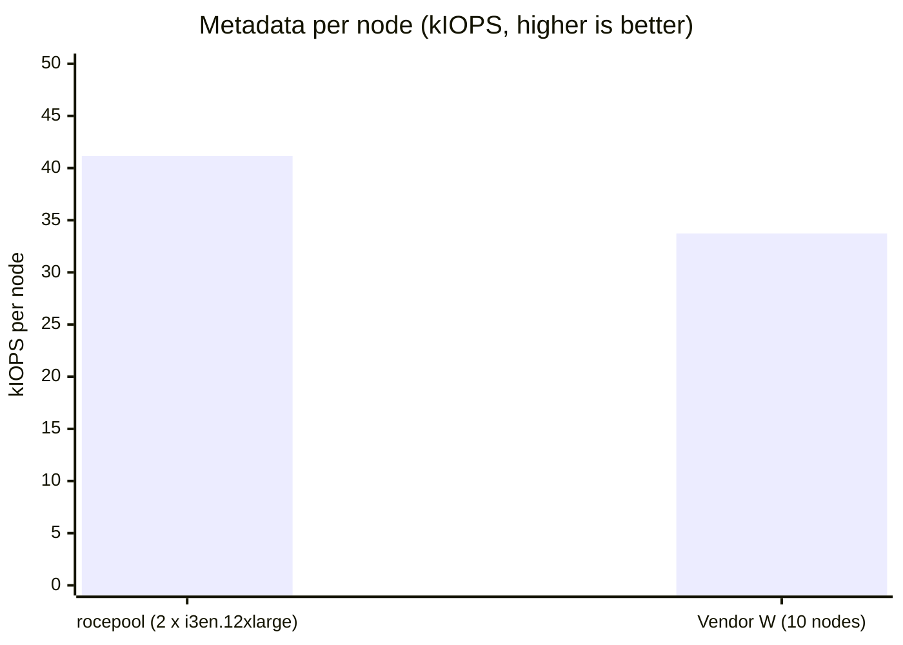

# IO500 Test Report: rocepool on AWS (2 × i3en.12xlarge, EFA)

| | |
|---|---|
| Report date | 2026-10-25 |
| System under test | rocepool (RDMA memory-pool distributed file system) |
| Platform | Amazon EC2, us-east-2, 2 × i3en.12xlarge, Elastic Fabric Adapter (EFA) |
| Benchmark | IO500, official application (github.com/IO500/io500), standard mode, 300 s stonewall |
| Result | **Valid** (IO500 validity checks passed) |
| Run record | GitHub Actions run 40153359125; raw reports on branch `aws-results/gh-40153359125` |
| Reference system | Vendor W, a commercial parallel file system: 10-node entry on the ISC25 IO500 10-node production list |

## 1. Summary

On two mid-size AWS instances, rocepool completed a **valid** IO500 run with
a **score of 16.68** (bandwidth 3.38 GiB/s, metadata 82.3 kIOPS).

Compared per node with Vendor W's 10-node production entry:

- **Metadata: 41.1 kIOPS per node against 33.7, which is 22% higher.** The
  rocepool metadata servers sustained 100 kIOPS creates (mdtest-easy-write)
  and 174–180 kIOPS stats across the cluster.
- **Bandwidth: 1.69 GiB/s per node against 3.33.** Vendor W has about twice
  the bandwidth per node. On this hardware the limit is the instance-store
  NVMe and the 50 Gb/s network (section 5).
- **Footprint and cost:** 2 nodes against 10, on general-purpose cloud
  instances that cost **$10.85/hour for the whole cluster** (on-demand
  price). The full benchmark session, including setup and functional
  checks, took 2.6 h and cost about **$28**. No dedicated storage hardware
  was purchased.

This is not an official IO500 list submission, and the two systems differ in
scale (section 6). The per-node figures show that the rocepool metadata path
already outperforms an established commercial system per node, on cloud
servers that cost a small fraction of a dedicated storage cluster.

## 2. Test environment

| Item | rocepool (this test) | Vendor W (reference) |
|---|---|---|
| Nodes | 2 (each node is both a client and a server) | 10 client nodes |
| Node type | AWS i3en.12xlarge: 48 vCPU, 384 GiB RAM, 4 × 7.5 TB NVMe instance store | dedicated HPC/storage hardware |
| Network | EFA (SRD), 50 Gb/s per node | not published in the list summary |
| Storage | RAM cache with an NVMe tier per node (4 drives, RAID 0, XFS) | vendor NVMe storage |
| Processes | 64 MPI ranks (32 per node) | per list entry |
| Metadata servers | 2 (one per node) | n/a |
| Object storage servers | 2 (one per node) | n/a |
| Client | rocepool LD_PRELOAD POSIX interception library (no kernel module) | vendor client |
| Price | $5.424/h per node, on-demand, us-east-2 | not published |

Software: Ubuntu, kernel 7.0.0-1014-aws, libfabric 2.7.0amzn2.0 (efa
provider). Every step ran automatically: provisioning, NVMe assembly,
functional checks, both IO500 runs, collecting results and releasing the
instances.

## 3. Results

### 3.1 Headline numbers

| | rocepool, 2 nodes | Vendor W, 10 nodes |
|---|---|---|
| IO500 score | 16.68 | 105.94 |
| Bandwidth | 3.38 GiB/s | 33.28 GiB/s |
| Metadata | 82.30 kIOPS | 337.29 kIOPS |
| **Bandwidth per node** | 1.69 GiB/s | 3.33 GiB/s |
| **Metadata per node** | **41.15 kIOPS** | 33.73 kIOPS |

### 3.2 Phase results (rocepool)

| Phase | Result | Time (s) |
|---|---|---|
| ior-easy-write | 5.63 GiB/s | 327 |
| mdtest-easy-write | 100.30 kIOPS | 381 |
| ior-hard-write | 0.68 GiB/s | 315 |
| mdtest-hard-write | 59.74 kIOPS | 440 |
| find | 56.96 kIOPS | 1130 |
| ior-easy-read | 7.71 GiB/s | 239 |
| mdtest-easy-stat | 174.08 kIOPS | 220 |
| ior-hard-read | 4.40 GiB/s | 49 |
| mdtest-hard-stat | 180.26 kIOPS | 147 |
| mdtest-easy-delete | 69.68 kIOPS | 548 |
| mdtest-hard-read | 64.55 kIOPS | 408 |
| mdtest-hard-delete | 43.67 kIOPS | 602 |
| **Score** | **bandwidth 3.38 GiB/s, metadata 82.30 kIOPS, total 16.68** | |

The write phases created about 38 M (easy) and 26 M (hard) files. Every
phase met the 300 s stonewall rule, and find returned the expected number
of matching files (1,033,152).

Vendor W's per-phase figures were not available to us, so section 3.1
compares the three headline numbers.

## 4. Why the metadata path is fast

- **Metadata held in memory, reached over RDMA.** Each metadata server keeps
  its namespace in RAM in hash tables with locks per name bucket, so
  creates and stats in a single directory proceed in parallel.
- **One-sided lookups.** Every entry is also published to a registered
  table, so a client can resolve a path by itself with a direct RDMA read
  of that table. Where the NIC supports RDMA read in hardware, this takes
  no server CPU. i3en's EFA generation emulates RDMA reads, and the client
  probes at startup to choose between one-sided reads and RPCs.
- **Small files stored inline.** The contents of small files (mdtest-hard
  writes 3901 bytes per file) stay in the metadata server up to a memory
  budget, so these files need no separate trip to an object storage server.
- **No kernel client.** The interception library maps POSIX calls straight
  onto RDMA requests. There is no FUSE or VFS round trip.

## 5. Bandwidth analysis

- The cluster wrote at 5.63 GiB/s in ior-easy-write and read at 7.71 GiB/s
  in ior-easy-read. Each node has a 50 Gb/s (≈5.8 GiB/s) EFA link, and its
  NVMe tier measured 2.3–2.8 GiB/s per node at preflight. These two limits
  set the bandwidth ceiling, not the file system software.
- ior-hard-write, at 0.68 GiB/s, is the weakest phase and the main item
  to work on next.
- On EFA instances with more network and drive bandwidth (for example
  i4i.32xlarge, 75 Gb/s and 8 NVMe drives), the bandwidth half is expected
  to improve. That has not been measured yet.

## 6. Comparability and limitations

- **Scale:** this run had 2 nodes and the reference has 10. Per-node figures
  assume roughly linear scaling, which has not yet been measured on 10 AWS
  nodes.
- **Not a list submission:** the run used the official IO500 application and
  passed its validity checks, but it has not been submitted to or reviewed
  by the IO500 committee.
- **Hardware:** both clients and servers ran on the same two hosts. The
  reference system's configuration is as published on the list.
- **Cost:** the cost figures are AWS on-demand prices for this test. Vendor
  W's system cost is not public, so this report does not compare price
  directly.
- **find:** the find phase (1130 s) was slowed by a directory-listing
  inefficiency found in this run. A fix that serves every page of a listing
  from a single sorted snapshot is in review (PR #16). Its effect will be
  measured in the next run.

## 7. Conclusion

rocepool ran a valid IO500 on two general-purpose AWS instances costing
$10.85/hour in total. It reached **41 kIOPS of metadata per node, 22% above
Vendor W's 10-node commercial production entry**. Bandwidth per node is
about half of Vendor W's and is limited by the instances' network and NVMe.
Next steps: ior-hard-write, the find fix, and a larger EFA instance type
for bandwidth.
