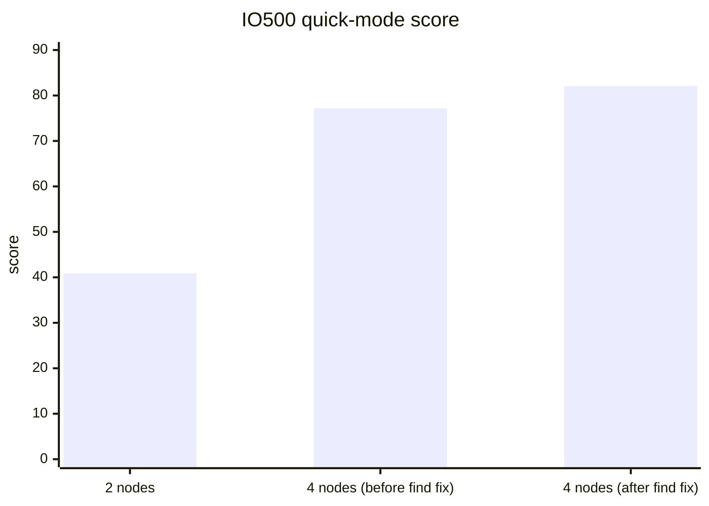

# IO500-Skalierungsbericht: von 2 auf 4 Knoten auf AWS (i3en.12xlarge, EFA)

| | |
|---|---|
| Berichtsdatum | 2026-10-29 |
| Gegenstand | rocepool (verteiltes Dateisystem auf Basis eines RDMA-Speicherpools) |
| Plattform | Amazon EC2 us-east-2, i3en.12xlarge (pro Knoten 48 vCPU, 384 GiB RAM, 4 × 7,5 TB NVMe, 50 Gb/s EFA) |
| Benchmark | Offizielle IO500-Anwendung, Quick-Modus: Stonewall 30 Sekunden, 32 Ranks pro Knoten |
| Vergleich | Vendor W (kommerzielles paralleles Dateisystem): Eintrag der ISC25-IO500-Produktionsliste für 10 Knoten (10 Client-Knoten + 18 Datenserver), Ergebnis 105,94 |
| Verwandte Berichte | [IO500_AWS_Fortschrittsbericht.md](IO500_AWS_Fortschrittsbericht.md) (drei gültige Läufe mit 2 Knoten) · englische Fassung dieses Berichts: [IO500_AWS_4NODE_REPORT.md](IO500_AWS_4NODE_REPORT.md) · weitere Sprachen: [日本語](IO500_AWS_4ノード検証レポート.md) · [Español](IO500_AWS_Informe_de_validación_de_4_nodos.md) · [繁體中文](IO500_AWS_4節點驗證報告.md) |

## 1. Zusammenfassung

- **Skalierung von 2 auf 4 Knoten:** Das IO500-Ergebnis stieg auf das 1,89-Fache (40,88 → 77,19). Die Skalierungseffizienz beträgt 94 %. Bandbreite 1,99-fach, Metadaten 1,79-fach.
- **Eine Phase skalierte nicht.** Alle Phasen außer find stiegen auf das 1,92- bis 2,03-Fache, find aber nur auf das 1,04-Fache.
  - Ursache: Ein einzelner MPI-Rank las das gesamte mdtest-hard-Verzeichnis, mit etwa 300 000 Einträgen pro Sekunde.
  - Nachdem das Verzeichnis auf alle Ranks verteilt gelesen wird, stieg find bei 4 Knoten von 997 000 auf 2,787 Millionen Einträge pro Sekunde (2,8-fach). Das Ergebnis mit 4 Knoten stieg auf **82,05**.
- **Vergleich mit Vendor W bei 4 Knoten:** Das Ergebnis erreicht 77 % des 10-Knoten-Ergebnisses von Vendor W (105,94).
  - Metadaten pro Knoten: das 4,9-Fache der Metadaten pro Client-Knoten von Vendor W.
  - Bandbreite pro Knoten: 76 % von Vendor W.
- **Wie viele Knoten für Gleichstand mit Vendor W nötig sind** (geschätzt aus den Ergebnissen mit 4 Knoten):
  - Ein gültiger Lauf mit **6 Knoten** wird auf 101–109 geschätzt, etwa gleichauf mit 105,94.
  - Mit **7 Knoten** auf 117–127, klar darüber.
  - Das sind Schätzungen; Läufe mit mehr als 4 Knoten gab es noch nicht.

## 2. Übersicht der Läufe

Alle drei Läufe liefen im Quick-Modus. Ergebnisse im Quick-Modus sind keine gültigen IO500-Ergebnisse (Abschnitt 7).

| | 2 Knoten | 4 Knoten (vor dem find-Fix) | 4 Knoten (nach dem find-Fix) |
|---|---|---|---|
| Lauf in GitHub Actions | 40443313800 | 40497186409 | 40511776202 |
| Zeitpunkt (UTC) | 2026-10-27 03:17 | 2026-10-27 11:34 | 2026-10-27 13:24 |
| MPI-Ranks | 64 | 128 | 128 |
| **IO500-Ergebnis** | **40,88** | **77,19** | **82,05** |
| Bandbreite (GiB/s) | 5,08 | 10,11 | 10,09 |
| Metadaten (kIOPS) | 329,2 | 589,4 | 667,3 |
| Laufzeit der Instanzen / Kosten | | 37 Min. / 13,7 $ | 37 Min. / 13,7 $ |

Die Kosten ergeben sich aus der On-Demand-Laufzeit bei AWS: 5,424 $ pro Instanz und Stunde, zuzüglich etwa 0,18 $ pro Stunde für die gp3-Systemplatte.

## 3. Skalierung von 2 auf 4 Knoten

Beide Läufe nutzen dieselbe Software (vor dem find-Fix), der Faktor zeigt also nur den Effekt der verdoppelten Knotenzahl. Ein Faktor von 2,00 entspricht linearer Skalierung.

| Phase | 2 Knoten | 4 Knoten | Faktor |
|---|---|---|---|
| ior-easy-write (GiB/s) | 3,48 | 7,05 | 2,03 |
| ior-hard-write (GiB/s) | 3,24 | 6,43 | 1,98 |
| ior-easy-read (GiB/s) | 7,57 | 15,35 | 2,03 |
| ior-hard-read (GiB/s) | 7,80 | 15,02 | 1,93 |
| mdtest-easy-write (kIOPS) | 348,3 | 669,2 | 1,92 |
| mdtest-hard-write (kIOPS) | 155,9 | 302,9 | 1,94 |
| **find (kIOPS)** | **962,5** | **996,5** | **1,04** |
| mdtest-easy-stat (kIOPS) | 354,1 | 687,2 | 1,94 |
| mdtest-hard-stat (kIOPS) | 350,8 | 681,4 | 1,94 |
| mdtest-easy-delete (kIOPS) | 355,7 | 688,5 | 1,94 |
| mdtest-hard-read (kIOPS) | 171,3 | 330,3 | 1,93 |
| mdtest-hard-delete (kIOPS) | 349,0 | 677,1 | 1,94 |
| **Bandbreitenergebnis** | 5,08 | 10,11 | **1,99** |
| **Metadatenergebnis** | 329,2 | 589,4 | **1,79** |
| **IO500-Ergebnis** | 40,88 | 77,19 | **1,89** |

- **Die Bandbreite** skalierte fast linear, denn jeder Knoten bringt eigene NVMe-Laufwerke und eine eigene 50-Gb/s-Verbindung mit.
- **Die Metadaten ohne find** stiegen um das 1,93-Fache (geometrisches Mittel der sieben Phasen außer find). Jeder Knoten bringt einen Metadatenserver mehr, und das mdtest-hard-Verzeichnis wird über alle gestreift.
- **find** stieg nur um das 1,04-Fache. Das Metadatenergebnis ist das geometrische Mittel aus acht Phasen; allein diese Phase senkte den Metadatenfaktor von 1,93 auf 1,79.

## 4. find: Ursache und Behebung

### 4.1 Ursache

Die find-Phase von IO500 führt pfind auf allen Ranks aus. pfind verteilt die Arbeit nach Verzeichnissen: Ein Rank, der ein Verzeichnis liest, gibt Unterverzeichnisse und ausstehende stat-Aufrufe an freie Ranks ab. mdtest-hard legt aber alle Dateien in **einem einzigen Verzeichnis** ab, und pfind lässt standardmäßig ein Verzeichnis von Anfang bis Ende von einem Rank lesen.

Die Messwerte zeigen: Die Dauer der find-Phase war genau die Zeit, in der ein Rank dieses Verzeichnis ganz las.

| | 2 Knoten | 4 Knoten |
|---|---|---|
| Dateien im mdtest-hard-Verzeichnis | 5,12 Mio. | 9,44 Mio. |
| Dauer der find-Phase | 17,5 s | 30,5 s |
| mdtest-hard-Einträge pro Sekunde | 293 000 | 310 000 |
| Rank-CPU pro durchlaufenem Eintrag | 63 µs | 122 µs |

- Mit doppelter Knotenzahl gab es mehr Ranks und mehr erzeugte Dateien: Das Verzeichnis verdoppelte sich, und mit ihm die Zeit. Die Rate blieb bei etwa 300 000 Einträgen pro Sekunde, der Lesegeschwindigkeit eines Ranks.
- Die Rank-CPU pro Eintrag verdoppelte sich, weil die übrigen Ranks in der Work-Stealing-Schleife von pfind leer liefen, ohne etwas zu stehlen.

Auf der Client-Seite bremsten zwei weitere Kosten diesen einen Leser. Beide sind unabhängig von der Knotenzahl und daher nicht der Grund für die fehlende Skalierung.
- **Die ganze Liste wurde vor dem ersten Eintrag geholt.** Die Interception-Bibliothek holte alle 9,44 Millionen Einträge, sortierte die zusammengeführte Liste und legte jeden Eintrag im Attribut-Cache ab. Der Cache fasst 100 000 Einträge und wurde während einer Auflistung etwa 90-mal geleert.
- **Zum Finden des offenen Verzeichnisses wurden 4 096 Slots durchsucht.** Bei jedem readdir-Aufruf wurden 4 096 Slots durchsucht, um den eigenen Stream zu finden.

### 4.2 Behebung (PR #31)

1. **IO500-Option.** In `[find]` der Konfigurationsdatei wird jetzt `pfind-parallelize-single-dir-access-using-hashing = TRUE` gesetzt.
   - Das ist eine Option der offiziellen IO500-Anwendung und berührt die Gültigkeit der Ergebnisse nicht.
   - Ist sie gesetzt (pfind `-H 1`), gibt ein lesender Rank einem freien Rank, der nach Arbeit fragt, die hintere Hälfte des noch nicht gelesenen Bereichs der telldir-Positionen ab.
   - Die Option braucht funktionierende `telldir`/`seekdir` auf dem Dateisystem. Bis zu dieser Änderung fehlten sie in der Interception-Bibliothek.
2. **telldir/seekdir in der Interception-Bibliothek.**
   - Große Verzeichnisse, die pro Metadatenserver nicht auf eine Seite passen, werden ab jeder beliebigen Position seitenweise (256 KiB) gelesen. Die Positionen sind gleichmäßig über [0, LONG_MAX) verteilt; halbiert man den Positionsbereich, halbiert sich auch die Zahl der verbleibenden Einträge genau.
   - Kleine Verzeichnisse werden wie bisher in einem Zug gelesen.
   - Der Attribut-Cache wird seitenweise befüllt, und die Suche nach offenen Verzeichnissen durchläuft nur belegte Slots.
3. **Metadatenserver: Lesen ab einer Position.**
   - Eine neue Anfrage liefert die Einträge ab einem angegebenen Index, zusammen mit der Zahl der Einträge im Verzeichnis.
   - Mehrere Leser eines unveränderten Verzeichnisses teilen sich einen sortierten Snapshot. Ein Versionszähler, der bei jeder Änderung im Verzeichnis steigt, zeigt an, ob der Snapshot veraltet ist.

Tests:
- Echtes pfind wurde mit der Interception-Bibliothek über mpirun ausgeführt; mit und ohne `-H 1` werden dieselben Dateien gefunden.
- Die Positionstests prüften:
  - dass Positionen monoton steigen,
  - dass ein seek zum selben Eintrag zurückführt (auch aus einem anderen Stream),
  - dass an beliebigen Positionen geteilte Bereiche alle Einträge genau einmal abdecken,
  - dass Änderungen am Verzeichnis in der nächsten Auflistung erscheinen.

### 4.3 Ergebnis (4 Knoten, gleicher Instanztyp)

| | vorher | nachher | Änderung |
|---|---|---|---|
| **find (kIOPS)** | 996,5 | **2.787,5** | **2,8-fach** |
| Dauer der find-Phase | 30,5 s | 10,9 s | −64 % |
| Rank-CPU pro durchlaufenem Eintrag | 122 µs | 41 µs | −66 % |
| Metadatenergebnis (kIOPS) | 589,4 | 667,3 | +13 % |
| **IO500-Ergebnis** | 77,19 | **82,05** | **+6,3 %** |

Die übrigen 11 Phasen änderten sich um weniger als 2 % (im Bereich der Streuung zwischen Läufen); der Fix hat keine Nachteile.

## 5. 4 Knoten im Vergleich mit Vendor W (pro Knoten)

Die Werte von Vendor W sind der gültige 10-Knoten-Eintrag (Stonewall 300 Sekunden), geteilt durch 10 Client-Knoten. Die Werte von rocepool sind der 30-s-Quick-Lauf nach dem find-Fix, geteilt durch 4 Knoten. Jeder rocepool-Knoten ist zugleich Client und Server. „Abstand“ ist Vendor W ÷ rocepool; unter 1,0 liegt rocepool vorn.

| Phase | rocepool/Knoten | Vendor W/Client-Knoten | Abstand |
|---|---|---|---|
| ior-easy-write (GiB/s) | 1,78 | 7,58 | 4,27 |
| ior-hard-write (GiB/s) | 1,61 | 1,51 | 0,94 |
| ior-easy-read (GiB/s) | 3,81 | 13,40 | 3,52 |
| ior-hard-read (GiB/s) | 3,73 | 0,80 | 0,21 |
| mdtest-easy-write (kIOPS) | 167,4 | 42,48 | 0,25 |
| mdtest-hard-write (kIOPS) | 75,3 | 1,69 | 0,02 |
| find (kIOPS) | 696,9 | 113,25 | 0,16 |
| mdtest-easy-stat (kIOPS) | 171,8 | 191,11 | 1,11 |
| mdtest-hard-stat (kIOPS) | 169,1 | 146,58 | 0,87 |
| mdtest-easy-delete (kIOPS) | 171,3 | 48,01 | 0,28 |
| mdtest-hard-read (kIOPS) | 81,9 | 82,32 | 1,01 |
| mdtest-hard-delete (kIOPS) | 167,5 | 1,86 | 0,01 |
| **Bandbreitenergebnis (GiB/s)** | 2,52 | 3,33 | **1,32** |
| **Metadatenergebnis (kIOPS)** | 166,8 | 33,7 | **0,20** |

- **Metadaten:** Pro Knoten ist das Metadatenergebnis von rocepool das 4,9-Fache von Vendor W. Außer bei mdtest-easy-stat (Vendor W 11 % vorn) liegt rocepool in allen Metadatenphasen vorn oder gleichauf.
- **Bandbreite:** Bei ior-easy-write (4,3-fach) und ior-easy-read (3,5-fach) liegt Vendor W vorn. Diese Phasen mit großem sequenziellem I/O stoßen auf i3en an die Grenze der NVMe-Laufwerke und der 50-Gb/s-Verbindung. Vendor W nutzt InfiniBand und 18 eigene Datenserver. Bei ior-hard-read liegt rocepool vorn, ior-hard-write ist etwa gleichauf.

## 6. Wie viele Knoten 105,94 erreichen

### 6.1 Schätzverfahren

- **Ausgangspunkt:** das Quick-Ergebnis mit 4 Knoten nach dem find-Fix, 82,05.
- **Zuwachs bei doppelter Knotenzahl:** zwei Annahmen.
  - Vorsichtig: **1,89-fach**, die vor dem Fix gemessene Skalierung von 2 auf 4 Knoten.
  - Optimistisch: **1,95-fach**, der Zuwachs der Phasen außer find von 2 auf 4 Knoten. Da find nun ebenfalls auf die Ranks verteilt wird, sollte es ähnlich wachsen.
- **Von Quick zu gültig:** Ein gültiger Lauf hat einen Stonewall von 300 Sekunden und schreibt etwa zehnmal so viele Daten. Die Lesezugriffe reichen dadurch tief in die NVMe-Schicht, und das Ergebnis sinkt. Der letzte gültige 2-Knoten-Lauf erreichte 28,58, der Quick-Lauf danach 33,02; das gültige Ergebnis lag bei 87 % des Quick-Ergebnisses. Dieser Bericht nimmt 85–90 % an.

### 6.2 Schätzung

| Knoten | Nötige vCPU | Quick-Ergebnis (geschätzt) | **Gültiges Ergebnis (geschätzt)** | Gegenüber 105,94 | Kosten eines gültigen Laufs (geschätzt) |
|---|---|---|---|---|---|
| 4 (Quick gemessen) | 192 | **82,05** | etwa 70–74 | darunter | — |
| 5 | 240 | 101–102 | 86–92 | darunter | 50–59 $ |
| **6** | 288 | 119–121 | **101–109** | **etwa gleichauf** | **61–71 $** |
| **7** | 336 | 137–141 | **117–127** | **darüber** | **71–82 $** |
| 8 | 384 | 155–160 | 132–144 | deutlich darüber | 81–94 $ |
| 10 | 480 | 190–198 | 162–179 | deutlich darüber | 101–118 $ |

- **Kostenschätzung:** 5,605 $ pro Instanz und Stunde, einschließlich Systemplatte. Die gültigen 2-Knoten-Läufe B und C hielten die Instanzen jeweils 1 Stunde 48 Minuten in Betrieb: etwa 58 Minuten für Einrichtung, Funktionsprüfung und Ergebnissammlung, 50 Minuten für IO500. Für gültige Läufe mit 6–10 Knoten werden 1,8–2,1 Stunden erwartet.
- **Für Gleichstand mit Vendor W braucht es im Quick-Modus 5,2–5,3 Knoten, bei einem gültigen Lauf etwa 5,8–6,3 Knoten.** 6 Knoten sind die Gewinnschwelle, 7 Knoten bringen einen klaren Vorsprung.
- **Zahl der Maschinen:** Der Eintrag von Vendor W nutzt 10 Clients und 18 Datenserver, zusammen 28 Maschinen. rocepool mit 6 Knoten nutzt etwa ein Fünftel davon, mit 7 Knoten ein Viertel.

### 6.3 Was diese Schätzung nicht weiß

- **Engpässe jenseits von 4 Knoten.** Ob ab 4 Knoten Konkurrenz im Netz oder bei den Metadatenservern auftritt, zeigen erst größere Läufe. Von 2 auf 4 Knoten gab es keine Anzeichen dafür.
- **Die Skalierung von find.** find nach dem Fix wurde nur mit 4 Knoten gemessen. Dass es darüber hinaus weiter wächst, ist eine Annahme, keine Messung.
- **Das Verhältnis von Quick zu gültig.** Es stammt aus Läufen mit 2 Knoten und kann bei 6–7 Knoten anders sein.

## 7. Voraussetzungen und Grenzen des Vergleichs

- **Der Quick-Modus ist kein gültiges IO500-Ergebnis.** 30 Sekunden Stonewall sind kürzer als die vorgeschriebenen 300 Sekunden; die Werte fallen höher aus als bei einem gültigen Lauf. Abschnitt 5 vergleicht Quick-Werte mit gültigen Werten von Vendor W, um zu zeigen, wo die Unterschiede liegen, nicht um die Systeme zu reihen.
- **Keine Einreichung für die Liste.** Keiner der Läufe wurde beim IO500-Komitee eingereicht oder von ihm geprüft.
- **Hardware:** Bei rocepool teilen sich Client und Server auf jedem Knoten denselben Host. Die Werte von Vendor W sind die im Listeneintrag (submission 704) veröffentlichten.
- **Kosten:** Die Instanzkosten folgen den On-Demand-Preisen von AWS. Die Systempreise von Vendor W sind nicht veröffentlicht, Preise werden daher nicht verglichen.
- **Rohdaten:** Die Berichte jedes Laufs liegen im Branch `aws-results/gh-<run id>`.
