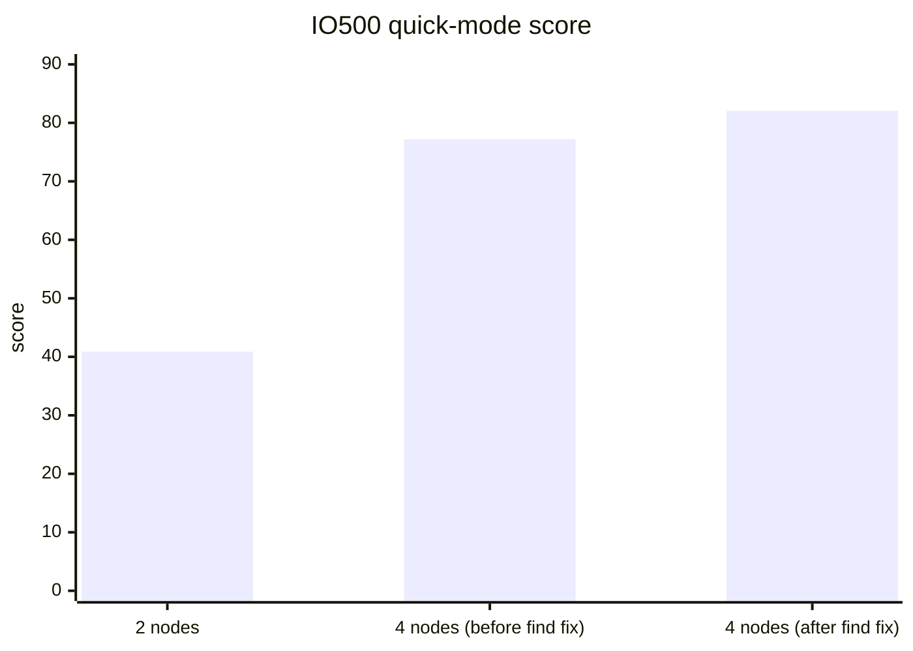

# IO500 Scaling Report: 2 to 4 Nodes on AWS (i3en.12xlarge, EFA)

| | |
|---|---|
| Report date | 2026-10-29 |
| System under test | rocepool (RDMA memory-pool distributed file system) |
| Platform | Amazon EC2 us-east-2, i3en.12xlarge (48 vCPU, 384 GiB RAM, 4 × 7.5 TB NVMe, 50 Gb/s EFA per node) |
| Benchmark | IO500 official application, quick mode: 30 s stonewall, 32 ranks per node |
| Reference | Vendor W, a commercial parallel file system: 10-node entry on the ISC25 IO500 10-node production list (10 client nodes + 18 data servers), score 105.94 |
| Earlier reports | [IO500_AWS_PROGRESS_REPORT.md](IO500_AWS_PROGRESS_REPORT.md) (three valid 2-node runs) · Japanese version of this report: [IO500_AWS_4ノード検証レポート.md](IO500_AWS_4ノード検証レポート.md) |

## 1. Summary

- **Scaling from 2 to 4 nodes:** the IO500 score rose 1.89× (40.88 to 77.19). That is a scaling efficiency of 94%. Bandwidth scaled 1.99× and metadata 1.79×.
- **One phase did not scale.** Every phase scaled 1.92–2.03×, except find, which scaled only 1.04×.
  - The cause: one MPI rank read the whole mdtest-hard directory, at about 300 k entries/s.
  - With the directory split among all ranks, find at 4 nodes rose from 997 k to 2,787 k entries/s (2.8×). The 4-node score rose to **82.05**.
- **Where 4 nodes stand against Vendor W:** the score is 77% of Vendor W's 10-node 105.94.
  - Per node, metadata is 4.9× Vendor W's per client node.
  - Per node, bandwidth is 76% of Vendor W's.
- **Nodes needed to match Vendor W:** projected from the 4-node result.
  - A valid run on **6 nodes** is estimated at 101–109, about equal to 105.94.
  - **7 nodes** are estimated at 117–127, clearly above it.
  - These are projections; no run on more than 4 nodes has been made yet.

## 2. Runs

All three runs used quick mode. Quick runs are not valid IO500 results (section 7).

| | 2 nodes | 4 nodes, before the find fix | 4 nodes, after the find fix |
|---|---|---|---|
| GitHub Actions run | 40443313800 | 40497186409 | 40511776202 |
| Date (UTC) | 2026-10-27 03:17 | 2026-10-27 11:34 | 2026-10-27 13:24 |
| MPI ranks | 64 | 128 | 128 |
| **IO500 score** | **40.88** | **77.19** | **82.05** |
| Bandwidth (GiB/s) | 5.08 | 10.11 | 10.09 |
| Metadata (kIOPS) | 329.2 | 589.4 | 667.3 |
| Instance time / cost | | 37 min / $13.7 | 37 min / $13.7 |

Cost is AWS on-demand time: $5.424/h per instance, plus about $0.18/h per instance for its gp3 system disk.

## 3. Scaling from 2 to 4 nodes

Both runs used the same software (before the find fix), so the ratio shows only the effect of doubling the nodes. A ratio of 2.00 is linear scaling.

| Phase | 2 nodes | 4 nodes | Ratio |
|---|---|---|---|
| ior-easy-write (GiB/s) | 3.48 | 7.05 | 2.03 |
| ior-hard-write (GiB/s) | 3.24 | 6.43 | 1.98 |
| ior-easy-read (GiB/s) | 7.57 | 15.35 | 2.03 |
| ior-hard-read (GiB/s) | 7.80 | 15.02 | 1.93 |
| mdtest-easy-write (kIOPS) | 348.3 | 669.2 | 1.92 |
| mdtest-hard-write (kIOPS) | 155.9 | 302.9 | 1.94 |
| **find (kIOPS)** | **962.5** | **996.5** | **1.04** |
| mdtest-easy-stat (kIOPS) | 354.1 | 687.2 | 1.94 |
| mdtest-hard-stat (kIOPS) | 350.8 | 681.4 | 1.94 |
| mdtest-easy-delete (kIOPS) | 355.7 | 688.5 | 1.94 |
| mdtest-hard-read (kIOPS) | 171.3 | 330.3 | 1.93 |
| mdtest-hard-delete (kIOPS) | 349.0 | 677.1 | 1.94 |
| **Bandwidth score** | 5.08 | 10.11 | **1.99** |
| **Metadata score** | 329.2 | 589.4 | **1.79** |
| **IO500 score** | 40.88 | 77.19 | **1.89** |

- **Bandwidth** scaled almost linearly. Each node adds its own NVMe drives and its own 50 Gb/s link.
- **Metadata, without find,** scaled 1.93× (geometric mean of the other seven metadata phases). Each node adds one metadata server, and the mdtest-hard directory is striped over all of them.
- **find** scaled 1.04×. Because the metadata score is a geometric mean of eight phases, this one phase lowered the metadata ratio from 1.93 to 1.79.

## 4. find: root cause and fix

### 4.1 Root cause

IO500's find phase runs pfind on all ranks. pfind balances work by directories: a rank that reads a directory hands out its subdirectories and pending stat calls to idle ranks. mdtest-hard, however, puts all of its files in **one directory**, and by default pfind lets one rank read a directory from start to end.

The measurements show that the time of the find phase was the time one rank took to read that directory:

| | 2 nodes | 4 nodes |
|---|---|---|
| Files in the mdtest-hard directory | 5.12 M | 9.44 M |
| find phase time | 17.5 s | 30.5 s |
| mdtest-hard entries per second | 293 k | 310 k |
| Rank CPU per entry scanned | 63 µs | 122 µs |

- Doubling the nodes doubled the directory (more ranks create more files) and doubled the time. The rate stayed at about 300 k entries/s, which is one rank's reading speed.
- The rank CPU per entry doubled because the other ranks were spinning in pfind's work-stealing loop with nothing to steal.

Two client-side costs also slowed that one reader. Each was the same on every node, so neither caused the lack of scaling.
- **The whole listing was fetched before the first entry.** The interception library fetched all 9.4 M entries, sorted the merged listing, and loaded every entry into the attribute cache. That cache holds 100 k entries, so it was emptied about 90 times during one listing.
- **Finding the open directory took a 4,096-slot scan.** Every readdir call scanned 4,096 slots to locate its stream.

### 4.2 Fix (PR #31)

1. **IO500 option.** The configuration now sets `pfind-parallelize-single-dir-access-using-hashing = TRUE` in `[find]`.
   - This is an option of the official IO500 application and does not affect validity.
   - With it (pfind `-H 1`), when an idle rank asks for work, the rank reading a directory gives away the second half of the telldir position range it still has to read.
   - The option needs `telldir`/`seekdir` that work on the file system. Before this change, the interception library did not provide them.
2. **telldir/seekdir in the interception library.**
   - A directory larger than one page per metadata server is read page by page (256 KiB), starting at any position. Positions are spread evenly over [0, LONG_MAX), so halving a position range halves the remaining entries.
   - Small directories are still read in one piece.
   - The attribute cache is filled one page at a time, and finding an open directory scans only the slots in use.
3. **Metadata server: read from a position.**
   - A new request returns the entries from a given index on, with the directory's entry count.
   - Readers of an unchanged directory share one sorted snapshot. A version counter, bumped by every change in the directory, decides when the snapshot is out of date.

Tests:
- The real pfind, run through mpirun with the interception library, finds the same files with and without `-H 1`.
- Position tests check that:
  - positions increase;
  - a seek returns to the same entry, also from another stream;
  - ranges split at arbitrary positions cover every entry exactly once;
  - a change to the directory is seen by the next listing.

### 4.3 Result (4 nodes, same hardware type)

| | Before the fix | After the fix | Change |
|---|---|---|---|
| **find (kIOPS)** | 996.5 | **2,787.5** | **2.8×** |
| find phase time | 30.5 s | 10.9 s | −64% |
| Rank CPU per entry scanned | 122 µs | 41 µs | −66% |
| Metadata score (kIOPS) | 589.4 | 667.3 | +13% |
| **IO500 score** | 77.19 | **82.05** | **+6.3%** |

The other eleven phases changed by less than 2% (run-to-run variation), so the fix has no side effects on them.

## 5. 4 nodes against Vendor W, per node

Vendor W's figures are from its valid 10-node entry (300 s stonewall), divided by its 10 client nodes. rocepool's figures are from the 30 s quick run after the find fix, divided by 4 nodes. Each rocepool node is both client and server. "Gap" is Vendor W ÷ rocepool; below 1.0 means rocepool is ahead.

| Phase | rocepool / node | Vendor W / client node | Gap |
|---|---|---|---|
| ior-easy-write (GiB/s) | 1.78 | 7.58 | 4.27 |
| ior-hard-write (GiB/s) | 1.61 | 1.51 | 0.94 |
| ior-easy-read (GiB/s) | 3.81 | 13.40 | 3.52 |
| ior-hard-read (GiB/s) | 3.73 | 0.80 | 0.21 |
| mdtest-easy-write (kIOPS) | 167.4 | 42.48 | 0.25 |
| mdtest-hard-write (kIOPS) | 75.3 | 1.69 | 0.02 |
| find (kIOPS) | 696.9 | 113.25 | 0.16 |
| mdtest-easy-stat (kIOPS) | 171.8 | 191.11 | 1.11 |
| mdtest-hard-stat (kIOPS) | 169.1 | 146.58 | 0.87 |
| mdtest-easy-delete (kIOPS) | 171.3 | 48.01 | 0.28 |
| mdtest-hard-read (kIOPS) | 81.9 | 82.32 | 1.01 |
| mdtest-hard-delete (kIOPS) | 167.5 | 1.86 | 0.01 |
| **Bandwidth score (GiB/s)** | 2.52 | 3.33 | **1.32** |
| **Metadata score (kIOPS)** | 166.8 | 33.7 | **0.20** |

- **Metadata:** per node, rocepool delivers 4.9× Vendor W's metadata score. rocepool is ahead or level on every metadata phase except mdtest-easy-stat, where Vendor W leads by 11%.
- **Bandwidth:** Vendor W leads in ior-easy-write (4.3×) and ior-easy-read (3.5×). These large sequential phases are bounded on i3en by its NVMe drives and its 50 Gb/s link. Vendor W uses InfiniBand and 18 dedicated data servers. rocepool leads in ior-hard-read and is level in ior-hard-write.

## 6. How many nodes to reach 105.94

### 6.1 Method

- **Starting point:** the 4-node quick score after the fix, 82.05.
- **Scaling per doubling of nodes:** two assumptions.
  - Conservative: **1.89×**, the 2-to-4-node scaling measured before the fix.
  - Optimistic: **1.95×**, how the phases other than find scaled from 2 to 4 nodes. With find now split among ranks, it is expected to scale like them.
- **Quick to valid:** a valid run uses a 300 s stonewall and writes about ten times more data. Its reads therefore go deeper into the NVMe tier, so valid scores are lower. The last valid 2-node run scored 28.58, and the next quick run scored 33.02, so the valid score was 87% of the quick score. This report assumes 85–90%.

### 6.2 Projection

| Nodes | vCPU needed | Quick score (estimate) | **Valid score (estimate)** | Against 105.94 | Valid-run cost (estimate) |
|---|---|---|---|---|---|
| 4 (measured, quick) | 192 | **82.05** | ~70–74 | below | — |
| 5 | 240 | 101–102 | 86–92 | below | $50–59 |
| **6** | 288 | 119–121 | **101–109** | **about equal** | **$61–71** |
| **7** | 336 | 137–141 | **117–127** | **above** | **$71–82** |
| 8 | 384 | 155–160 | 132–144 | well above | $81–94 |
| 10 | 480 | 190–198 | 162–179 | well above | $101–118 |

- **Cost estimate:** each instance costs $5.605/h, including its system disk. The 2-node valid runs B and C each kept their instances for 1 h 48 min. That time is about 58 min of setup, functional checks and result collection plus 50 min of IO500. A valid run on 6–10 nodes is estimated at 1.8–2.1 h.
- **To match Vendor W, quick mode needs 5.2–5.3 nodes. A valid run needs about 5.8–6.3 nodes.** Six nodes is the break-even point. Seven nodes gives a clear margin.
- **Machine count:** Vendor W's entry uses 28 machines: 10 clients and 18 data servers. Six rocepool nodes is about one fifth of that, and seven nodes one quarter.

### 6.3 What the projection cannot show

- **Bottlenecks above 4 nodes.** Contention in the network or the metadata servers beyond 4 nodes would only appear in a larger run. None was visible from 2 to 4 nodes.
- **find scaling.** find has been measured after the fix only at 4 nodes. Its continued scaling is assumed, not measured.
- **The quick-to-valid ratio.** It comes from 2-node runs. At 6–7 nodes it may differ.

## 7. Comparability and limitations

- **Quick mode is not a valid IO500 result.** Its 30 s stonewall is shorter than the required 300 s, so its numbers run higher than a valid run's. Section 5 compares quick numbers with Vendor W's valid numbers and is meant to show where the gaps are, not to rank the systems.
- **Not a list submission.** None of these runs has been submitted to or reviewed by the IO500 committee.
- **Hardware.** On each rocepool node, clients and servers share the host. Vendor W's figures are as published for its list entry (submission 704).
- **Cost.** Instance costs are AWS on-demand prices. Vendor W's system cost is not public, so price is not compared.
- **Raw data.** The reports for each run are on the branches `aws-results/gh-<run id>`.
