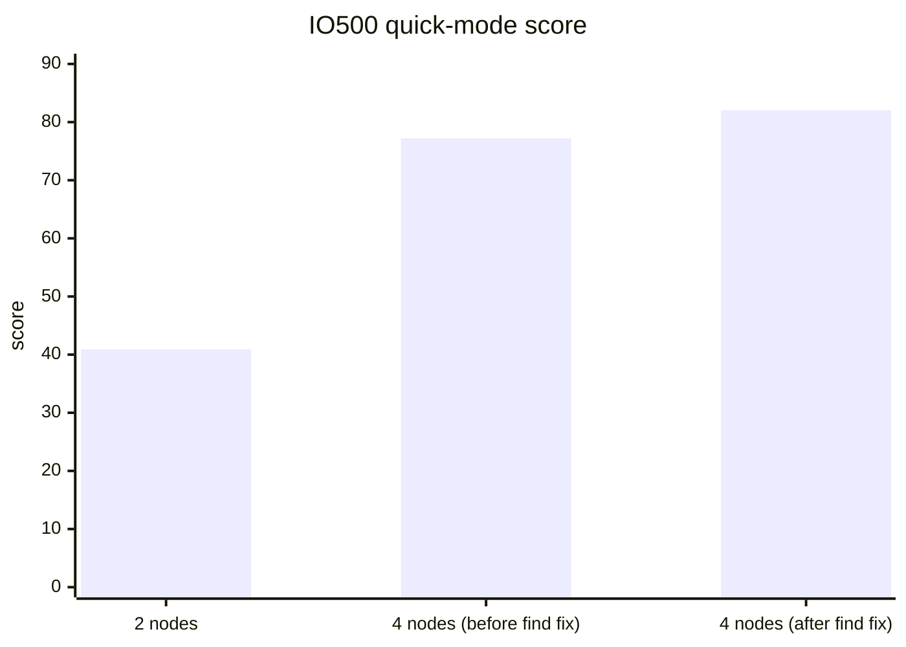

# IO500 スケーリングレポート：AWS 上の 2 ノードから 4 ノードへ（i3en.12xlarge、EFA）

| | |
|---|---|
| 報告日 | 2026-10-29 |
| 評価対象 | rocepool（RDMA メモリプール型分散ファイルシステム） |
| プラットフォーム | Amazon EC2 us-east-2、i3en.12xlarge（1 ノードあたり 48 vCPU、384 GiB RAM、4 × 7.5 TB NVMe、50 Gb/s EFA） |
| ベンチマーク | IO500 公式アプリケーション、クイックモード：stonewall 30 秒、1 ノードあたり 32 ランク |
| 比較対象 | Vendor W（商用並列ファイルシステム）：ISC25 IO500 10 ノード本番リストのエントリ（クライアント 10 ノード＋データサーバー 18 台）、スコア 105.94 |
| 関連レポート | [IO500_AWS_進捗レポート.md](IO500_AWS_進捗レポート.md)（2 ノードでの有効な 3 回の実行）・本レポートの英語版：[IO500_AWS_4NODE_REPORT.md](IO500_AWS_4NODE_REPORT.md) |

## 1. 概要

- **2 ノードから 4 ノードへのスケーリング：** IO500 スコアは 1.89 倍（40.88 → 77.19）になった。スケーリング効率は 94%。帯域幅は 1.99 倍、メタデータは 1.79 倍。
- **スケールしないフェーズが 1 つあった。** find 以外のフェーズは 1.92〜2.03 倍だったが、find だけは 1.04 倍にとどまった。
  - 原因：1 つの MPI ランクが mdtest-hard のディレクトリ全体を、毎秒約 30 万エントリで読んでいた。
  - ディレクトリを全ランクで分担して読むようにしたところ、4 ノードの find は毎秒 99.7 万エントリから 278.7 万エントリ（2.8 倍）になった。4 ノードのスコアは **82.05** に上がった。
- **4 ノード時点での Vendor W との比較：** スコアは Vendor W の 10 ノードのスコア 105.94 の 77%。
  - 1 ノードあたりのメタデータは、Vendor W のクライアント 1 ノードあたりの 4.9 倍。
  - 1 ノードあたりの帯域幅は Vendor W の 76%。
- **Vendor W と並ぶのに必要なノード数：** 4 ノードの結果から推定した。
  - **6 ノード**の有効な実行は 101〜109 と推定され、105.94 とほぼ同等。
  - **7 ノード**は 117〜127 と推定され、明確に上回る。
  - これらは推定値であり、4 ノードを超える実行はまだ行っていない。

## 2. 実行一覧

3 回ともクイックモードで実行した。クイックモードの結果は有効な IO500 の結果ではない（第 7 節）。

| | 2 ノード | 4 ノード（find 修正前） | 4 ノード（find 修正後） |
|---|---|---|---|
| GitHub Actions の実行 | 40443313800 | 40497186409 | 40511776202 |
| 日時（UTC） | 2026-10-27 03:17 | 2026-10-27 11:34 | 2026-10-27 13:24 |
| MPI ランク数 | 64 | 128 | 128 |
| **IO500 スコア** | **40.88** | **77.19** | **82.05** |
| 帯域幅（GiB/s） | 5.08 | 10.11 | 10.09 |
| メタデータ（kIOPS） | 329.2 | 589.4 | 667.3 |
| インスタンス稼働時間／費用 | | 37 分／$13.7 | 37 分／$13.7 |

費用は AWS オンデマンドの稼働時間による。インスタンス 1 台あたり $5.424/時間に、gp3 システムディスク分の約 $0.18/時間を加えた。

## 3. 2 ノードから 4 ノードへのスケーリング

2 回の実行は同じソフトウェア（find 修正前）を使っているので、倍率はノード数を倍にした効果だけを表す。倍率 2.00 が線形スケーリングにあたる。

| フェーズ | 2 ノード | 4 ノード | 倍率 |
|---|---|---|---|
| ior-easy-write（GiB/s） | 3.48 | 7.05 | 2.03 |
| ior-hard-write（GiB/s） | 3.24 | 6.43 | 1.98 |
| ior-easy-read（GiB/s） | 7.57 | 15.35 | 2.03 |
| ior-hard-read（GiB/s） | 7.80 | 15.02 | 1.93 |
| mdtest-easy-write（kIOPS） | 348.3 | 669.2 | 1.92 |
| mdtest-hard-write（kIOPS） | 155.9 | 302.9 | 1.94 |
| **find（kIOPS）** | **962.5** | **996.5** | **1.04** |
| mdtest-easy-stat（kIOPS） | 354.1 | 687.2 | 1.94 |
| mdtest-hard-stat（kIOPS） | 350.8 | 681.4 | 1.94 |
| mdtest-easy-delete（kIOPS） | 355.7 | 688.5 | 1.94 |
| mdtest-hard-read（kIOPS） | 171.3 | 330.3 | 1.93 |
| mdtest-hard-delete（kIOPS） | 349.0 | 677.1 | 1.94 |
| **帯域幅スコア** | 5.08 | 10.11 | **1.99** |
| **メタデータスコア** | 329.2 | 589.4 | **1.79** |
| **IO500 スコア** | 40.88 | 77.19 | **1.89** |

- **帯域幅**はほぼ線形にスケールした。ノードごとに専用の NVMe ドライブと 50 Gb/s のリンクが増えるため。
- **find を除くメタデータ**は 1.93 倍だった（find 以外の 7 フェーズの幾何平均）。ノードごとにメタデータサーバーが 1 台増え、mdtest-hard のディレクトリはそのすべてにストライプされる。
- **find** は 1.04 倍だった。メタデータスコアは 8 フェーズの幾何平均なので、この 1 フェーズだけでメタデータの倍率が 1.93 から 1.79 に下がった。

## 4. find：根本原因と修正

### 4.1 根本原因

IO500 の find フェーズは、全ランクで pfind を実行する。pfind はディレクトリ単位で作業を分配する。ディレクトリを読むランクは、サブディレクトリと保留中の stat を手の空いたランクに渡す。ところが mdtest-hard はすべてのファイルを **1 つのディレクトリ**に置く。そして pfind はデフォルトでは、1 つのディレクトリを最初から最後まで 1 つのランクに読ませる。

測定値を見ると、find フェーズの時間は、1 つのランクがこのディレクトリを読み切る時間そのものだった。

| | 2 ノード | 4 ノード |
|---|---|---|
| mdtest-hard ディレクトリのファイル数 | 512 万 | 944 万 |
| find フェーズの時間 | 17.5 秒 | 30.5 秒 |
| mdtest-hard の毎秒エントリ数 | 29.3 万 | 31.0 万 |
| 走査 1 エントリあたりのランク CPU | 63 µs | 122 µs |

- ノード数を倍にすると、ランクが増えて作られるファイルも増えるので、ディレクトリも倍になり、時間も倍になった。速度は毎秒約 30 万エントリのままで、これは 1 ランクの読み取り速度にあたる。
- 1 エントリあたりのランク CPU が倍になったのは、他のランクが pfind の作業奪取ループの中で、奪う作業もないまま空回りしていたため。

クライアント側では、さらに 2 つのコストがこの 1 つの読み手を遅くしていた。どちらもノード数に関係なく同じなので、スケールしない原因ではない。
- **最初のエントリより前に一覧全体を取得していた。** インターセプトライブラリは 944 万エントリをすべて取得し、統合した一覧をソートし、全エントリを属性キャッシュに入れていた。キャッシュは 10 万エントリまでなので、1 回の一覧の間に約 90 回空にされていた。
- **開いているディレクトリを探すのに 4,096 スロットを走査していた。** readdir を呼ぶたびに、自分のストリームを見つけるため 4,096 スロットを走査していた。

### 4.2 修正（PR #31）

1. **IO500 のオプション。** 設定ファイルの `[find]` で `pfind-parallelize-single-dir-access-using-hashing = TRUE` を指定するようにした。
   - IO500 公式アプリケーションのオプションであり、結果の有効性には影響しない。
   - これを指定すると（pfind の `-H 1`）、手の空いたランクが作業を求めたとき、ディレクトリを読んでいるランクは、まだ読んでいない telldir 位置の範囲の後半を渡す。
   - このオプションには、ファイルシステム上で動く `telldir`/`seekdir` が必要。この変更までは、インターセプトライブラリにそれがなかった。
2. **インターセプトライブラリの telldir/seekdir。**
   - メタデータサーバー 1 台につき 1 ページに収まらない大きなディレクトリは、任意の位置からページ単位（256 KiB）で読む。位置は [0, LONG_MAX) に均等に割り振るので、位置の範囲を半分にすれば、残りのエントリもちょうど半分になる。
   - 小さなディレクトリは、これまでどおり一度に読む。
   - 属性キャッシュへの登録はページごとに行い、開いているディレクトリの検索は使用中のスロットだけを走査する。
3. **メタデータサーバー：位置を指定した読み取り。**
   - 新しいリクエストは、指定したインデックス以降のエントリを、ディレクトリのエントリ数とともに返す。
   - 変更のないディレクトリを読む複数の読み手は、ソート済みのスナップショットを 1 つ共有する。ディレクトリ内の変更のたびに増えるバージョンカウンタで、スナップショットが古くなったかを判断する。

テスト：
- インターセプトライブラリを使って mpirun から実際の pfind を実行し、`-H 1` の有無にかかわらず同じファイルが見つかることを確認した。
- 位置のテストでは次を確認した：
  - 位置が単調に増えること。
  - seek すると同じエントリに戻ること（別のストリームからでも）。
  - 任意の位置で分割した範囲が、全エントリをちょうど 1 回ずつ覆うこと。
  - ディレクトリの変更が次の一覧に反映されること。

### 4.3 結果（4 ノード、同じインスタンスタイプ）

| | 修正前 | 修正後 | 変化 |
|---|---|---|---|
| **find（kIOPS）** | 996.5 | **2,787.5** | **2.8 倍** |
| find フェーズの時間 | 30.5 秒 | 10.9 秒 | −64% |
| 走査 1 エントリあたりのランク CPU | 122 µs | 41 µs | −66% |
| メタデータスコア（kIOPS） | 589.4 | 667.3 | +13% |
| **IO500 スコア** | 77.19 | **82.05** | **+6.3%** |

ほかの 11 フェーズの変化は 2% 未満（実行ごとのばらつきの範囲）で、修正による悪影響はない。

## 5. 4 ノードと Vendor W の比較（1 ノードあたり）

Vendor W の数値は、有効な 10 ノードのエントリ（stonewall 300 秒）をクライアント 10 ノードで割ったもの。rocepool の数値は、find 修正後の 30 秒クイック実行を 4 ノードで割ったもの。rocepool の各ノードはクライアントとサーバーを兼ねる。「差」は Vendor W ÷ rocepool で、1.0 未満なら rocepool が上回っている。

| フェーズ | rocepool／ノード | Vendor W／クライアントノード | 差 |
|---|---|---|---|
| ior-easy-write（GiB/s） | 1.78 | 7.58 | 4.27 |
| ior-hard-write（GiB/s） | 1.61 | 1.51 | 0.94 |
| ior-easy-read（GiB/s） | 3.81 | 13.40 | 3.52 |
| ior-hard-read（GiB/s） | 3.73 | 0.80 | 0.21 |
| mdtest-easy-write（kIOPS） | 167.4 | 42.48 | 0.25 |
| mdtest-hard-write（kIOPS） | 75.3 | 1.69 | 0.02 |
| find（kIOPS） | 696.9 | 113.25 | 0.16 |
| mdtest-easy-stat（kIOPS） | 171.8 | 191.11 | 1.11 |
| mdtest-hard-stat（kIOPS） | 169.1 | 146.58 | 0.87 |
| mdtest-easy-delete（kIOPS） | 171.3 | 48.01 | 0.28 |
| mdtest-hard-read（kIOPS） | 81.9 | 82.32 | 1.01 |
| mdtest-hard-delete（kIOPS） | 167.5 | 1.86 | 0.01 |
| **帯域幅スコア（GiB/s）** | 2.52 | 3.33 | **1.32** |
| **メタデータスコア（kIOPS）** | 166.8 | 33.7 | **0.20** |

- **メタデータ：** 1 ノードあたりで、rocepool のメタデータスコアは Vendor W の 4.9 倍。mdtest-easy-stat（Vendor W が 11% 上回る）を除き、すべてのメタデータフェーズで rocepool が上回るか同等。
- **帯域幅：** ior-easy-write（4.3 倍）と ior-easy-read（3.5 倍）では Vendor W が上回る。これらの大きな連続 I/O のフェーズは、i3en では NVMe ドライブと 50 Gb/s のリンクで頭打ちになる。Vendor W は InfiniBand と専用データサーバー 18 台を使っている。ior-hard-read では rocepool が上回り、ior-hard-write はほぼ同等。

## 6. 105.94 に届くノード数

### 6.1 推定方法

- **出発点：** find 修正後の 4 ノードのクイックスコア 82.05。
- **ノード数を倍にしたときの伸び：** 2 つの仮定を置いた。
  - 保守的：**1.89 倍**。修正前に測った 2→4 ノードのスケーリング。
  - 楽観的：**1.95 倍**。find 以外のフェーズの 2→4 ノードでの伸び。find もランク間で分担されるようになったので、同じように伸びると見込む。
- **クイックから有効な実行へ：** 有効な実行は stonewall が 300 秒で、約 10 倍のデータを書く。そのため読み取りが NVMe 層の深くまで及び、スコアは下がる。最後の有効な 2 ノード実行は 28.58、その次のクイック実行は 33.02 で、有効スコアはクイックスコアの 87% だった。本レポートでは 85〜90% と仮定する。

### 6.2 推定結果

| ノード数 | 必要な vCPU | クイックスコア（推定） | **有効スコア（推定）** | 105.94 との比較 | 有効な実行の費用（推定） |
|---|---|---|---|---|---|
| 4（クイックの実測） | 192 | **82.05** | 約 70〜74 | 下回る | — |
| 5 | 240 | 101〜102 | 86〜92 | 下回る | $50〜59 |
| **6** | 288 | 119〜121 | **101〜109** | **ほぼ同等** | **$61〜71** |
| **7** | 336 | 137〜141 | **117〜127** | **上回る** | **$71〜82** |
| 8 | 384 | 155〜160 | 132〜144 | 大きく上回る | $81〜94 |
| 10 | 480 | 190〜198 | 162〜179 | 大きく上回る | $101〜118 |

- **費用の推定：** インスタンス 1 台あたり、システムディスクを含めて $5.605/時間。2 ノードの有効な実行 B と C は、いずれもインスタンスを 1 時間 48 分稼働させた。その内訳は、セットアップ・機能チェック・結果収集の約 58 分と IO500 の 50 分。6〜10 ノードの有効な実行は 1.8〜2.1 時間と見込む。
- **Vendor W と並ぶには、クイックモードで 5.2〜5.3 ノード、有効な実行で約 5.8〜6.3 ノードが必要。** 6 ノードが損益分岐点で、7 ノードなら明確な差がつく。
- **マシン台数：** Vendor W のエントリはクライアント 10 台とデータサーバー 18 台の計 28 台を使う。rocepool の 6 ノードはその約 5 分の 1、7 ノードは 4 分の 1。

### 6.3 この推定ではわからないこと

- **4 ノードを超えたときのボトルネック。** 4 ノードを超えてからネットワークやメタデータサーバーで競合が起きるかは、より大きな実行でしかわからない。2→4 ノードではその兆候はなかった。
- **find のスケーリング。** 修正後の find は 4 ノードでしか測っていない。その先も伸び続けることは仮定であり、測定していない。
- **クイックから有効な実行への比率。** 2 ノードの実行から得た値であり、6〜7 ノードでは異なる可能性がある。

## 7. 比較の前提と制約

- **クイックモードは有効な IO500 の結果ではない。** stonewall の 30 秒は規定の 300 秒より短いため、数値は有効な実行より高めに出る。第 5 節はクイックの数値と Vendor W の有効な数値を比べており、システムの順位づけではなく、どこに差があるかを示すためのもの。
- **リストへの提出ではない。** どの実行も IO500 委員会に提出しておらず、審査も受けていない。
- **ハードウェア：** rocepool の各ノードでは、クライアントとサーバーが同じホストを共有している。Vendor W の数値は、そのリストエントリ（submission 704）で公開されているもの。
- **費用：** インスタンスの費用は AWS オンデマンド価格による。Vendor W のシステム価格は公開されていないため、価格は比較していない。
- **生データ：** 各実行のレポートはブランチ `aws-results/gh-<run id>` にある。
