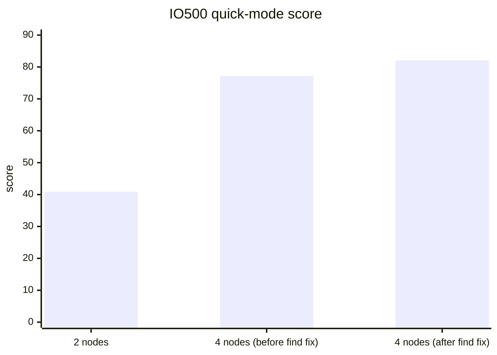

# IO500 擴展報告：在 AWS 上從 2 節點到 4 節點（i3en.12xlarge、EFA）

| | |
|---|---|
| 報告日期 | 2026-10-29 |
| 評估對象 | rocepool（以 RDMA 記憶體池為基礎的分散式檔案系統） |
| 平台 | Amazon EC2 us-east-2、i3en.12xlarge（每節點 48 vCPU、384 GiB RAM、4 × 7.5 TB NVMe、50 Gb/s EFA） |
| 效能測試 | IO500 官方應用程式，快速模式：stonewall 30 秒，每節點 32 個 rank |
| 比較對象 | Vendor W（商用平行檔案系統）：ISC25 IO500 10 節點正式榜單的項目（10 個用戶端節點＋18 台資料伺服器），分數 105.94 |
| 相關報告 | [IO500_AWS_進度報告.md](IO500_AWS_進度報告.md)（2 節點的 3 次有效執行）・本報告的英文版：[IO500_AWS_4NODE_REPORT.md](IO500_AWS_4NODE_REPORT.md)・其他語言：[日本語](IO500_AWS_4ノード検証レポート.md) · [Deutsch](IO500_AWS_4-Knoten-Validierungsbericht.md) · [Español](IO500_AWS_Informe_de_validación_de_4_nodos.md) |

## 1. 摘要

- **從 2 節點擴展到 4 節點：** IO500 分數提高為 1.89 倍（40.88 → 77.19），擴展效率 94%。頻寬 1.99 倍，中繼資料 1.79 倍。
- **有一個階段沒有擴展。** find 以外的階段都提高為 1.92～2.03 倍，只有 find 停在 1.04 倍。
  - 原因：單一 MPI rank 以每秒約 30 萬筆的速度讀取整個 mdtest-hard 目錄。
  - 改成由所有 rank 分擔讀取目錄後，4 節點的 find 從每秒 99.7 萬筆提高到 278.7 萬筆（2.8 倍）。4 節點分數提高到 **82.05**。
- **4 節點時與 Vendor W 的比較：** 分數為 Vendor W 10 節點分數 105.94 的 77%。
  - 每節點的中繼資料是 Vendor W 每個用戶端節點的 4.9 倍。
  - 每節點的頻寬是 Vendor W 的 76%。
- **追平 Vendor W 所需的節點數**（由 4 節點的結果推估）：
  - **6 節點**的有效執行推估為 101～109，與 105.94 大致相當。
  - **7 節點**推估為 117～127，明顯超越。
  - 以上為推估值，尚未進行超過 4 節點的執行。

## 2. 執行一覽

3 次都以快速模式執行。快速模式的結果不是有效的 IO500 結果（第 7 節）。

| | 2 節點 | 4 節點（find 修正前） | 4 節點（find 修正後） |
|---|---|---|---|
| GitHub Actions 的執行 | 40443313800 | 40497186409 | 40511776202 |
| 時間（UTC） | 2026-10-27 03:17 | 2026-10-27 11:34 | 2026-10-27 13:24 |
| MPI rank 數 | 64 | 128 | 128 |
| **IO500 分數** | **40.88** | **77.19** | **82.05** |
| 頻寬（GiB/s） | 5.08 | 10.11 | 10.09 |
| 中繼資料（kIOPS） | 329.2 | 589.4 | 667.3 |
| 執行個體運作時間／費用 | | 37 分鐘／$13.7 | 37 分鐘／$13.7 |

費用依 AWS 隨需執行的運作時間計算：每台執行個體每小時 $5.424，加上 gp3 系統磁碟每小時約 $0.18。

## 3. 從 2 節點到 4 節點的擴展

兩次執行使用相同的軟體（find 修正前），因此倍率只反映節點數加倍的效果。倍率 2.00 相當於線性擴展。

| 階段 | 2 節點 | 4 節點 | 倍率 |
|---|---|---|---|
| ior-easy-write（GiB/s） | 3.48 | 7.05 | 2.03 |
| ior-hard-write（GiB/s） | 3.24 | 6.43 | 1.98 |
| ior-easy-read（GiB/s） | 7.57 | 15.35 | 2.03 |
| ior-hard-read（GiB/s） | 7.80 | 15.02 | 1.93 |
| mdtest-easy-write（kIOPS） | 348.3 | 669.2 | 1.92 |
| mdtest-hard-write（kIOPS） | 155.9 | 302.9 | 1.94 |
| **find（kIOPS）** | **962.5** | **996.5** | **1.04** |
| mdtest-easy-stat（kIOPS） | 354.1 | 687.2 | 1.94 |
| mdtest-hard-stat（kIOPS） | 350.8 | 681.4 | 1.94 |
| mdtest-easy-delete（kIOPS） | 355.7 | 688.5 | 1.94 |
| mdtest-hard-read（kIOPS） | 171.3 | 330.3 | 1.93 |
| mdtest-hard-delete（kIOPS） | 349.0 | 677.1 | 1.94 |
| **頻寬分數** | 5.08 | 10.11 | **1.99** |
| **中繼資料分數** | 329.2 | 589.4 | **1.79** |
| **IO500 分數** | 40.88 | 77.19 | **1.89** |

- **頻寬**幾乎線性擴展，因為每個節點都多了專屬的 NVMe 磁碟與 50 Gb/s 連線。
- **find 以外的中繼資料**提高為 1.93 倍（find 以外 7 個階段的幾何平均）。每個節點多一台中繼資料伺服器，mdtest-hard 的目錄分條到所有伺服器上。
- **find** 只有 1.04 倍。中繼資料分數是 8 個階段的幾何平均，單是這個階段就讓中繼資料倍率從 1.93 降到 1.79。

## 4. find：根本原因與修正

### 4.1 根本原因

IO500 的 find 階段在所有 rank 上執行 pfind。pfind 以目錄為單位分配工作：讀取目錄的 rank 把子目錄和待處理的 stat 交給空閒的 rank。然而 mdtest-hard 把所有檔案放在**同一個目錄**中，而 pfind 預設讓單一 rank 從頭到尾讀完一個目錄。

量測值顯示，find 階段的時間恰好就是一個 rank 讀完這個目錄的時間。

| | 2 節點 | 4 節點 |
|---|---|---|
| mdtest-hard 目錄中的檔案數 | 512 萬 | 944 萬 |
| find 階段的時間 | 17.5 秒 | 30.5 秒 |
| mdtest-hard 每秒筆數 | 29.3 萬 | 31.0 萬 |
| 每走訪 1 筆的 rank CPU | 63 µs | 122 µs |

- 節點數加倍時，rank 變多、建立的檔案也變多，目錄加倍，時間也跟著加倍。速度維持在每秒約 30 萬筆，相當於單一 rank 的讀取速度。
- 每筆的 rank CPU 加倍，是因為其他 rank 在 pfind 的工作竊取迴圈中空轉，卻沒有工作可竊取。

在用戶端，另外兩項成本也拖慢了這個唯一的讀取者。兩者都與節點數無關，因此不是無法擴展的原因。
- **在第一筆之前就取得整份清單。** 攔截函式庫取得全部 944 萬筆，排序合併後的清單，並把每一筆放進屬性快取。快取上限為 10 萬筆，因此一次列出期間會被清空約 90 次。
- **為了找到開啟中的目錄而走訪 4,096 個槽。** 每次呼叫 readdir 都要走訪 4,096 個槽，才能找到自己的串流。

### 4.2 修正（PR #31）

1. **IO500 選項。** 在設定檔的 `[find]` 中指定 `pfind-parallelize-single-dir-access-using-hashing = TRUE`。
   - 這是 IO500 官方應用程式的選項，不影響結果的有效性。
   - 指定後（pfind 的 `-H 1`），當空閒的 rank 請求工作時，正在讀取目錄的 rank 會把尚未讀取的 telldir 位置範圍的後半交出去。
   - 這個選項需要在檔案系統上能運作的 `telldir`/`seekdir`。在這次修改之前，攔截函式庫沒有提供。
2. **攔截函式庫的 telldir/seekdir。**
   - 每台中繼資料伺服器一頁放不下的大目錄，可從任意位置以頁為單位（256 KiB）讀取。位置平均分配在 [0, LONG_MAX) 上，因此把位置範圍切成一半，剩下的筆數也正好一半。
   - 小目錄照舊一次讀完。
   - 屬性快取按頁登錄，搜尋開啟中的目錄時只走訪使用中的槽。
3. **中繼資料伺服器：指定位置讀取。**
   - 新的請求從指定的索引開始回傳筆目，並附上目錄的筆數。
   - 讀取未變更目錄的多個讀取者共用一份已排序的快照。以目錄內每次變更都會遞增的版本計數器判斷快照是否過期。

測試：
- 透過攔截函式庫從 mpirun 執行真正的 pfind，確認不論有無 `-H 1` 都找到相同的檔案。
- 位置測試確認了：
  - 位置單調遞增。
  - seek 後會回到同一筆（從另一個串流也一樣）。
  - 在任意位置切分的範圍，恰好各涵蓋所有筆目一次。
  - 目錄的變更會反映在下一次列出中。

### 4.3 結果（4 節點，相同執行個體類型）

| | 修正前 | 修正後 | 變化 |
|---|---|---|---|
| **find（kIOPS）** | 996.5 | **2,787.5** | **2.8 倍** |
| find 階段的時間 | 30.5 秒 | 10.9 秒 | −64% |
| 每走訪 1 筆的 rank CPU | 122 µs | 41 µs | −66% |
| 中繼資料分數（kIOPS） | 589.4 | 667.3 | +13% |
| **IO500 分數** | 77.19 | **82.05** | **+6.3%** |

其他 11 個階段的變化不到 2%（在每次執行的變動範圍內），修正沒有負面影響。

## 5. 4 節點與 Vendor W 的比較（每節點）

Vendor W 的數值是有效的 10 節點項目（stonewall 300 秒）除以 10 個用戶端節點。rocepool 的數值是 find 修正後的 30 秒快速執行除以 4 個節點。rocepool 的每個節點同時是用戶端與伺服器。「差距」為 Vendor W ÷ rocepool，小於 1.0 表示 rocepool 領先。

| 階段 | rocepool／節點 | Vendor W／用戶端節點 | 差距 |
|---|---|---|---|
| ior-easy-write（GiB/s） | 1.78 | 7.58 | 4.27 |
| ior-hard-write（GiB/s） | 1.61 | 1.51 | 0.94 |
| ior-easy-read（GiB/s） | 3.81 | 13.40 | 3.52 |
| ior-hard-read（GiB/s） | 3.73 | 0.80 | 0.21 |
| mdtest-easy-write（kIOPS） | 167.4 | 42.48 | 0.25 |
| mdtest-hard-write（kIOPS） | 75.3 | 1.69 | 0.02 |
| find（kIOPS） | 696.9 | 113.25 | 0.16 |
| mdtest-easy-stat（kIOPS） | 171.8 | 191.11 | 1.11 |
| mdtest-hard-stat（kIOPS） | 169.1 | 146.58 | 0.87 |
| mdtest-easy-delete（kIOPS） | 171.3 | 48.01 | 0.28 |
| mdtest-hard-read（kIOPS） | 81.9 | 82.32 | 1.01 |
| mdtest-hard-delete（kIOPS） | 167.5 | 1.86 | 0.01 |
| **頻寬分數（GiB/s）** | 2.52 | 3.33 | **1.32** |
| **中繼資料分數（kIOPS）** | 166.8 | 33.7 | **0.20** |

- **中繼資料：** 以每節點計，rocepool 的中繼資料分數是 Vendor W 的 4.9 倍。除了 mdtest-easy-stat（Vendor W 領先 11%）之外，所有中繼資料階段 rocepool 都領先或持平。
- **頻寬：** ior-easy-write（4.3 倍）和 ior-easy-read（3.5 倍）由 Vendor W 領先。這些大型循序 I/O 階段在 i3en 上受限於 NVMe 磁碟與 50 Gb/s 連線。Vendor W 使用 InfiniBand 與 18 台專用資料伺服器。ior-hard-read 由 rocepool 領先，ior-hard-write 大致持平。

## 6. 達到 105.94 需要的節點數

### 6.1 推估方法

- **起點：** find 修正後 4 節點的快速分數 82.05。
- **節點數加倍時的成長：** 設定兩種假設。
  - 保守：**1.89 倍**。修正前量到的 2→4 節點擴展。
  - 樂觀：**1.95 倍**。find 以外各階段在 2→4 節點的成長。find 現在也由各 rank 分擔，預期會同樣成長。
- **從快速到有效執行：** 有效執行的 stonewall 為 300 秒，寫入約 10 倍的資料。因此讀取會深入 NVMe 層，分數下降。最後一次有效的 2 節點執行為 28.58，接著的快速執行為 33.02，有效分數是快速分數的 87%。本報告假設為 85～90%。

### 6.2 推估結果

| 節點數 | 所需 vCPU | 快速分數（推估） | **有效分數（推估）** | 與 105.94 相比 | 有效執行的費用（推估） |
|---|---|---|---|---|---|
| 4（快速實測） | 192 | **82.05** | 約 70～74 | 低於 | — |
| 5 | 240 | 101～102 | 86～92 | 低於 | $50～59 |
| **6** | 288 | 119～121 | **101～109** | **大致相當** | **$61～71** |
| **7** | 336 | 137～141 | **117～127** | **超越** | **$71～82** |
| 8 | 384 | 155～160 | 132～144 | 大幅超越 | $81～94 |
| 10 | 480 | 190～198 | 162～179 | 大幅超越 | $101～118 |

- **費用推估：** 每台執行個體每小時 $5.605（含系統磁碟）。2 節點的有效執行 B 和 C，執行個體都運作了 1 小時 48 分：設定、功能檢查與結果收集約 58 分鐘，IO500 50 分鐘。6～10 節點的有效執行預估 1.8～2.1 小時。
- **要追平 Vendor W，快速模式需要 5.2～5.3 個節點，有效執行約需 5.8～6.3 個節點。** 6 節點是損益兩平點，7 節點則有明顯差距。
- **機器台數：** Vendor W 的項目使用 10 台用戶端與 18 台資料伺服器，共 28 台。rocepool 的 6 節點約為其 5 分之 1，7 節點約為 4 分之 1。

### 6.3 這份推估無法得知的事

- **超過 4 節點時的瓶頸。** 超過 4 節點後網路或中繼資料伺服器是否出現競爭，只有更大規模的執行才能得知。2→4 節點時沒有這種跡象。
- **find 的擴展。** 修正後的 find 只在 4 節點量測過。它之後會繼續成長只是假設，並未量測。
- **快速與有效執行的比例。** 這是從 2 節點的執行得到的值，6～7 節點時可能不同。

## 7. 比較的前提與限制

- **快速模式不是有效的 IO500 結果。** stonewall 30 秒短於規定的 300 秒，因此數值會比有效執行高。第 5 節是把快速數值與 Vendor W 的有效數值相比，用來顯示差異在哪裡，而不是為系統排名。
- **不是榜單提交。** 所有執行都沒有提交給 IO500 委員會，也沒有經過審查。
- **硬體：** rocepool 的每個節點上，用戶端與伺服器共用同一台主機。Vendor W 的數值是其榜單項目（submission 704）公開的數值。
- **費用：** 執行個體費用依 AWS 隨需價格。Vendor W 的系統價格沒有公開，因此不比較價格。
- **原始資料：** 各次執行的報告位於分支 `aws-results/gh-<run id>`。
