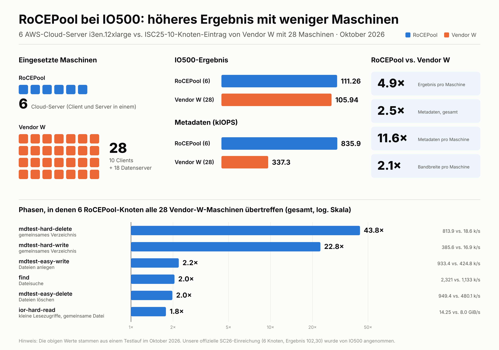
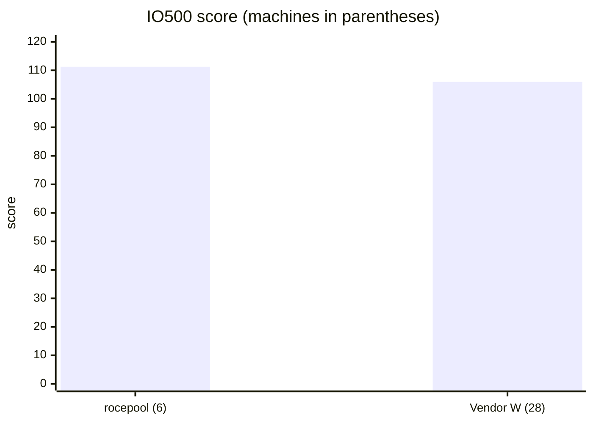

# IO500-Ergebnis: 6 Cloud-Knoten übertreffen ein kommerzielles System mit 28 Maschinen (inoffiziell)

| | |
|---|---|
| Berichtsdatum | 2026-10-30 |
| Gegenstand | rocepool (verteiltes Dateisystem auf Basis eines RDMA-Speicherpools) |
| Plattform | Amazon EC2 us-east-2, 6 × i3en.12xlarge (pro Knoten: 48 vCPU, 384 GiB RAM, 4 × 7,5 TB NVMe, 50 Gb/s EFA) |
| Benchmark | Offizielle IO500-Anwendung, Standardmodus: Stonewall 300 Sekunden, 192 Ranks (32 pro Knoten) |
| Einordnung | **Inoffiziell.** Eine Phase endete vor dem Stonewall, daher wertete IO500 das Ergebnis als INVALID (Abschnitt 4). Nicht bei der IO500-Liste eingereicht. |
| Vergleich | Vendor W (kommerzielles paralleles Dateisystem): Eintrag der ISC25-IO500-Produktionsliste für 10 Knoten. Er nutzt 10 Client-Knoten und 18 Datenserver, zusammen 28 Maschinen. Ergebnis 105,94. |
| Laufprotokoll | GitHub-Actions-Lauf 40999521729. Rohdaten im Branch `aws-results/gh-40999521729`. Alle Schritte des Laufs: [IO500_AWS_6-Knoten-Gesamttestbericht.md](IO500_AWS_6-Knoten-Gesamttestbericht.md) |
| Verwandte Berichte | [Skalierung auf 4 Knoten](IO500_AWS_4-Knoten-Validierungsbericht.md) · [Fortschritt mit 2 Knoten](IO500_AWS_Fortschrittsbericht.md) · englische Fassung dieses Berichts: [IO500_AWS_6NODE_REPORT.md](IO500_AWS_6NODE_REPORT.md) · weitere Sprachen: [日本語](IO500_AWS_6ノード結果レポート.md) · [Español](IO500_AWS_Informe_de_resultados_de_6_nodos.md) · [繁體中文](IO500_AWS_6節點結果報告.md) |

## 1. Zusammenfassung

rocepool lief auf sechs Standard-Cloud-Instanzen durch das 300-Sekunden-Standard-IO500 und erreichte **111,26**. Der 10-Knoten-Produktionseintrag von Vendor W mit 28 Maschinen erreicht 105,94.

| | rocepool | Vendor W | rocepool gegenüber Vendor W |
|---|---|---|---|
| Maschinen | **6** (jeder Knoten ist Client und Server) | **28** (10 Clients + 18 Datenserver) | **21 % der Maschinen** |
| **IO500-Ergebnis** | **111,26** | 105,94 | **+5 %** |
| Metadaten (kIOPS) | **835,9** | 337,29 | **2,5-fach** |
| Bandbreite (GiB/s) | 14,81 | 33,28 | 0,44-fach |
| **Ergebnis pro Maschine** | **18,5** | 3,8 | **4,9-fach** |
| Metadaten pro Maschine (kIOPS) | 139,3 | 12,0 | 11,6-fach |
| Bandbreite pro Maschine (GiB/s) | 2,47 | 1,19 | 2,1-fach |
| Hardwarekosten | On-Demand 33,6 $/Stunde (5,605 $/Stunde pro Knoten inkl. Platte); dieser Lauf etwa 67 $ | nicht veröffentlicht | — |

- **Weniger Maschinen, höheres Ergebnis.** Mit etwa einem Fünftel der Maschinen liegt das Gesamtergebnis 5 % höher.
- **Der Haupttreiber sind die Metadaten.** Das Metadatenergebnis von rocepool ist das 2,5-Fache der Gesamtsumme von Vendor W, pro Maschine das 11,6-Fache. Metadaten liegen im Speicher und werden per RDMA angesprochen; der Namensraum ist über die Metadatenserver aller Knoten verteilt.
- **Die Bandbreite ist in Summe niedriger, pro Maschine aber höher.** Auf dieser Instanz stößt die sequenzielle I/O-Bandbreite jedes Knotens an die Grenze von vier NVMe-Laufwerken und der 50-Gb/s-Verbindung. Vendor W nutzt InfiniBand und 18 eigene Datenserver.

## 2. Ergebnisse nach Phase

rocepool: Lauf mit 6 Knoten und 300 s Stonewall. Vendor W: Werte pro Phase des Eintrags, wie in den früheren Berichten verwendet. Der Faktor ist das Verhältnis der Gesamtwerte; über 1 liegt rocepool vorn.

| Phase | rocepool 6 Knoten | Vendor W 28 Maschinen | Faktor (gesamt) | Faktor (pro Maschine) |
|---|---|---|---|---|
| ior-easy-write (GiB/s) | 16,36 | 75,8 | 0,22 | 1,0 |
| ior-hard-write (GiB/s) | 9,36 | 15,1 | 0,62 | 2,9 |
| ior-easy-read (GiB/s) | 22,03 | 134,0 | 0,16 | 0,8 |
| ior-hard-read (GiB/s) | **14,25** | 8,0 | **1,78** | 8,3 |
| mdtest-easy-write (kIOPS) | **933,4** ¹ | 424,8 | **2,20** | 10,3 |
| mdtest-hard-write (kIOPS) | **385,6** | 16,9 | **22,8** | 106 |
| find (kIOPS) | **2.321,4** | 1.132,5 | **2,05** | 9,6 |
| mdtest-easy-stat (kIOPS) | 938,7 | 1.911,1 | 0,49 | 2,3 |
| mdtest-hard-stat (kIOPS) | 934,1 | 1.465,8 | 0,64 | 3,0 |
| mdtest-easy-delete (kIOPS) | **949,4** | 480,1 | **1,98** | 9,2 |
| mdtest-hard-read (kIOPS) | 421,1 | 823,2 | 0,51 | 2,4 |
| mdtest-hard-delete (kIOPS) | **813,9** | 18,6 | **43,8** | 204 |
| **Bandbreitenergebnis (GiB/s)** | 14,81 | 33,28 | 0,44 | 2,1 |
| **Metadatenergebnis (kIOPS)** | **835,9** | 337,29 | **2,48** | 11,6 |
| **IO500-Ergebnis** | **111,26** | 105,94 | **1,05** | 4,9 |

¹ Diese Phase endete nach 207 statt 300 Sekunden (Abschnitt 4).

- **In Summe liegt rocepool in sechs Phasen vorn:** ior-hard-read, mdtest-easy-write, mdtest-hard-write, find, mdtest-easy-delete, mdtest-hard-delete. Schreiben und Löschen bei mdtest-hard, das mit einem gemeinsamen Verzeichnis arbeitet, liegen beim 23- bzw. 44-Fachen.
- **Pro Maschine** ist rocepool in allen Phasen gleichauf oder vorn, außer bei ior-easy-read (0,8-fach).

## 3. Entwicklung des Ergebnisses

Alle Läufe nutzten denselben Instanztyp. Zwischen den Läufen änderte sich nur die Software.

| Datum | Knoten | Lauf | Ergebnis | Anmerkung |
|---|---|---|---|---|
| 2026-10-25 | 2 | gültig, 300 s | 16,68 | erster gültiger Lauf |
| 2026-10-25 | 2 | gültig, 300 s | 28,58 | nach Verbesserungen an Metadaten und Schreibpfad |
| 2026-10-27 | 2 | Quick, 30 s | 40,88 | |
| 2026-10-27 | 4 | Quick, 30 s | 82,05 | nach dem find-Fix (ein Verzeichnis auf alle Ranks verteilt) |
| **2026-10-30** | **6** | **300 s** | **111,26** | dieser Bericht |

- Von 4 auf 6 Knoten: Der 60-Sekunden-Lauf vor dem 300-Sekunden-Lauf ergab 124,79, das 1,52-Fache des 4-Knoten-Quick-Ergebnisses (bei 1,5-facher Knotenzahl). Zwischen 4 und 6 Knoten trat kein neuer Engpass auf.
- Das Ergebnis des 300-Sekunden-Laufs, 111,26, liegt bei 89 % des 60-Sekunden-Laufs derselben Runde. Der 4-Knoten-Bericht schätzte einen gültigen 6-Knoten-Lauf auf 101–109; das Ergebnis liegt leicht darüber.

## 4. Warum IO500 das Ergebnis als INVALID wertete

- IO500 verlangt, dass jede Schreibphase mindestens 300 Sekunden läuft. mdtest-easy-write hatte die vorgegebenen Dateien (1 Million pro Rank, insgesamt 192 Millionen) nach 207 Sekunden angelegt und hielt an. Die übrigen 11 Phasen erfüllen die Regeln.
- Der Wert von 1 Million Dateien pro Rank stammt aus der Zeit, als ein Rank etwa 600 Dateien pro Sekunde anlegte. Nach den Metadatenverbesserungen dieses Monats legt ein Rank etwa 4 900 Dateien pro Sekunde an, und 1 Million Dateien sind nach etwa 205 Sekunden erschöpft. Das hängt von der Geschwindigkeit pro Rank ab, nicht von der Knotenzahl.
- **Behebung (PR #35):** Die Dateizahl pro Rank wird jetzt aus der Geschwindigkeit eines kurzen vorausgehenden Laufs bestimmt, mit 1,5-facher Reserve, damit die Phase länger als 300 Sekunden läuft.
- **Auswirkung auf das Ergebnis:** Eine längere Phase legt bei nahezu gleicher Geschwindigkeit nur mehr Dateien an. Die 933 000 pro Sekunde bei mdtest-easy-write in diesem Lauf entsprechen fast den 942 000 pro Sekunde des 60-Sekunden-Laufs; ein Lauf nach dem Fix sollte daher ein nahezu gleiches Ergebnis liefern. Dieser Lauf steht aber noch aus.

## 5. Voraussetzungen und Grenzen des Vergleichs

- **Inoffiziell:** IO500 wertete das Ergebnis als INVALID (Abschnitt 4), und es wurde weder beim IO500-Komitee eingereicht noch von ihm geprüft.
- **Maschinen:** rocepool betreibt Clients und Server auf denselben 6 Maschinen. Die Werte von Vendor W sind die in seinem Listeneintrag (submission 704) veröffentlichten, Konfiguration mit 10 Client-Knoten und 18 Datenservern.
- **Netzwerk und Speichermedien:** rocepool lief auf AWS EFA (50 Gb/s pro Knoten) und Instanzspeicher-NVMe. Der Eintrag von Vendor W nutzt InfiniBand und eigene Speicherserver.
- **Kosten:** Die Kosten von rocepool folgen den AWS-On-Demand-Preisen. Die Systempreise von Vendor W sind nicht veröffentlicht, Preise werden daher nicht verglichen.
- **Vergleichswerte pro Phase:** Die Werte von Vendor W pro Phase sind die gerundeten Werte des öffentlichen Eintrags, wie in den früheren Berichten verwendet.
