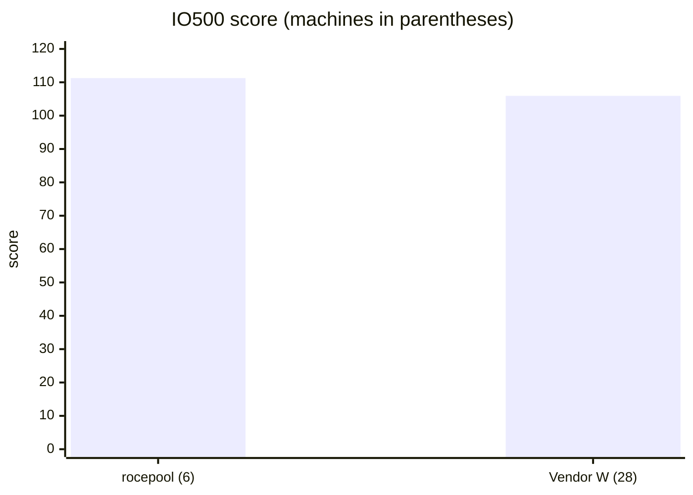

# IO500 Result: 6 Cloud Nodes Above a 28-Machine Commercial System (unofficial)

| | |
|---|---|
| Report date | 2026-10-30 |
| System under test | rocepool (RDMA memory-pool distributed file system) |
| Platform | Amazon EC2 us-east-2, 6 × i3en.12xlarge (each: 48 vCPU, 384 GiB RAM, 4 × 7.5 TB NVMe, 50 Gb/s EFA) |
| Benchmark | IO500 official application, standard mode: 300 s stonewall, 192 ranks (32 per node) |
| Status | **Unofficial.** IO500 marked the result INVALID because one phase ended before the stonewall (section 4). Not submitted to the IO500 list. |
| Reference | Vendor W, a commercial parallel file system: its 10-node entry on the ISC25 IO500 10-node production list, which uses 10 client nodes and 18 data servers (28 machines). Score 105.94. |
| Run record | GitHub Actions run 40999521729; raw reports on branch `aws-results/gh-40999521729` |
| Earlier reports | [4-node scaling](IO500_AWS_4NODE_REPORT.md) · [2-node progress](IO500_AWS_PROGRESS_REPORT.md) · Japanese version of this report: [IO500_AWS_6ノード結果レポート.md](IO500_AWS_6ノード結果レポート.md) |

## 1. Summary

With 6 general-purpose cloud instances, rocepool scored **111.26** in a standard 300 s IO500 run. Vendor W's 10-node production entry, which uses 28 machines, scored 105.94.

| | rocepool | Vendor W | rocepool vs Vendor W |
|---|---|---|---|
| Machines | **6** (each node is both client and server) | **28** (10 clients + 18 data servers) | **21% of the machines** |
| **IO500 score** | **111.26** | 105.94 | **+5%** |
| Metadata (kIOPS) | **835.9** | 337.29 | **2.5×** |
| Bandwidth (GiB/s) | 14.81 | 33.28 | 0.44× |
| **Score per machine** | **18.5** | 3.8 | **4.9×** |
| Metadata per machine (kIOPS) | 139.3 | 12.0 | 11.6× |
| Bandwidth per machine (GiB/s) | 2.47 | 1.19 | 2.1× |
| Hardware cost | $33.6/hour on demand ($5.605/h per node with disk); this run cost about $67 | not public | — |

- **Fewer machines, higher score.** About one fifth of the machines produced a 5% higher total score.
- **Metadata is the main reason.** rocepool's metadata score is 2.5× Vendor W's total and 11.6× per machine. Metadata is held in memory and reached over RDMA, and the namespace is spread over every node's metadata server.
- **Bandwidth is lower in total but higher per machine.** On these instances, each node's sequential bandwidth is bounded by its four NVMe drives and its 50 Gb/s link. Vendor W uses InfiniBand and 18 dedicated data servers.

## 2. Phase results

rocepool: the 6-node run with a 300 s stonewall. Vendor W: its entry's per-phase figures, as used in our earlier reports. The ratio compares totals; a ratio above 1 means rocepool is ahead.

| Phase | rocepool, 6 nodes | Vendor W, 28 machines | Ratio (total) | Ratio per machine |
|---|---|---|---|---|
| ior-easy-write (GiB/s) | 16.36 | 75.8 | 0.22 | 1.0 |
| ior-hard-write (GiB/s) | 9.36 | 15.1 | 0.62 | 2.9 |
| ior-easy-read (GiB/s) | 22.03 | 134.0 | 0.16 | 0.8 |
| ior-hard-read (GiB/s) | **14.25** | 8.0 | **1.78** | 8.3 |
| mdtest-easy-write (kIOPS) | **933.4** ¹ | 424.8 | **2.20** | 10.3 |
| mdtest-hard-write (kIOPS) | **385.6** | 16.9 | **22.8** | 106 |
| find (kIOPS) | **2,321.4** | 1,132.5 | **2.05** | 9.6 |
| mdtest-easy-stat (kIOPS) | 938.7 | 1,911.1 | 0.49 | 2.3 |
| mdtest-hard-stat (kIOPS) | 934.1 | 1,465.8 | 0.64 | 3.0 |
| mdtest-easy-delete (kIOPS) | **949.4** | 480.1 | **1.98** | 9.2 |
| mdtest-hard-read (kIOPS) | 421.1 | 823.2 | 0.51 | 2.4 |
| mdtest-hard-delete (kIOPS) | **813.9** | 18.6 | **43.8** | 204 |
| **Bandwidth score (GiB/s)** | 14.81 | 33.28 | 0.44 | 2.1 |
| **Metadata score (kIOPS)** | **835.9** | 337.29 | **2.48** | 11.6 |
| **IO500 score** | **111.26** | 105.94 | **1.05** | 4.9 |

¹ This phase ran 207 s instead of 300 s (section 4).

- **Six phases are ahead in total:** ior-hard-read, mdtest-easy-write, mdtest-hard-write, find, mdtest-easy-delete and mdtest-hard-delete. The two mdtest-hard write and delete phases, which work on one shared directory, are 23× and 44× higher.
- **Per machine,** rocepool is level or ahead in every phase except ior-easy-read (0.8×).

## 3. How the score grew

All runs used the same instance type. The changes between them were software only.

| Date | Nodes | Run | Score | Note |
|---|---|---|---|---|
| 2026-10-25 | 2 | valid, 300 s | 16.68 | first valid run |
| 2026-10-25 | 2 | valid, 300 s | 28.58 | after metadata and write-path work |
| 2026-10-27 | 2 | quick, 30 s | 40.88 | |
| 2026-10-27 | 4 | quick, 30 s | 82.05 | after the find fix (one directory read by all ranks) |
| **2026-10-30** | **6** | **300 s** | **111.26** | this report |

- From 4 to 6 nodes, the 60 s run that precedes the 300 s run scored 124.79, which is 1.52× the 4-node quick score for 1.5× the nodes. No new bottleneck appeared between 4 and 6 nodes.
- The 300 s run scored 111.26, which is 89% of its 60 s run. The 4-node report projected 101–109 for a valid 6-node run, and the result came out slightly above that range.

## 4. Why IO500 marked the run invalid

- IO500 requires each write phase to run for at least 300 s. mdtest-easy-write created every file it had been told to create (1 M per rank, 192 M files) in 207 s, and stopped there. The other eleven phases met the rules.
- The 1 M files per rank were set when a rank created about 600 files per second. After this month's metadata work, a rank creates about 4,900 per second, so 1 M files last only about 205 s. This depends on the speed per rank, not on the number of nodes.
- **Fix (PR #35):** the number of files per rank is now sized from the rate measured in the preceding short run, so the phase lasts past 300 s with a 1.5× margin.
- **Effect on the score:** a longer phase would create more files at about the same rate. mdtest-easy-write's 933 k/s in this run matches the 942 k/s of the 60 s run, so a run with the fix is expected to score about the same. That run has not been made.

## 5. Comparability and limitations

- **Unofficial:** IO500 marked the result invalid (section 4), and it has not been submitted to or reviewed by the IO500 committee.
- **Machines:** rocepool runs clients and servers on the same 6 hosts. Vendor W's figures are as published for its list entry (submission 704), with 10 client nodes and 18 data servers.
- **Network and media:** rocepool ran on AWS EFA (50 Gb/s per node) with instance-store NVMe. Vendor W's entry uses InfiniBand and dedicated storage servers.
- **Cost:** rocepool's cost is AWS on-demand pricing; Vendor W's system cost is not public, so prices are not compared.
- **Per-phase reference figures:** Vendor W's per-phase values come from its published entry, as used in our earlier reports (rounded).
