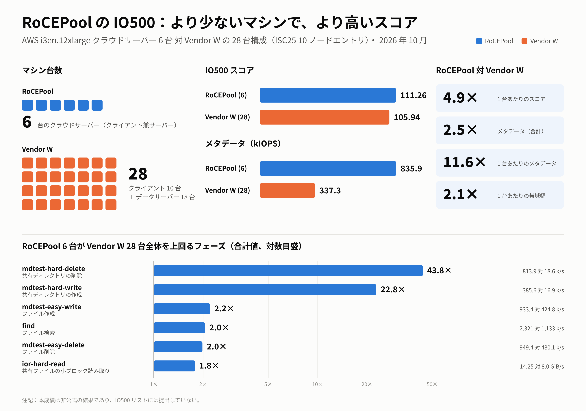
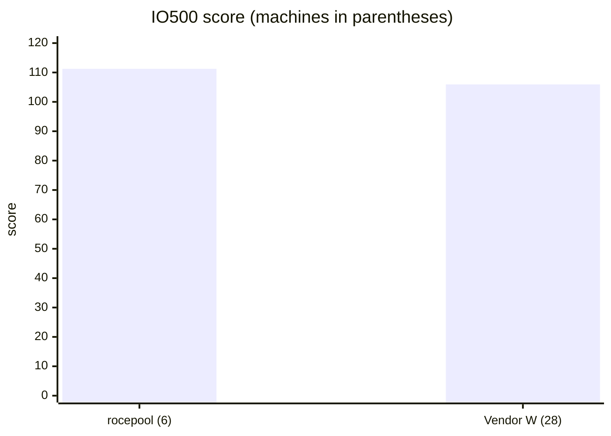

# IO500 結果：クラウド 6 ノードで 28 台構成の商用システムを上回る（非公式）

| | |
|---|---|
| 報告日 | 2026-10-30 |
| 評価対象 | rocepool（RDMA メモリプール型分散ファイルシステム） |
| プラットフォーム | Amazon EC2 us-east-2、i3en.12xlarge × 6（各ノード：48 vCPU、384 GiB RAM、4 × 7.5 TB NVMe、50 Gb/s EFA） |
| ベンチマーク | IO500 公式アプリケーション、標準モード：stonewall 300 秒、192 ランク（1 ノードあたり 32） |
| 位置づけ | **非公式。** 1 つのフェーズが stonewall より前に終わったため、IO500 は結果を INVALID と判定した（第 4 節）。IO500 リストには提出していない。 |
| 比較対象 | Vendor W（商用並列ファイルシステム）：ISC25 IO500 10 ノード本番リストのエントリ。クライアント 10 ノードとデータサーバー 18 台の計 28 台を使う。スコア 105.94。 |
| 実行記録 | GitHub Actions の実行 40999521729。生データはブランチ `aws-results/gh-40999521729` |
| 関連レポート | [4 ノードのスケーリング](IO500_AWS_4ノード検証レポート.md)・[2 ノードの進捗](IO500_AWS_進捗レポート.md)・本レポートの英語版：[IO500_AWS_6NODE_REPORT.md](IO500_AWS_6NODE_REPORT.md) |

## 1. 概要

rocepool は汎用クラウドインスタンス 6 台で、300 秒の標準 IO500 を実行し、スコア **111.26** を記録した。28 台を使う Vendor W の 10 ノード本番エントリのスコアは 105.94。

| | rocepool | Vendor W | rocepool の Vendor W 比 |
|---|---|---|---|
| マシン台数 | **6**（各ノードがクライアントとサーバーを兼ねる） | **28**（クライアント 10 ＋データサーバー 18） | **台数は 21%** |
| **IO500 スコア** | **111.26** | 105.94 | **+5%** |
| メタデータ（kIOPS） | **835.9** | 337.29 | **2.5 倍** |
| 帯域幅（GiB/s） | 14.81 | 33.28 | 0.44 倍 |
| **マシン 1 台あたりのスコア** | **18.5** | 3.8 | **4.9 倍** |
| マシン 1 台あたりのメタデータ（kIOPS） | 139.3 | 12.0 | 11.6 倍 |
| マシン 1 台あたりの帯域幅（GiB/s） | 2.47 | 1.19 | 2.1 倍 |
| ハードウェア費用 | オンデマンドで $33.6/時間（ディスク込みで 1 ノード $5.605/時間）。今回の実行は約 $67 | 非公開 | — |

- **より少ないマシンで、より高いスコア。** 約 5 分の 1 の台数で、合計スコアが 5% 高い。
- **主な要因はメタデータ。** rocepool のメタデータスコアは Vendor W の合計の 2.5 倍、1 台あたりでは 11.6 倍。メタデータはメモリ上に置かれ RDMA でアクセスされ、名前空間は全ノードのメタデータサーバーに分散される。
- **帯域幅は合計では低いが、1 台あたりでは高い。** このインスタンスでは、各ノードの連続 I/O 帯域幅が 4 台の NVMe ドライブと 50 Gb/s のリンクで頭打ちになる。Vendor W は InfiniBand と専用データサーバー 18 台を使っている。

## 2. フェーズ別の結果

rocepool は 6 ノード・stonewall 300 秒の実行。Vendor W はエントリのフェーズ別の数値で、これまでのレポートで使ってきたもの。倍率は合計値の比で、1 を超えれば rocepool が上回っている。

| フェーズ | rocepool 6 ノード | Vendor W 28 台 | 倍率（合計） | 倍率（1 台あたり） |
|---|---|---|---|---|
| ior-easy-write（GiB/s） | 16.36 | 75.8 | 0.22 | 1.0 |
| ior-hard-write（GiB/s） | 9.36 | 15.1 | 0.62 | 2.9 |
| ior-easy-read（GiB/s） | 22.03 | 134.0 | 0.16 | 0.8 |
| ior-hard-read（GiB/s） | **14.25** | 8.0 | **1.78** | 8.3 |
| mdtest-easy-write（kIOPS） | **933.4** ¹ | 424.8 | **2.20** | 10.3 |
| mdtest-hard-write（kIOPS） | **385.6** | 16.9 | **22.8** | 106 |
| find（kIOPS） | **2,321.4** | 1,132.5 | **2.05** | 9.6 |
| mdtest-easy-stat（kIOPS） | 938.7 | 1,911.1 | 0.49 | 2.3 |
| mdtest-hard-stat（kIOPS） | 934.1 | 1,465.8 | 0.64 | 3.0 |
| mdtest-easy-delete（kIOPS） | **949.4** | 480.1 | **1.98** | 9.2 |
| mdtest-hard-read（kIOPS） | 421.1 | 823.2 | 0.51 | 2.4 |
| mdtest-hard-delete（kIOPS） | **813.9** | 18.6 | **43.8** | 204 |
| **帯域幅スコア（GiB/s）** | 14.81 | 33.28 | 0.44 | 2.1 |
| **メタデータスコア（kIOPS）** | **835.9** | 337.29 | **2.48** | 11.6 |
| **IO500 スコア** | **111.26** | 105.94 | **1.05** | 4.9 |

¹ このフェーズは 300 秒ではなく 207 秒で終わった（第 4 節）。

- **合計で上回るフェーズは 6 つ：** ior-hard-read、mdtest-easy-write、mdtest-hard-write、find、mdtest-easy-delete、mdtest-hard-delete。1 つの共有ディレクトリを扱う mdtest-hard の書き込みと削除は、それぞれ 23 倍と 44 倍。
- **1 台あたりでは、** ior-easy-read（0.8 倍）を除くすべてのフェーズで rocepool が同等以上。

## 3. スコアの推移

すべての実行で同じインスタンスタイプを使った。実行間の変更はソフトウェアだけ。

| 日付 | ノード数 | 実行 | スコア | 備考 |
|---|---|---|---|---|
| 2026-10-25 | 2 | 有効、300 秒 | 16.68 | 初の有効な実行 |
| 2026-10-25 | 2 | 有効、300 秒 | 28.58 | メタデータと書き込み経路の改善後 |
| 2026-10-27 | 2 | クイック、30 秒 | 40.88 | |
| 2026-10-27 | 4 | クイック、30 秒 | 82.05 | find の修正後（1 つのディレクトリを全ランクで分担） |
| **2026-10-30** | **6** | **300 秒** | **111.26** | 本レポート |

- 4 ノードから 6 ノードへ：300 秒の実行の前に行う 60 秒の実行は 124.79 で、4 ノードのクイックスコアの 1.52 倍（ノード数は 1.5 倍）。4 ノードと 6 ノードの間で新たなボトルネックは現れなかった。
- 300 秒の実行のスコア 111.26 は、同じ回の 60 秒実行の 89%。4 ノードのレポートでは 6 ノードの有効な実行を 101〜109 と推定しており、結果はその範囲をやや上回った。

## 4. IO500 が INVALID と判定した理由

- IO500 は、書き込みフェーズを最低 300 秒続けることを求めている。mdtest-easy-write は、指定されたファイル（1 ランクあたり 100 万、計 1 億 9,200 万）を 207 秒で作り終えて止まった。ほかの 11 フェーズは規定を満たしている。
- 1 ランクあたり 100 万ファイルという値は、1 ランクが毎秒約 600 ファイルを作っていたころに決めたもの。今月のメタデータ改善の結果、1 ランクは毎秒約 4,900 ファイルを作るようになり、100 万ファイルは約 205 秒で尽きる。これはノード数ではなく、1 ランクあたりの速度で決まる。
- **修正（PR #35）：** 1 ランクあたりのファイル数を、直前の短い実行で測った速度から決めるようにした。1.5 倍の余裕を持たせ、フェーズが 300 秒を超えて続くようにする。
- **スコアへの影響：** フェーズが長くなっても、ほぼ同じ速度でより多くのファイルを作るだけ。今回の mdtest-easy-write の毎秒 93.3 万は、60 秒実行の毎秒 94.2 万とほぼ同じなので、修正後の実行もほぼ同じスコアになると見込む。ただし、その実行はまだ行っていない。

## 5. 比較の前提と制約

- **非公式：** IO500 は結果を INVALID と判定しており（第 4 節）、IO500 委員会への提出も審査も受けていない。
- **マシン：** rocepool は同じ 6 台でクライアントとサーバーを動かしている。Vendor W の数値は、そのリストエントリ（submission 704）で公開されているもので、クライアント 10 ノードとデータサーバー 18 台の構成。
- **ネットワークと記憶媒体：** rocepool は AWS EFA（1 ノード 50 Gb/s）とインスタンスストアの NVMe で動かした。Vendor W のエントリは InfiniBand と専用ストレージサーバーを使っている。
- **費用：** rocepool の費用は AWS オンデマンド価格による。Vendor W のシステム価格は公開されていないため、価格は比較していない。
- **フェーズ別の比較値：** Vendor W のフェーズ別の数値は、これまでのレポートで使ってきた公開エントリの値（四捨五入）。
