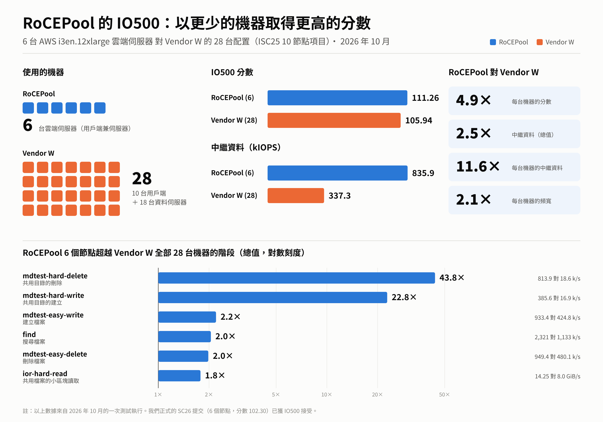
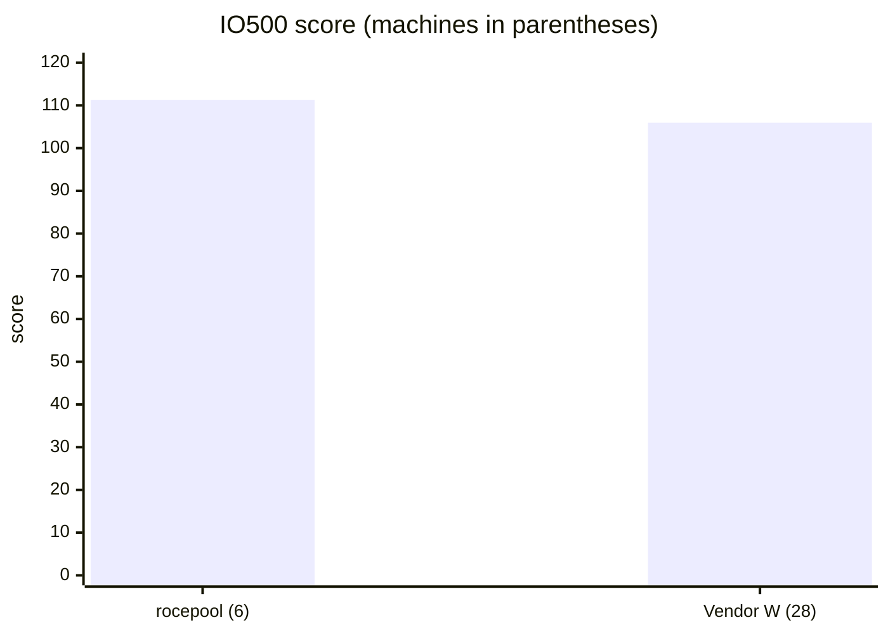

# IO500 結果：雲端 6 個節點超越 28 台機器的商用系統（非正式）

| | |
|---|---|
| 報告日期 | 2026-10-30 |
| 評估對象 | rocepool（以 RDMA 記憶體池為基礎的分散式檔案系統） |
| 平台 | Amazon EC2 us-east-2、i3en.12xlarge × 6（每節點 48 vCPU、384 GiB RAM、4 × 7.5 TB NVMe、50 Gb/s EFA） |
| 效能測試 | IO500 官方應用程式，標準模式：stonewall 300 秒，192 個 rank（每節點 32 個） |
| 定位 | **非正式。** 有一個階段在 stonewall 之前就結束，因此 IO500 判定結果為 INVALID（第 4 節）。未提交 IO500 榜單。 |
| 比較對象 | Vendor W（商用平行檔案系統）：ISC25 IO500 10 節點正式榜單的項目。使用 10 個用戶端節點與 18 台資料伺服器，共 28 台。分數 105.94。 |
| 執行紀錄 | GitHub Actions 執行 40999521729。原始資料位於分支 `aws-results/gh-40999521729`。執行的所有步驟：[IO500_AWS_6節點全項目測試報告.md](IO500_AWS_6節點全項目測試報告.md) |
| 相關報告 | [擴展到 4 節點](IO500_AWS_4節點驗證報告.md)・[2 節點的進度](IO500_AWS_進度報告.md)・本報告的英文版：[IO500_AWS_6NODE_REPORT.md](IO500_AWS_6NODE_REPORT.md)・其他語言：[日本語](IO500_AWS_6ノード結果レポート.md) · [Deutsch](IO500_AWS_6-Knoten-Ergebnisbericht.md) · [Español](IO500_AWS_Informe_de_resultados_de_6_nodos.md) |

## 1. 摘要

rocepool 在 6 台通用雲端執行個體上執行 300 秒的標準 IO500，取得 **111.26** 分。使用 28 台機器的 Vendor W 10 節點正式項目為 105.94 分。

| | rocepool | Vendor W | rocepool 相對 Vendor W |
|---|---|---|---|
| 機器台數 | **6**（每個節點同時是用戶端與伺服器） | **28**（10 台用戶端＋18 台資料伺服器） | **台數為 21%** |
| **IO500 分數** | **111.26** | 105.94 | **+5%** |
| 中繼資料（kIOPS） | **835.9** | 337.29 | **2.5 倍** |
| 頻寬（GiB/s） | 14.81 | 33.28 | 0.44 倍 |
| **每台機器的分數** | **18.5** | 3.8 | **4.9 倍** |
| 每台機器的中繼資料（kIOPS） | 139.3 | 12.0 | 11.6 倍 |
| 每台機器的頻寬（GiB/s） | 2.47 | 1.19 | 2.1 倍 |
| 硬體費用 | 隨需 $33.6／小時（含磁碟每節點 $5.605／小時）；本次執行約 $67 | 未公開 | — |

- **機器更少，分數更高。** 只用約 5 分之 1 的台數，總分高出 5%。
- **主要來自中繼資料。** rocepool 的中繼資料分數是 Vendor W 總和的 2.5 倍，每台則是 11.6 倍。中繼資料放在記憶體中並以 RDMA 存取，命名空間分散在所有節點的中繼資料伺服器上。
- **頻寬總量較低，但每台較高。** 在這種執行個體上，每個節點的循序 I/O 頻寬受限於 4 顆 NVMe 磁碟與 50 Gb/s 連線。Vendor W 使用 InfiniBand 與 18 台專用資料伺服器。

## 2. 各階段結果

rocepool 為 6 節點、stonewall 300 秒的執行。Vendor W 為該項目的各階段數值，也就是先前報告使用的數值。倍率為總值的比，超過 1 表示 rocepool 領先。

| 階段 | rocepool 6 節點 | Vendor W 28 台 | 倍率（總值） | 倍率（每台） |
|---|---|---|---|---|
| ior-easy-write（GiB/s） | 16.36 | 75.8 | 0.22 | 1.0 |
| ior-hard-write（GiB/s） | 9.36 | 15.1 | 0.62 | 2.9 |
| ior-easy-read（GiB/s） | 22.03 | 134.0 | 0.16 | 0.8 |
| ior-hard-read（GiB/s） | **14.25** | 8.0 | **1.78** | 8.3 |
| mdtest-easy-write（kIOPS） | **933.4** ¹ | 424.8 | **2.20** | 10.3 |
| mdtest-hard-write（kIOPS） | **385.6** | 16.9 | **22.8** | 106 |
| find（kIOPS） | **2,321.4** | 1,132.5 | **2.05** | 9.6 |
| mdtest-easy-stat（kIOPS） | 938.7 | 1,911.1 | 0.49 | 2.3 |
| mdtest-hard-stat（kIOPS） | 934.1 | 1,465.8 | 0.64 | 3.0 |
| mdtest-easy-delete（kIOPS） | **949.4** | 480.1 | **1.98** | 9.2 |
| mdtest-hard-read（kIOPS） | 421.1 | 823.2 | 0.51 | 2.4 |
| mdtest-hard-delete（kIOPS） | **813.9** | 18.6 | **43.8** | 204 |
| **頻寬分數（GiB/s）** | 14.81 | 33.28 | 0.44 | 2.1 |
| **中繼資料分數（kIOPS）** | **835.9** | 337.29 | **2.48** | 11.6 |
| **IO500 分數** | **111.26** | 105.94 | **1.05** | 4.9 |

¹ 這個階段在 207 秒而非 300 秒結束（第 4 節）。

- **總值領先的階段有 6 個：** ior-hard-read、mdtest-easy-write、mdtest-hard-write、find、mdtest-easy-delete、mdtest-hard-delete。在單一共用目錄上操作的 mdtest-hard，寫入與刪除分別達 23 倍與 44 倍。
- **以每台計，** 除了 ior-easy-read（0.8 倍）之外，rocepool 在所有階段都持平或領先。

## 3. 分數的演進

所有執行都使用相同的執行個體類型，各次之間只改了軟體。

| 日期 | 節點數 | 執行 | 分數 | 備註 |
|---|---|---|---|---|
| 2026-10-25 | 2 | 有效，300 秒 | 16.68 | 第一次有效執行 |
| 2026-10-25 | 2 | 有效，300 秒 | 28.58 | 改善中繼資料與寫入路徑後 |
| 2026-10-27 | 2 | 快速，30 秒 | 40.88 | |
| 2026-10-27 | 4 | 快速，30 秒 | 82.05 | find 修正後（單一目錄由所有 rank 分擔） |
| **2026-10-30** | **6** | **300 秒** | **111.26** | 本報告 |

- 從 4 節點到 6 節點：300 秒執行之前的 60 秒執行為 124.79，是 4 節點快速分數的 1.52 倍（節點數為 1.5 倍）。4 到 6 節點之間沒有出現新的瓶頸。
- 300 秒執行的分數 111.26，是同一輪 60 秒執行的 89%。4 節點報告推估 6 節點有效執行為 101～109，結果略高於這個範圍。

## 4. IO500 判定為 INVALID 的原因

- IO500 要求每個寫入階段至少持續 300 秒。mdtest-easy-write 在 207 秒內建立完指定的檔案（每個 rank 100 萬個，共 1.92 億個）就停止了。其他 11 個階段都符合規定。
- 每個 rank 100 萬個檔案這個值，是在每個 rank 每秒約建立 600 個檔案時訂的。本月改善中繼資料後，每個 rank 每秒約建立 4,900 個檔案，100 萬個檔案約 205 秒就用完。這取決於每個 rank 的速度，而不是節點數。
- **修正（PR #35）：** 每個 rank 的檔案數改為依前一次短時間執行量到的速度決定，並保留 1.5 倍餘裕，讓階段持續超過 300 秒。
- **對分數的影響：** 階段變長只是以幾乎相同的速度建立更多檔案。本次 mdtest-easy-write 的每秒 93.3 萬，幾乎等於 60 秒執行的每秒 94.2 萬，因此預期修正後的執行分數幾乎相同。不過該次執行尚未進行。

## 5. 比較的前提與限制

- **非正式：** IO500 判定結果為 INVALID（第 4 節），且未提交給 IO500 委員會，也沒有經過審查。
- **機器：** rocepool 在相同的 6 台機器上執行用戶端與伺服器。Vendor W 的數值是其榜單項目（submission 704）公開的數值，配置為 10 個用戶端節點與 18 台資料伺服器。
- **網路與儲存媒體：** rocepool 在 AWS EFA（每節點 50 Gb/s）與執行個體儲存 NVMe 上執行。Vendor W 的項目使用 InfiniBand 與專用儲存伺服器。
- **費用：** rocepool 的費用依 AWS 隨需價格。Vendor W 的系統價格沒有公開，因此不比較價格。
- **各階段比較值：** Vendor W 的各階段數值是先前報告使用的公開項目數值（四捨五入）。
