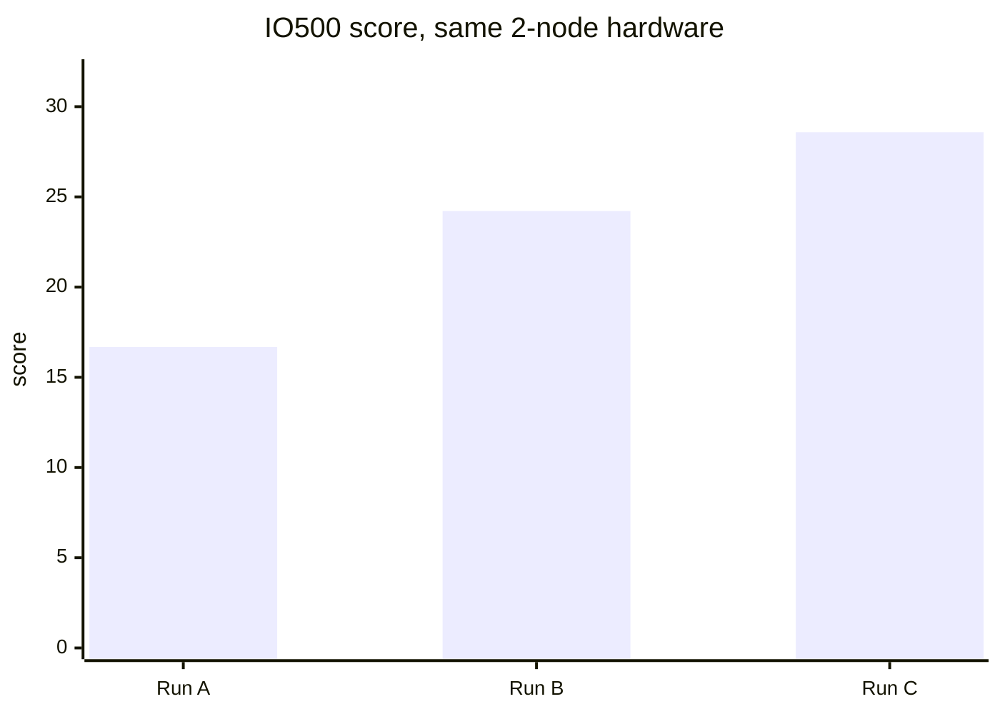

# IO500-Fortschrittsbericht: drei gültige Läufe auf AWS (2 × i3en.12xlarge, EFA)

| | |
|---|---|
| Berichtsdatum | 2026-10-26 |
| Gegenstand | rocepool (verteiltes Dateisystem auf Basis eines RDMA-Speicherpools) |
| Plattform | Amazon EC2 us-east-2, 2 × i3en.12xlarge (pro Knoten 48 vCPU, 384 GiB RAM, 4 × 7,5 TB NVMe, 50 Gb/s EFA) |
| Benchmark | Offizielle IO500-Anwendung, Standardmodus, Stonewall 300 Sekunden, 64 Ranks (32 pro Knoten) |
| Vergleich | Vendor W (kommerzielles paralleles Dateisystem): 10-Knoten-Konfiguration der ISC25-IO500-Produktionsliste für 10 Knoten (10 Clients + 18 Datenserver) |
| Vorheriger Bericht | [IO500_AWS_2NODE_REPORT.md](IO500_AWS_2NODE_REPORT.md) (nur Lauf A) |
| Original | [IO500_AWS_PROGRESS_REPORT.md](IO500_AWS_PROGRESS_REPORT.md) (englische Fassung; dieses Dokument ist ihre Übersetzung) · weitere Sprachen: [日本語](IO500_AWS_進捗レポート.md) · [Español](IO500_AWS_Informe_de_progreso.md) · [繁體中文](IO500_AWS_進度報告.md) |

## 1. Zusammenfassung

Alle drei Läufe nutzten dieselbe Hardware: zwei Knoten desselben Instanztyps. Geändert wurde nur die Software.

| | Lauf A | Lauf B | Lauf C | C gegenüber A |
|---|---|---|---|---|
| Lauf in GitHub Actions | 40153359125 | 40184980653 | 40195061844 | |
| Zeitpunkt (UTC) | 2026-10-25 02:09 | 2026-10-25 10:29 | 2026-10-25 12:52 | |
| Ergebnis | gültig | gültig | gültig | |
| **IO500-Ergebnis** | **16,68** | **24,22** | **28,58** | **+71 %** |
| Bandbreite (GiB/s) | 3,38 | 3,56 | 4,06 | +20 % |
| Metadaten (kIOPS) | 82,30 | 164,72 | 201,01 | +144 % |
| Dauer von IO500 (s) | 5406 | 3181 | 2991 | −45 % |

Vergleich mit Vendor W (pro Client-Knoten):
- **Metadaten:** rocepool erreicht **100,5 kIOPS pro Knoten, Vendor W 33,7 – etwa das 3,0-Fache.** Zum Zeitpunkt von Lauf A war es das 1,2-Fache.
- **Bandbreite:** Vendor W erreicht 3,33 GiB/s pro Knoten, rocepool 2,03; Vendor W liegt um das 1,6-Fache vorn. Zum Zeitpunkt von Lauf A betrug der Abstand das 2,0-Fache.
- **Geteilt durch alle Maschinen:** Die Konfiguration von Vendor W umfasst 28 Maschinen (10 Clients + 18 Datenserver). Über alle geteilt ergibt das 1,19 GiB/s und 12,0 kIOPS pro Maschine; rocepool liegt mit 2,03 GiB/s und 100,5 kIOPS pro Maschine bei beidem darüber.

## 2. Änderungen zwischen den Läufen

Alle Änderungen betreffen nur die Software. Jede wurde vor dem Lauf mit Tests für ihren Änderungsbereich geprüft.

**A → B**
- **find:** Für jede Seite einer Verzeichnisauflistung wurde das ganze Verzeichnis erneut sortiert. Jetzt erzeugt der Metadatenserver pro Auflistung nur einen sortierten Snapshot (PR #16).
- **ior-hard-write (Schreiben in den Speicher):** Für jedes ungeordnet eintreffende 47-KB-Fragment wurde das Stripe-Objekt von diesem Offset bis zum Ende neu geschrieben – etwa das Zehnfache der Nutzdaten. Jetzt wird nur der geänderte Bereich geschrieben, der Speicherplatz wird vorab in einem Zug reserviert, und schmutzige Daten werden nur einmal zurückgeschrieben (PR #18).
- **ior-hard-write (Flush im Client):** Alle Fragmente eines Flushs werden parallel gesendet, und die Größenaktualisierung an den Metadatenserver wird zu einer zusammengefasst (PR #18).
- **Weniger Metadatenanfragen:** Vor dem Löschen wird die Datei nicht mehr nachgeschlagen. Beim schreibgeschützten Öffnen kleiner Dateien wird der Inhalt in derselben Anfrage mitgeholt (PR #19).
- **Kleine Antworten asynchron:** Der Server wartet nicht mehr auf das Ende des Sendens kleiner Antworten, bevor er die nächste Anfrage bearbeitet (PR #19).
- **Leerlaufwarten auf EFA:** EFA hat kein Warteobjekt für die CQ, daher schliefen untätige Threads in Schritten von etwa 100 µs. Jetzt geben sie die CPU ab, ohne zu schlafen (PR #20).

**B → C**
- **Leerlaufwarten überarbeitet:** In Lauf B gingen alle wartenden Threads in eine yield-Schleife. Jetzt gibt nur noch ein Server-Thread mit kurzer Wartezeit per yield ab (PR #21).
- **Verdrängung aus der Anfragebearbeitung herausgenommen:** Verdrängung und Zurückschreiben des RAM-Caches der OSTs laufen in einem Hintergrund-Thread statt im Anfrage-Handler (PR #21).

## 3. Ergebnisse nach Phase

| Phase | Lauf A | Lauf B | Lauf C | B vs. A | C vs. B | C vs. A |
|---|---|---|---|---|---|---|
| ior-easy-write (GiB/s) | 5,63 | 4,94 | 4,86 | −12 % | −1 % | **−14 %** |
| ior-hard-write (GiB/s) | 0,68 | 1,43 | 2,02 | +109 % | +42 % | **+195 %** |
| ior-easy-read (GiB/s) | 7,71 | 6,73 | 7,04 | −13 % | +5 % | **−9 %** |
| ior-hard-read (GiB/s) | 4,40 | 3,39 | 3,95 | −23 % | +16 % | **−10 %** |
| mdtest-easy-write (kIOPS) | 100,30 | 98,49 | 123,23 | −2 % | +25 % | **+23 %** |
| mdtest-hard-write (kIOPS) | 59,74 | 60,73 | 77,15 | +2 % | +27 % | **+29 %** |
| find (kIOPS) | 56,96 | 609,28 | 637,12 | +970 % | +5 % | **+1019 %** |
| mdtest-easy-stat (kIOPS) | 174,08 | 196,25 | 247,63 | +13 % | +26 % | **+42 %** |
| mdtest-hard-stat (kIOPS) | 180,26 | 196,38 | 244,75 | +9 % | +25 % | **+36 %** |
| mdtest-easy-delete (kIOPS) | 69,68 | 200,78 | 245,78 | +188 % | +22 % | **+253 %** |
| mdtest-hard-read (kIOPS) | 64,55 | 97,05 | 120,68 | +50 % | +24 % | **+87 %** |
| mdtest-hard-delete (kIOPS) | 43,67 | 198,06 | 244,74 | +353 % | +24 % | **+460 %** |

### 3.1 CPU-Auslastung des Hosts (Knoten 0, Anteil „busy“ an allen 48 vCPU)

| Phase | Lauf A | Lauf B | Lauf C |
|---|---|---|---|
| ior-easy-write | 12 % | 32 % | 19 % |
| ior-hard-write | 16 % | **83 %** | 31 % |
| ior-easy-read | 36 % | 60 % | 47 % |
| mdtest-easy-stat | 38 % | 76 % | 39 % |
| ior-hard-read | 34 % | **82 %** | 33 % |

Der Rückgang der IOR-Phasen in Lauf B kam von den wartenden Threads; der Großteil war Systemzeit in `sched_yield`. In Lauf C ist yield auf Server-Threads mit kurzer Wartezeit beschränkt, und die CPU-Auslastung liegt wieder nahe an Lauf A. Auch die Metadatenphasen stiegen von B nach C um 20–27 %.

### 3.2 Datenmengen

IO500 legt die Datenmenge jeder Schreibphase nach der gemessenen Geschwindigkeit fest. Je schneller ior-hard-write wird, desto mehr Daten werden also geschrieben.

| | Lauf A | Lauf B | Lauf C |
|---|---|---|---|
| Geschriebene ior-hard-Daten | 236 GiB | 511 GiB | 752 GiB |
| Aus NVMe zurückgelesene ior-hard-Daten (pro OST) | ca. 108 GB | ca. 217 GB | ca. 310 GB |
| Rückschreibvorgänge während ior-hard-write (pro OST) | nicht gemessen | 145 000 (im Anfrage-Handler) | 245 000 (im Hintergrund) |

## 4. Abstand zu Vendor W (pro Client-Knoten, Stand Lauf C)

Vendor W hat 10 Client-Knoten. rocepool hat 2 Knoten, jeder ist zugleich Client und Server. „Abstand“ ist Vendor W ÷ rocepool; unter 1,0 liegt rocepool vorn.

| Phase | rocepool (pro Knoten) | Vendor W (pro Client) | Abstand bei Lauf A | **Abstand bei Lauf C** |
|---|---|---|---|---|
| ior-easy-write (GiB/s) | 2,43 | 7,58 | 2,69 | **3,12** |
| ior-hard-write (GiB/s) | 1,01 | 1,51 | 4,43 | **1,49** |
| ior-easy-read (GiB/s) | 3,52 | 13,40 | 3,48 | **3,81** |
| ior-hard-read (GiB/s) | 1,97 | 0,80 | 0,36 | **0,41** |
| mdtest-easy-write (kIOPS) | 61,61 | 42,48 | 0,85 | **0,69** |
| mdtest-hard-write (kIOPS) | 38,57 | 1,69 | 0,06 | **0,04** |
| find (kIOPS) | 318,56 | 113,25 | 3,98 | **0,36** |
| mdtest-easy-stat (kIOPS) | 123,81 | 191,11 | 2,20 | **1,54** |
| mdtest-hard-stat (kIOPS) | 122,37 | 146,58 | 1,63 | **1,20** |
| mdtest-easy-delete (kIOPS) | 122,89 | 48,01 | 1,38 | **0,39** |
| mdtest-hard-read (kIOPS) | 60,34 | 82,32 | 2,55 | **1,36** |
| mdtest-hard-delete (kIOPS) | 122,37 | 1,86 | 0,09 | **0,02** |
| **Bandbreitenergebnis (GiB/s)** | 2,03 | 3,33 | 1,97 | **1,64** |
| **Metadatenergebnis (kIOPS)** | 100,5 | 33,7 | 0,82 | **0,34** |

Von Lauf A bis Lauf C geschlossene Abstände:
- find: von 4,0-fachem Rückstand zu 2,8-fachem Vorsprung.
- mdtest-easy-delete: von 1,4-fachem Rückstand zu 2,6-fachem Vorsprung.
- ior-hard-write: Rückstand von 4,4-fach auf 1,5-fach verringert.
- mdtest-hard-read: Rückstand von 2,6-fach auf 1,4-fach verringert.
- mdtest-easy-stat: Rückstand von 2,2-fach auf 1,5-fach verringert.

## 5. Verbleibende Abstände

| Abstand | Größe (Lauf C) | Mögliche Ursache | Nächster Schritt |
|---|---|---|---|
| ior-easy-read | 3,8-fach | Jeder Knoten liest über eine 50-Gb/s-Verbindung (ca. 5,8 GiB/s) mit 3,5 GiB/s aus der NVMe-Schicht. Vendor W nutzt InfiniBand und 18 eigene Datenserver. | Hauptsächlich ein Hardwareunterschied. Auf dieser Instanz bleibt nur, die Leseparallelität der Speicherschicht zu erhöhen (ein OST bearbeitet pro Endpunkt eine Anfrage zur Zeit, bei 12 Endpunkten). |
| ior-easy-write | 3,1-fach | Schreibgeschwindigkeit der NVMe auf i3en (Vorabmessung: ca. 2,5 GB/s pro Knoten). | Eine Instanz mit größerer NVMe- und Netzwerkleistung (z. B. i4i.32xlarge, 8 Laufwerke, 75 Gb/s). |
| mdtest-easy-stat / hard-stat | 1,54-fach / 1,20-fach | Jedes stat ist eine Anfrage. Der Metadatenserver bearbeitet pro Endpunkt eine Anfrage zur Zeit; die meiste Zeit pro Anfrage entfällt auf Senden/Empfangen über EFA, nicht auf die Metadatenarbeit selbst (3–4 µs). | Last gleichmäßig über die Endpunkte verteilen und mehrere Metadatenoperationen in einer Anfrage bündeln. |
| ior-hard-write | 1,49-fach | Nicht ausgerichtete 47-KB-Schreibvorgänge in eine gemeinsame Datei. | Weniger, größere Schreibvorgänge in die Speicherschicht und tiefere Pipelines pro Client. |
| mdtest-hard-read | 1,36-fach | open und read zusammen in einer Anfrage; gleicher Bearbeitungspfad wie stat. | Wie bei stat. |

### Noch nicht geklärte Punkte

ior-easy-write (−14 %), ior-easy-read (−9 %) und ior-hard-read (−10 %) liegen noch unter Lauf A.
- **ior-hard-read:** Der Rückgang kommt größtenteils von der Datenmenge. In Lauf C wurden etwa dreimal so viele ior-hard-Daten aus NVMe zurückgelesen wie in Lauf A (Abschnitt 3.2).
- **ior-easy-write und ior-easy-read:** Die Datenmenge pro OST entspricht Lauf A, und die CPU-Auslastung des Hosts ist nicht mehr hoch. Die NVMe-Schreibwerte der Vorabmessung von Lauf C lagen bei 2652 / 2544 MiB/s, gleich oder über denen von Lauf A (2264 / 2509 MiB/s). Diese 0,4-Sekunden-Vorabmessung stützt die Erklärung „die Laufwerke waren langsam“ nicht; die Ursache ist ungeklärt. Als Nächstes wird vor dem Lauf 30 Sekunden lang anhaltend NVMe-Lesen/Schreiben gemessen und der Anfragepfad der OSTs zwischen Lauf A und C verglichen.

## 6. Voraussetzungen und Grenzen des Vergleichs

- **Keine Listeneintragung:** Alle drei Läufe nutzten die offizielle IO500-Anwendung und bestanden ihre Gültigkeitsprüfungen, wurden aber weder beim IO500-Komitee eingereicht noch von ihm geprüft.
- **Größenordnung:** Verglichen werden 2 Knoten mit 10 Client-Knoten. Es wird angenommen, dass die Werte pro Knoten ungefähr linear skalieren; mit mehr AWS-Knoten wurde das noch nicht gemessen.
- **Hardware:** Auf jedem rocepool-Knoten laufen Client und Server auf demselben Host. Die Werte von Vendor W sind die veröffentlichten Werte des Listeneintrags (submission 704), einschließlich der Werte pro Phase.
- **Kosten:** Ein gültiger Lauf kostet für beide Knoten zusammen etwa 20–28 $ zu AWS-On-Demand-Preisen (10,85 $ pro Stunde). Die Systemkosten von Vendor W sind nicht veröffentlicht, Preise werden daher nicht verglichen.
- **Rohdaten:** Die Berichte jedes Laufs liegen im Branch `aws-results/gh-<run id>`.
