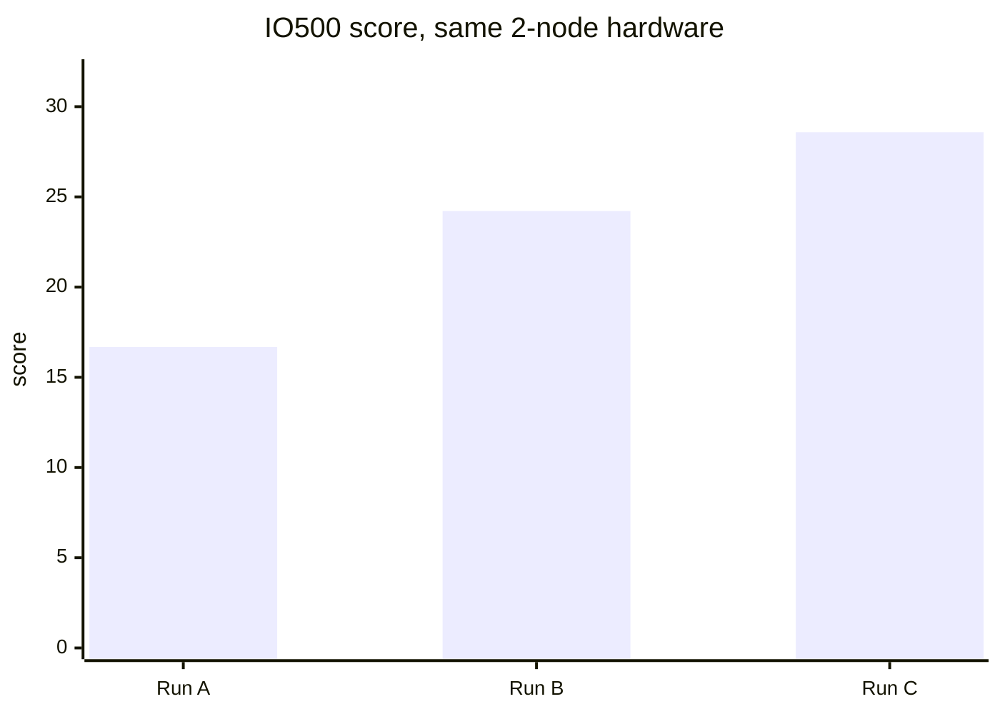

# Informe de progreso IO500: tres ejecuciones válidas en AWS (2 × i3en.12xlarge, EFA)

| | |
|---|---|
| Fecha del informe | 2026-10-26 |
| Objeto | rocepool (sistema de archivos distribuido basado en un pool de memoria RDMA) |
| Plataforma | Amazon EC2 us-east-2, 2 × i3en.12xlarge (por nodo: 48 vCPU, 384 GiB de RAM, 4 × 7,5 TB NVMe, EFA de 50 Gb/s) |
| Benchmark | Aplicación oficial de IO500, modo estándar, stonewall de 300 segundos, 64 ranks (32 por nodo) |
| Comparación | Vendor W (sistema de archivos paralelo comercial): configuración de 10 nodos de la lista de producción IO500 ISC25 para 10 nodos (10 clientes + 18 servidores de datos) |
| Informe anterior | [IO500_AWS_2NODE_REPORT.md](IO500_AWS_2NODE_REPORT.md) (solo la ejecución A) |
| Original | [IO500_AWS_PROGRESS_REPORT.md](IO500_AWS_PROGRESS_REPORT.md) (versión en inglés; este documento es su traducción) · otros idiomas: [日本語](IO500_AWS_進捗レポート.md) · [Deutsch](IO500_AWS_Fortschrittsbericht.md) · [繁體中文](IO500_AWS_進度報告.md) |

## 1. Resumen

Las tres ejecuciones usaron el mismo hardware: dos nodos del mismo tipo de instancia. Solo cambió el software.

| | Ejecución A | Ejecución B | Ejecución C | C frente a A |
|---|---|---|---|---|
| Ejecución en GitHub Actions | 40153359125 | 40184980653 | 40195061844 | |
| Fecha y hora (UTC) | 2026-10-25 02:09 | 2026-10-25 10:29 | 2026-10-25 12:52 | |
| Resultado | válida | válida | válida | |
| **Puntuación IO500** | **16,68** | **24,22** | **28,58** | **+71 %** |
| Ancho de banda (GiB/s) | 3,38 | 3,56 | 4,06 | +20 % |
| Metadatos (kIOPS) | 82,30 | 164,72 | 201,01 | +144 % |
| Duración de IO500 (s) | 5406 | 3181 | 2991 | −45 % |

Comparación con Vendor W (por nodo cliente):
- **Metadatos:** rocepool logra **100,5 kIOPS por nodo y Vendor W 33,7: unas 3,0 veces más.** En la ejecución A era 1,2 veces.
- **Ancho de banda:** Vendor W logra 3,33 GiB/s por nodo y rocepool 2,03; Vendor W va 1,6 veces por delante. En la ejecución A la diferencia era de 2,0 veces.
- **Dividido entre todas las máquinas:** la configuración de Vendor W tiene 28 máquinas (10 clientes + 18 servidores de datos). Dividido entre todas da 1,19 GiB/s y 12,0 kIOPS por máquina; rocepool, con 2,03 GiB/s y 100,5 kIOPS por máquina, supera ambas cifras.

## 2. Cambios entre ejecuciones

Todos los cambios son solo de software. Cada uno se verificó antes de la ejecución con pruebas centradas en su ámbito.

**A → B**
- **find:** en cada página de un listado se volvía a ordenar el directorio entero. Ahora el servidor de metadatos crea una sola instantánea ordenada por listado (PR #16).
- **ior-hard-write (escritura en el almacenamiento):** por cada fragmento de 47 KB que llegaba desordenado, se reescribía el objeto de franja desde ese desplazamiento hasta el final, unas diez veces los datos útiles. Ahora solo se escribe el rango modificado, el espacio se reserva de una vez al principio y los datos sucios se escriben de vuelta una sola vez (PR #18).
- **ior-hard-write (vaciado en el cliente):** todos los fragmentos de un vaciado se envían en paralelo, y la actualización de tamaño al servidor de metadatos se agrupa en una sola (PR #18).
- **Menos peticiones de metadatos:** ya no se busca el archivo antes de borrarlo. Al abrir archivos pequeños en solo lectura, el contenido se obtiene en la misma petición (PR #19).
- **Respuestas pequeñas asíncronas:** el servidor ya no espera a que termine el envío de una respuesta pequeña para atender la siguiente petición (PR #19).
- **Espera inactiva en EFA:** EFA no tiene objeto de espera para la CQ, así que los hilos inactivos dormían en pasos de unos 100 µs. Ahora ceden la CPU sin dormir (PR #20).

**B → C**
- **Espera inactiva revisada:** en la ejecución B todos los hilos en espera entraban en un bucle de yield. Ahora solo cede con yield un hilo de servidor cuya espera es corta (PR #21).
- **Expulsión fuera del tratamiento de peticiones:** la expulsión y la escritura de vuelta de la caché en RAM de los OST se hacen en un hilo de fondo en lugar de dentro del manejador de peticiones (PR #21).

## 3. Resultados por fase

| Fase | Ejecución A | Ejecución B | Ejecución C | B vs. A | C vs. B | C vs. A |
|---|---|---|---|---|---|---|
| ior-easy-write (GiB/s) | 5,63 | 4,94 | 4,86 | −12 % | −1 % | **−14 %** |
| ior-hard-write (GiB/s) | 0,68 | 1,43 | 2,02 | +109 % | +42 % | **+195 %** |
| ior-easy-read (GiB/s) | 7,71 | 6,73 | 7,04 | −13 % | +5 % | **−9 %** |
| ior-hard-read (GiB/s) | 4,40 | 3,39 | 3,95 | −23 % | +16 % | **−10 %** |
| mdtest-easy-write (kIOPS) | 100,30 | 98,49 | 123,23 | −2 % | +25 % | **+23 %** |
| mdtest-hard-write (kIOPS) | 59,74 | 60,73 | 77,15 | +2 % | +27 % | **+29 %** |
| find (kIOPS) | 56,96 | 609,28 | 637,12 | +970 % | +5 % | **+1019 %** |
| mdtest-easy-stat (kIOPS) | 174,08 | 196,25 | 247,63 | +13 % | +26 % | **+42 %** |
| mdtest-hard-stat (kIOPS) | 180,26 | 196,38 | 244,75 | +9 % | +25 % | **+36 %** |
| mdtest-easy-delete (kIOPS) | 69,68 | 200,78 | 245,78 | +188 % | +22 % | **+253 %** |
| mdtest-hard-read (kIOPS) | 64,55 | 97,05 | 120,68 | +50 % | +24 % | **+87 %** |
| mdtest-hard-delete (kIOPS) | 43,67 | 198,06 | 244,74 | +353 % | +24 % | **+460 %** |

### 3.1 Uso de CPU del host (nodo 0, porcentaje ocupado sobre las 48 vCPU)

| Fase | Ejecución A | Ejecución B | Ejecución C |
|---|---|---|---|
| ior-easy-write | 12 % | 32 % | 19 % |
| ior-hard-write | 16 % | **83 %** | 31 % |
| ior-easy-read | 36 % | 60 % | 47 % |
| mdtest-easy-stat | 38 % | 76 % | 39 % |
| ior-hard-read | 34 % | **82 %** | 33 % |

La caída de las fases IOR en la ejecución B se debió a los hilos en espera; la mayor parte fue tiempo de sistema en `sched_yield`. En la ejecución C el yield se limita a hilos de servidor con espera corta, y el uso de CPU volvió a un nivel cercano al de la ejecución A. Las fases de metadatos también mejoraron entre un 20 % y un 27 % de B a C.

### 3.2 Volumen de datos

IO500 fija el volumen de datos de cada fase de escritura según la velocidad medida. Por eso, cuanto más rápido es ior-hard-write, más datos escribe.

| | Ejecución A | Ejecución B | Ejecución C |
|---|---|---|---|
| Datos escritos por ior-hard | 236 GiB | 511 GiB | 752 GiB |
| Datos de ior-hard releídos desde NVMe (por OST) | aprox. 108 GB | aprox. 217 GB | aprox. 310 GB |
| Escrituras de vuelta durante ior-hard-write (por OST) | no medido | 145 000 (en el manejador) | 245 000 (en segundo plano) |

## 4. Distancia con Vendor W (por nodo cliente, a la ejecución C)

Vendor W tiene 10 nodos cliente. rocepool tiene 2 nodos, cada uno cliente y servidor a la vez. «Distancia» es Vendor W ÷ rocepool; por debajo de 1,0, rocepool va por delante.

| Fase | rocepool (por nodo) | Vendor W (por cliente) | Distancia en A | **Distancia en C** |
|---|---|---|---|---|
| ior-easy-write (GiB/s) | 2,43 | 7,58 | 2,69 | **3,12** |
| ior-hard-write (GiB/s) | 1,01 | 1,51 | 4,43 | **1,49** |
| ior-easy-read (GiB/s) | 3,52 | 13,40 | 3,48 | **3,81** |
| ior-hard-read (GiB/s) | 1,97 | 0,80 | 0,36 | **0,41** |
| mdtest-easy-write (kIOPS) | 61,61 | 42,48 | 0,85 | **0,69** |
| mdtest-hard-write (kIOPS) | 38,57 | 1,69 | 0,06 | **0,04** |
| find (kIOPS) | 318,56 | 113,25 | 3,98 | **0,36** |
| mdtest-easy-stat (kIOPS) | 123,81 | 191,11 | 2,20 | **1,54** |
| mdtest-hard-stat (kIOPS) | 122,37 | 146,58 | 1,63 | **1,20** |
| mdtest-easy-delete (kIOPS) | 122,89 | 48,01 | 1,38 | **0,39** |
| mdtest-hard-read (kIOPS) | 60,34 | 82,32 | 2,55 | **1,36** |
| mdtest-hard-delete (kIOPS) | 122,37 | 1,86 | 0,09 | **0,02** |
| **Puntuación de ancho de banda (GiB/s)** | 2,03 | 3,33 | 1,97 | **1,64** |
| **Puntuación de metadatos (kIOPS)** | 100,5 | 33,7 | 0,82 | **0,34** |

Distancias reducidas de la ejecución A a la C:
- find: de ir 4,0 veces por detrás a ir 2,8 veces por delante.
- mdtest-easy-delete: de ir 1,4 veces por detrás a ir 2,6 veces por delante.
- ior-hard-write: el retraso bajó de 4,4 a 1,5 veces.
- mdtest-hard-read: el retraso bajó de 2,6 a 1,4 veces.
- mdtest-easy-stat: el retraso bajó de 2,2 a 1,5 veces.

## 5. Distancias pendientes

| Distancia | Tamaño (ejecución C) | Causa probable | Próximo paso |
|---|---|---|---|
| ior-easy-read | ×3,8 | Cada nodo lee a 3,5 GiB/s desde la capa NVMe a través de un enlace de 50 Gb/s (unos 5,8 GiB/s). Vendor W usa InfiniBand y 18 servidores de datos dedicados. | Sobre todo una diferencia de hardware. En esta instancia solo queda aumentar el paralelismo de lectura de la capa de almacenamiento (un OST atiende una petición a la vez por endpoint, con 12 endpoints). |
| ior-easy-write | ×3,1 | Velocidad de escritura NVMe de i3en (medición previa: unos 2,5 GB/s por nodo). | Una instancia con más NVMe y red (p. ej., i4i.32xlarge, 8 unidades, 75 Gb/s). |
| mdtest-easy-stat / hard-stat | ×1,54 / ×1,20 | Cada stat es una petición. El servidor de metadatos atiende una petición a la vez por endpoint, y la mayor parte del tiempo de cada petición se va en el envío/recepción por EFA, no en el trabajo de metadatos en sí (3–4 µs). | Repartir la carga por igual entre endpoints y agrupar varias operaciones de metadatos en una petición. |
| ior-hard-write | ×1,49 | Escrituras no alineadas de 47 KB en un archivo compartido. | Escrituras menos numerosas y más grandes en la capa de almacenamiento, y pipelines más profundos por cliente. |
| mdtest-hard-read | ×1,36 | open y read juntos en una petición; mismo camino de tratamiento que stat. | Igual que stat. |

### Puntos aún sin explicar

ior-easy-write (−14 %), ior-easy-read (−9 %) e ior-hard-read (−10 %) siguen por debajo de la ejecución A.
- **ior-hard-read:** la mayor parte de la caída se debe al volumen de datos. En la ejecución C se releyeron desde NVMe unas tres veces más datos de ior-hard que en la ejecución A (sección 3.2).
- **ior-easy-write e ior-easy-read:** el volumen por OST es el mismo que en la ejecución A, y el uso de CPU del host ya no es alto. La escritura NVMe de la medición previa de la ejecución C fue de 2652 / 2544 MiB/s, igual o superior a la de la ejecución A (2264 / 2509 MiB/s). Esta medición previa de 0,4 segundos no respalda la explicación de que «los discos iban lentos», así que la causa sigue sin aclarar. Lo siguiente es medir lectura/escritura NVMe sostenida durante 30 segundos antes de la ejecución y comparar el camino de peticiones de los OST entre las ejecuciones A y C.

## 6. Supuestos y límites de la comparación

- **No es una entrada de la lista:** las tres ejecuciones usaron la aplicación oficial de IO500 y pasaron sus comprobaciones de validez, pero no se enviaron al comité de IO500 ni fueron revisadas por él.
- **Escala:** se comparan 2 nodos con 10 nodos cliente. Se supone que las cifras por nodo escalan de forma aproximadamente lineal; todavía no se ha medido con más nodos en AWS.
- **Hardware:** en cada nodo de rocepool, el cliente y el servidor se ejecutan en el mismo host. Los valores de Vendor W son los publicados en su entrada de la lista (submission 704), incluidas las cifras por fase.
- **Coste:** una ejecución válida cuesta unos 20–28 $ para los dos nodos a precios bajo demanda de AWS (10,85 $ por hora). Los costes del sistema de Vendor W no son públicos, así que no se comparan precios.
- **Datos en bruto:** los informes de cada ejecución están en la rama `aws-results/gh-<run id>`.
