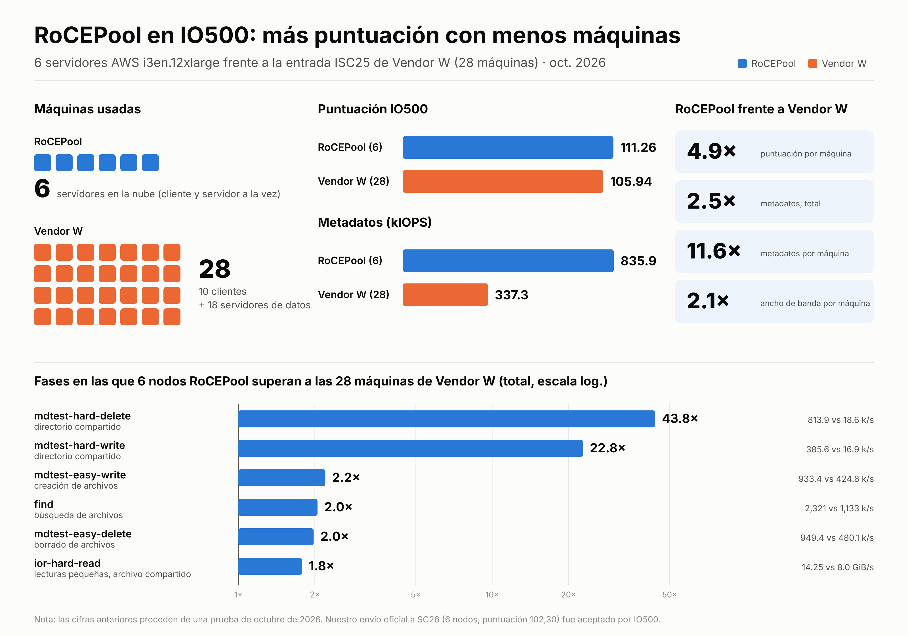
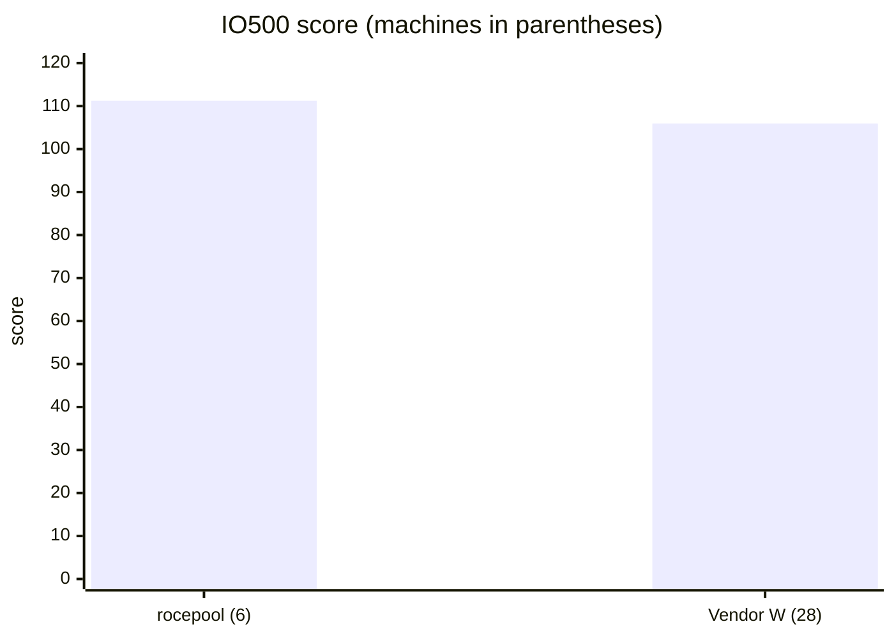

# Resultado IO500: 6 nodos en la nube superan a un sistema comercial de 28 máquinas (no oficial)

| | |
|---|---|
| Fecha del informe | 2026-10-30 |
| Objeto | rocepool (sistema de archivos distribuido basado en un pool de memoria RDMA) |
| Plataforma | Amazon EC2 us-east-2, 6 × i3en.12xlarge (por nodo: 48 vCPU, 384 GiB de RAM, 4 × 7,5 TB NVMe, EFA de 50 Gb/s) |
| Benchmark | Aplicación oficial de IO500, modo estándar: stonewall de 300 segundos, 192 ranks (32 por nodo) |
| Carácter | **No oficial.** Una fase terminó antes del stonewall, así que IO500 marcó el resultado como INVALID (sección 4). No se ha enviado a la lista IO500. |
| Comparación | Vendor W (sistema de archivos paralelo comercial): entrada de la lista de producción IO500 ISC25 para 10 nodos. Usa 10 nodos cliente y 18 servidores de datos, 28 máquinas en total. Puntuación 105,94. |
| Registro de la ejecución | Ejecución de GitHub Actions 40999521729. Datos en bruto en la rama `aws-results/gh-40999521729`. Todos los pasos de la ejecución: [IO500_AWS_Informe_de_prueba_completa_de_6_nodos.md](IO500_AWS_Informe_de_prueba_completa_de_6_nodos.md) |
| Informes relacionados | [Escalado a 4 nodos](IO500_AWS_Informe_de_validación_de_4_nodos.md) · [Progreso con 2 nodos](IO500_AWS_Informe_de_progreso.md) · versión en inglés de este informe: [IO500_AWS_6NODE_REPORT.md](IO500_AWS_6NODE_REPORT.md) · otros idiomas: [日本語](IO500_AWS_6ノード結果レポート.md) · [Deutsch](IO500_AWS_6-Knoten-Ergebnisbericht.md) · [繁體中文](IO500_AWS_6節點結果報告.md) |

## 1. Resumen

rocepool ejecutó el IO500 estándar de 300 segundos en seis instancias genéricas de la nube y obtuvo **111,26**. La entrada de producción de 10 nodos de Vendor W, con 28 máquinas, obtiene 105,94.

| | rocepool | Vendor W | rocepool frente a Vendor W |
|---|---|---|---|
| Máquinas | **6** (cada nodo es cliente y servidor) | **28** (10 clientes + 18 servidores de datos) | **21 % de las máquinas** |
| **Puntuación IO500** | **111,26** | 105,94 | **+5 %** |
| Metadatos (kIOPS) | **835,9** | 337,29 | **×2,5** |
| Ancho de banda (GiB/s) | 14,81 | 33,28 | ×0,44 |
| **Puntuación por máquina** | **18,5** | 3,8 | **×4,9** |
| Metadatos por máquina (kIOPS) | 139,3 | 12,0 | ×11,6 |
| Ancho de banda por máquina (GiB/s) | 2,47 | 1,19 | ×2,1 |
| Coste del hardware | Bajo demanda, 33,6 $/hora (5,605 $/hora por nodo, disco incluido); esta ejecución, unos 67 $ | no publicado | — |

- **Menos máquinas, más puntuación.** Con una quinta parte de las máquinas, la puntuación total es un 5 % mayor.
- **El motor principal son los metadatos.** La puntuación de metadatos de rocepool es 2,5 veces el total de Vendor W, y 11,6 veces por máquina. Los metadatos están en memoria y se accede a ellos por RDMA; el espacio de nombres se reparte entre los servidores de metadatos de todos los nodos.
- **El ancho de banda es menor en total, pero mayor por máquina.** En esta instancia, el ancho de banda de E/S secuencial de cada nodo toca techo con cuatro unidades NVMe y el enlace de 50 Gb/s. Vendor W usa InfiniBand y 18 servidores de datos dedicados.

## 2. Resultados por fase

rocepool: ejecución con 6 nodos y stonewall de 300 s. Vendor W: cifras por fase de la entrada, las usadas en los informes anteriores. El factor es la razón entre totales; por encima de 1, rocepool va por delante.

| Fase | rocepool 6 nodos | Vendor W 28 máquinas | Factor (total) | Factor (por máquina) |
|---|---|---|---|---|
| ior-easy-write (GiB/s) | 16,36 | 75,8 | 0,22 | 1,0 |
| ior-hard-write (GiB/s) | 9,36 | 15,1 | 0,62 | 2,9 |
| ior-easy-read (GiB/s) | 22,03 | 134,0 | 0,16 | 0,8 |
| ior-hard-read (GiB/s) | **14,25** | 8,0 | **1,78** | 8,3 |
| mdtest-easy-write (kIOPS) | **933,4** ¹ | 424,8 | **2,20** | 10,3 |
| mdtest-hard-write (kIOPS) | **385,6** | 16,9 | **22,8** | 106 |
| find (kIOPS) | **2.321,4** | 1.132,5 | **2,05** | 9,6 |
| mdtest-easy-stat (kIOPS) | 938,7 | 1.911,1 | 0,49 | 2,3 |
| mdtest-hard-stat (kIOPS) | 934,1 | 1.465,8 | 0,64 | 3,0 |
| mdtest-easy-delete (kIOPS) | **949,4** | 480,1 | **1,98** | 9,2 |
| mdtest-hard-read (kIOPS) | 421,1 | 823,2 | 0,51 | 2,4 |
| mdtest-hard-delete (kIOPS) | **813,9** | 18,6 | **43,8** | 204 |
| **Puntuación de ancho de banda (GiB/s)** | 14,81 | 33,28 | 0,44 | 2,1 |
| **Puntuación de metadatos (kIOPS)** | **835,9** | 337,29 | **2,48** | 11,6 |
| **Puntuación IO500** | **111,26** | 105,94 | **1,05** | 4,9 |

¹ Esta fase terminó a los 207 segundos en lugar de 300 (sección 4).

- **En total, rocepool va por delante en seis fases:** ior-hard-read, mdtest-easy-write, mdtest-hard-write, find, mdtest-easy-delete y mdtest-hard-delete. La escritura y el borrado de mdtest-hard, que trabaja sobre un directorio compartido, alcanzan 23 y 44 veces respectivamente.
- **Por máquina,** rocepool iguala o supera a Vendor W en todas las fases salvo ior-easy-read (×0,8).

## 3. Evolución de la puntuación

Todas las ejecuciones usaron el mismo tipo de instancia. Entre ejecuciones solo cambió el software.

| Fecha | Nodos | Ejecución | Puntuación | Nota |
|---|---|---|---|---|
| 2026-10-25 | 2 | válida, 300 s | 16,68 | primera ejecución válida |
| 2026-10-25 | 2 | válida, 300 s | 28,58 | tras mejorar metadatos y camino de escritura |
| 2026-10-27 | 2 | rápida, 30 s | 40,88 | |
| 2026-10-27 | 4 | rápida, 30 s | 82,05 | tras la corrección de find (un directorio repartido entre todos los ranks) |
| **2026-10-30** | **6** | **300 s** | **111,26** | este informe |

- De 4 a 6 nodos: la ejecución de 60 segundos previa a la de 300 dio 124,79, 1,52 veces la puntuación rápida con 4 nodos (con 1,5 veces más nodos). Entre 4 y 6 nodos no apareció ningún cuello de botella nuevo.
- La puntuación de la ejecución de 300 segundos, 111,26, es el 89 % de la ejecución de 60 segundos de la misma tanda. El informe de 4 nodos estimaba una ejecución válida con 6 nodos en 101–109; el resultado quedó algo por encima.

## 4. Por qué IO500 marcó el resultado como INVALID

- IO500 exige que cada fase de escritura dure al menos 300 segundos. mdtest-easy-write terminó de crear los archivos indicados (1 millón por rank, 192 millones en total) a los 207 segundos y se detuvo. Las otras 11 fases cumplen las reglas.
- El valor de 1 millón de archivos por rank se fijó cuando un rank creaba unos 600 archivos por segundo. Tras las mejoras de metadatos de este mes, un rank crea unos 4 900 archivos por segundo, y 1 millón de archivos se agota en unos 205 segundos. Esto depende de la velocidad por rank, no del número de nodos.
- **Corrección (PR #35):** el número de archivos por rank se calcula ahora a partir de la velocidad medida en una ejecución corta previa, con un margen de 1,5 veces, para que la fase dure más de 300 segundos.
- **Efecto en la puntuación:** una fase más larga solo crea más archivos a casi la misma velocidad. Los 933 000 por segundo de mdtest-easy-write en esta ejecución son casi iguales a los 942 000 por segundo de la ejecución de 60 segundos, así que se espera una puntuación casi igual tras la corrección. Esa ejecución, sin embargo, todavía no se ha hecho.

## 5. Supuestos y límites de la comparación

- **No oficial:** IO500 marcó el resultado como INVALID (sección 4), y no se envió al comité de IO500 ni fue revisado por él.
- **Máquinas:** rocepool ejecuta clientes y servidores en las mismas 6 máquinas. Los valores de Vendor W son los publicados en su entrada de la lista (submission 704), con 10 nodos cliente y 18 servidores de datos.
- **Red y almacenamiento:** rocepool funcionó sobre AWS EFA (50 Gb/s por nodo) y NVMe de almacenamiento de instancia. La entrada de Vendor W usa InfiniBand y servidores de almacenamiento dedicados.
- **Coste:** el coste de rocepool sigue los precios bajo demanda de AWS. Los precios del sistema de Vendor W no son públicos, así que no se comparan precios.
- **Valores por fase:** las cifras por fase de Vendor W son los valores redondeados de la entrada pública, los usados en los informes anteriores.
