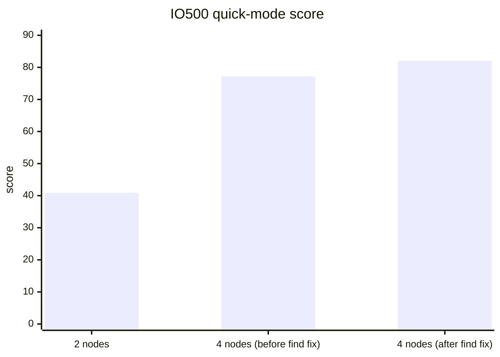

# Informe de escalado IO500: de 2 a 4 nodos en AWS (i3en.12xlarge, EFA)

| | |
|---|---|
| Fecha del informe | 2026-10-29 |
| Objeto | rocepool (sistema de archivos distribuido basado en un pool de memoria RDMA) |
| Plataforma | Amazon EC2 us-east-2, i3en.12xlarge (por nodo: 48 vCPU, 384 GiB de RAM, 4 × 7,5 TB NVMe, EFA de 50 Gb/s) |
| Benchmark | Aplicación oficial de IO500, modo rápido: stonewall de 30 segundos, 32 ranks por nodo |
| Comparación | Vendor W (sistema de archivos paralelo comercial): entrada de la lista de producción IO500 ISC25 para 10 nodos (10 nodos cliente + 18 servidores de datos), puntuación 105,94 |
| Informes relacionados | [IO500_AWS_Informe_de_progreso.md](IO500_AWS_Informe_de_progreso.md) (tres ejecuciones válidas con 2 nodos) · versión en inglés de este informe: [IO500_AWS_4NODE_REPORT.md](IO500_AWS_4NODE_REPORT.md) · otros idiomas: [日本語](IO500_AWS_4ノード検証レポート.md) · [Deutsch](IO500_AWS_4-Knoten-Validierungsbericht.md) · [繁體中文](IO500_AWS_4節點驗證報告.md) |

## 1. Resumen

- **Escalado de 2 a 4 nodos:** la puntuación IO500 se multiplicó por 1,89 (40,88 → 77,19). La eficiencia de escalado es del 94 %. Ancho de banda ×1,99, metadatos ×1,79.
- **Una fase no escaló.** Todas las fases salvo find crecieron entre 1,92 y 2,03 veces, pero find solo 1,04 veces.
  - Causa: un único rank MPI leía todo el directorio de mdtest-hard, a unas 300 000 entradas por segundo.
  - Tras repartir la lectura del directorio entre todos los ranks, find con 4 nodos pasó de 997 000 a 2,787 millones de entradas por segundo (×2,8). La puntuación con 4 nodos subió a **82,05**.
- **Comparación con Vendor W con 4 nodos:** la puntuación es el 77 % de la de Vendor W con 10 nodos (105,94).
  - Metadatos por nodo: 4,9 veces los de Vendor W por nodo cliente.
  - Ancho de banda por nodo: el 76 % del de Vendor W.
- **Cuántos nodos hacen falta para igualar a Vendor W** (estimado a partir de los resultados con 4 nodos):
  - Una ejecución válida con **6 nodos** se estima en 101–109, prácticamente igual a 105,94.
  - Con **7 nodos**, en 117–127, claramente por encima.
  - Son estimaciones; todavía no se ha hecho ninguna ejecución con más de 4 nodos.

## 2. Lista de ejecuciones

Las tres se ejecutaron en modo rápido. Los resultados del modo rápido no son resultados IO500 válidos (sección 7).

| | 2 nodos | 4 nodos (antes de la corrección de find) | 4 nodos (después de la corrección de find) |
|---|---|---|---|
| Ejecución en GitHub Actions | 40443313800 | 40497186409 | 40511776202 |
| Fecha y hora (UTC) | 2026-10-27 03:17 | 2026-10-27 11:34 | 2026-10-27 13:24 |
| Ranks MPI | 64 | 128 | 128 |
| **Puntuación IO500** | **40,88** | **77,19** | **82,05** |
| Ancho de banda (GiB/s) | 5,08 | 10,11 | 10,09 |
| Metadatos (kIOPS) | 329,2 | 589,4 | 667,3 |
| Tiempo de las instancias / coste | | 37 min / 13,7 $ | 37 min / 13,7 $ |

El coste se basa en el tiempo bajo demanda de AWS: 5,424 $ por instancia y hora, más unos 0,18 $ por hora del disco de sistema gp3.

## 3. Escalado de 2 a 4 nodos

Ambas ejecuciones usan el mismo software (antes de la corrección de find), así que el factor refleja solo el efecto de duplicar los nodos. Un factor de 2,00 equivale a escalado lineal.

| Fase | 2 nodos | 4 nodos | Factor |
|---|---|---|---|
| ior-easy-write (GiB/s) | 3,48 | 7,05 | 2,03 |
| ior-hard-write (GiB/s) | 3,24 | 6,43 | 1,98 |
| ior-easy-read (GiB/s) | 7,57 | 15,35 | 2,03 |
| ior-hard-read (GiB/s) | 7,80 | 15,02 | 1,93 |
| mdtest-easy-write (kIOPS) | 348,3 | 669,2 | 1,92 |
| mdtest-hard-write (kIOPS) | 155,9 | 302,9 | 1,94 |
| **find (kIOPS)** | **962,5** | **996,5** | **1,04** |
| mdtest-easy-stat (kIOPS) | 354,1 | 687,2 | 1,94 |
| mdtest-hard-stat (kIOPS) | 350,8 | 681,4 | 1,94 |
| mdtest-easy-delete (kIOPS) | 355,7 | 688,5 | 1,94 |
| mdtest-hard-read (kIOPS) | 171,3 | 330,3 | 1,93 |
| mdtest-hard-delete (kIOPS) | 349,0 | 677,1 | 1,94 |
| **Puntuación de ancho de banda** | 5,08 | 10,11 | **1,99** |
| **Puntuación de metadatos** | 329,2 | 589,4 | **1,79** |
| **Puntuación IO500** | 40,88 | 77,19 | **1,89** |

- **El ancho de banda** escaló casi linealmente, porque cada nodo aporta sus propias unidades NVMe y su propio enlace de 50 Gb/s.
- **Los metadatos sin find** crecieron 1,93 veces (media geométrica de las siete fases distintas de find). Cada nodo aporta un servidor de metadatos más, y el directorio de mdtest-hard se reparte en franjas entre todos ellos.
- **find** creció solo 1,04 veces. La puntuación de metadatos es la media geométrica de ocho fases; esta sola fase bajó el factor de metadatos de 1,93 a 1,79.

## 4. find: causa y corrección

### 4.1 Causa

La fase find de IO500 ejecuta pfind en todos los ranks. pfind reparte el trabajo por directorios: el rank que lee un directorio entrega los subdirectorios y los stat pendientes a los ranks libres. Pero mdtest-hard pone todos los archivos en **un único directorio**, y pfind, por defecto, hace que un solo rank lea un directorio de principio a fin.

Las mediciones muestran que la duración de la fase find era exactamente el tiempo que tardaba un rank en leer ese directorio entero.

| | 2 nodos | 4 nodos |
|---|---|---|
| Archivos en el directorio de mdtest-hard | 5,12 millones | 9,44 millones |
| Duración de la fase find | 17,5 s | 30,5 s |
| Entradas de mdtest-hard por segundo | 293 000 | 310 000 |
| CPU del rank por entrada recorrida | 63 µs | 122 µs |

- Al duplicar los nodos hubo más ranks y más archivos creados: el directorio se duplicó y el tiempo también. La velocidad se quedó en unas 300 000 entradas por segundo, la velocidad de lectura de un rank.
- La CPU del rank por entrada se duplicó porque los demás ranks giraban en vacío dentro del bucle de robo de trabajo de pfind, sin nada que robar.

En el cliente, otros dos costes frenaban a ese único lector. Ambos son iguales sea cual sea el número de nodos, así que no explican la falta de escalado.
- **Se obtenía la lista entera antes de la primera entrada.** La biblioteca de interceptación obtenía las 9,44 millones de entradas, ordenaba la lista combinada y metía cada entrada en la caché de atributos. La caché admite 100 000 entradas y se vaciaba unas 90 veces durante un solo listado.
- **Se recorrían 4 096 ranuras para encontrar el directorio abierto.** En cada llamada a readdir se recorrían 4 096 ranuras para encontrar su propio flujo.

### 4.2 Corrección (PR #31)

1. **Opción de IO500.** En `[find]` del archivo de configuración se indica ahora `pfind-parallelize-single-dir-access-using-hashing = TRUE`.
   - Es una opción de la aplicación oficial de IO500 y no afecta a la validez de los resultados.
   - Con ella (pfind `-H 1`), cuando un rank libre pide trabajo, el rank que lee el directorio le entrega la mitad final del rango de posiciones telldir que aún no ha leído.
   - La opción requiere `telldir`/`seekdir` que funcionen sobre el sistema de archivos. Hasta este cambio, la biblioteca de interceptación no los tenía.
2. **telldir/seekdir en la biblioteca de interceptación.**
   - Los directorios grandes, que no caben en una página por servidor de metadatos, se leen por páginas (256 KiB) desde cualquier posición. Las posiciones se reparten uniformemente en [0, LONG_MAX); al partir el rango de posiciones por la mitad, las entradas restantes también quedan exactamente a la mitad.
   - Los directorios pequeños se siguen leyendo de una vez.
   - La caché de atributos se llena página a página, y la búsqueda de directorios abiertos solo recorre las ranuras en uso.
3. **Servidor de metadatos: lectura desde una posición.**
   - Una nueva petición devuelve las entradas a partir de un índice dado, junto con el número de entradas del directorio.
   - Varios lectores de un directorio sin cambios comparten una instantánea ordenada. Un contador de versión, que sube con cada cambio en el directorio, indica si la instantánea ha quedado obsoleta.

Pruebas:
- Se ejecutó pfind real con la biblioteca de interceptación desde mpirun; con y sin `-H 1` se encuentran los mismos archivos.
- Las pruebas de posiciones comprobaron:
  - que las posiciones crecen de forma monótona,
  - que un seek vuelve a la misma entrada (también desde otro flujo),
  - que los rangos divididos en posiciones arbitrarias cubren todas las entradas exactamente una vez,
  - que los cambios en el directorio aparecen en el siguiente listado.

### 4.3 Resultado (4 nodos, mismo tipo de instancia)

| | antes | después | cambio |
|---|---|---|---|
| **find (kIOPS)** | 996,5 | **2.787,5** | **×2,8** |
| Duración de la fase find | 30,5 s | 10,9 s | −64 % |
| CPU del rank por entrada recorrida | 122 µs | 41 µs | −66 % |
| Puntuación de metadatos (kIOPS) | 589,4 | 667,3 | +13 % |
| **Puntuación IO500** | 77,19 | **82,05** | **+6,3 %** |

Las otras 11 fases variaron menos de un 2 % (dentro de la variación entre ejecuciones); la corrección no tiene efectos negativos.

## 5. 4 nodos frente a Vendor W (por nodo)

Los valores de Vendor W son la entrada válida de 10 nodos (stonewall de 300 segundos) dividida entre 10 nodos cliente. Los de rocepool son la ejecución rápida de 30 s tras la corrección de find, divididos entre 4 nodos. Cada nodo de rocepool es a la vez cliente y servidor. «Distancia» es Vendor W ÷ rocepool; por debajo de 1,0, rocepool va por delante.

| Fase | rocepool/nodo | Vendor W/nodo cliente | Distancia |
|---|---|---|---|
| ior-easy-write (GiB/s) | 1,78 | 7,58 | 4,27 |
| ior-hard-write (GiB/s) | 1,61 | 1,51 | 0,94 |
| ior-easy-read (GiB/s) | 3,81 | 13,40 | 3,52 |
| ior-hard-read (GiB/s) | 3,73 | 0,80 | 0,21 |
| mdtest-easy-write (kIOPS) | 167,4 | 42,48 | 0,25 |
| mdtest-hard-write (kIOPS) | 75,3 | 1,69 | 0,02 |
| find (kIOPS) | 696,9 | 113,25 | 0,16 |
| mdtest-easy-stat (kIOPS) | 171,8 | 191,11 | 1,11 |
| mdtest-hard-stat (kIOPS) | 169,1 | 146,58 | 0,87 |
| mdtest-easy-delete (kIOPS) | 171,3 | 48,01 | 0,28 |
| mdtest-hard-read (kIOPS) | 81,9 | 82,32 | 1,01 |
| mdtest-hard-delete (kIOPS) | 167,5 | 1,86 | 0,01 |
| **Puntuación de ancho de banda (GiB/s)** | 2,52 | 3,33 | **1,32** |
| **Puntuación de metadatos (kIOPS)** | 166,8 | 33,7 | **0,20** |

- **Metadatos:** por nodo, la puntuación de metadatos de rocepool es 4,9 veces la de Vendor W. Salvo en mdtest-easy-stat (Vendor W un 11 % por delante), rocepool está por delante o igualado en todas las fases de metadatos.
- **Ancho de banda:** en ior-easy-write (×4,3) e ior-easy-read (×3,5) va por delante Vendor W. Estas fases de E/S secuencial grande tocan techo en i3en con las unidades NVMe y el enlace de 50 Gb/s. Vendor W usa InfiniBand y 18 servidores de datos dedicados. En ior-hard-read va por delante rocepool, e ior-hard-write está prácticamente igualado.

## 6. Cuántos nodos alcanzan 105,94

### 6.1 Método de estimación

- **Punto de partida:** la puntuación rápida con 4 nodos tras la corrección de find, 82,05.
- **Crecimiento al duplicar los nodos:** dos supuestos.
  - Conservador: **×1,89**, el escalado de 2 a 4 nodos medido antes de la corrección.
  - Optimista: **×1,95**, el crecimiento de 2 a 4 nodos de las fases distintas de find. Como find ahora también se reparte entre los ranks, se espera que crezca igual.
- **De rápida a válida:** una ejecución válida tiene un stonewall de 300 segundos y escribe unas diez veces más datos. Por eso las lecturas llegan hasta lo más profundo de la capa NVMe y la puntuación baja. La última ejecución válida con 2 nodos obtuvo 28,58 y la ejecución rápida siguiente 33,02; la puntuación válida fue el 87 % de la rápida. Este informe supone un 85–90 %.

### 6.2 Estimación

| Nodos | vCPU necesarias | Puntuación rápida (estimada) | **Puntuación válida (estimada)** | Frente a 105,94 | Coste de una ejecución válida (estimado) |
|---|---|---|---|---|---|
| 4 (rápida medida) | 192 | **82,05** | aprox. 70–74 | por debajo | — |
| 5 | 240 | 101–102 | 86–92 | por debajo | 50–59 $ |
| **6** | 288 | 119–121 | **101–109** | **prácticamente igual** | **61–71 $** |
| **7** | 336 | 137–141 | **117–127** | **por encima** | **71–82 $** |
| 8 | 384 | 155–160 | 132–144 | muy por encima | 81–94 $ |
| 10 | 480 | 190–198 | 162–179 | muy por encima | 101–118 $ |

- **Estimación de coste:** 5,605 $ por instancia y hora, disco de sistema incluido. Las ejecuciones válidas B y C con 2 nodos mantuvieron las instancias 1 hora y 48 minutos cada una: unos 58 minutos de preparación, comprobación funcional y recogida de resultados, y 50 minutos de IO500. Para las ejecuciones válidas con 6–10 nodos se esperan 1,8–2,1 horas.
- **Para igualar a Vendor W hacen falta 5,2–5,3 nodos en modo rápido y unos 5,8–6,3 nodos en una ejecución válida.** 6 nodos son el punto de equilibrio y 7 nodos dan una ventaja clara.
- **Número de máquinas:** la entrada de Vendor W usa 10 clientes y 18 servidores de datos, 28 máquinas en total. rocepool con 6 nodos usa una quinta parte, y con 7 nodos, una cuarta parte.

### 6.3 Lo que esta estimación no sabe

- **Los cuellos de botella por encima de 4 nodos.** Si a partir de 4 nodos aparece competencia en la red o en los servidores de metadatos, solo lo dirán ejecuciones más grandes. De 2 a 4 nodos no hubo indicios.
- **El escalado de find.** find tras la corrección solo se ha medido con 4 nodos. Que siga creciendo más allá es una suposición, no una medición.
- **La relación entre rápida y válida.** Procede de ejecuciones con 2 nodos y puede ser distinta con 6–7 nodos.

## 7. Supuestos y límites de la comparación

- **El modo rápido no es un resultado IO500 válido.** 30 segundos de stonewall son menos que los 300 reglamentarios, así que los valores salen más altos que en una ejecución válida. La sección 5 compara valores rápidos con los valores válidos de Vendor W para mostrar dónde están las diferencias, no para clasificar los sistemas.
- **No es un envío a la lista.** Ninguna ejecución se envió al comité de IO500 ni fue revisada por él.
- **Hardware:** en cada nodo de rocepool, el cliente y el servidor comparten el mismo host. Los valores de Vendor W son los publicados en su entrada de la lista (submission 704).
- **Coste:** el coste de las instancias sigue los precios bajo demanda de AWS. Los precios del sistema de Vendor W no son públicos, así que no se comparan precios.
- **Datos en bruto:** los informes de cada ejecución están en la rama `aws-results/gh-<run id>`.
