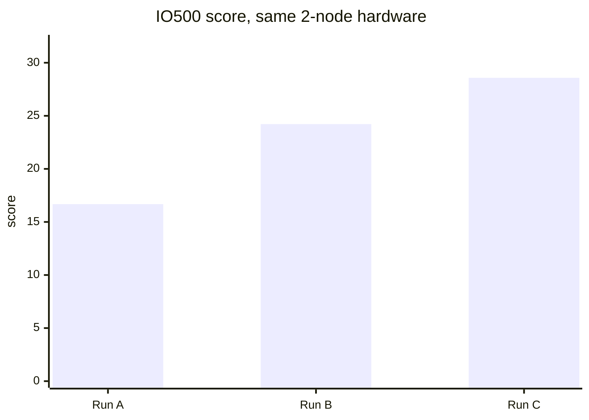

# IO500 Progress Report: Three Valid Runs on AWS (2 × i3en.12xlarge, EFA)

| | |
|---|---|
| Report date | 2026-10-26 |
| System under test | rocepool (RDMA memory-pool distributed file system) |
| Platform | Amazon EC2 us-east-2, 2 × i3en.12xlarge (48 vCPU, 384 GiB RAM, 4 × 7.5 TB NVMe, 50 Gb/s EFA per node) |
| Benchmark | IO500 official application, standard mode, 300 s stonewall, 64 ranks (32 per node) |
| Reference | Vendor W, a commercial parallel file system: 10-node entry on the ISC25 IO500 10-node production list (10 client nodes + 18 data servers) |
| Earlier report | [IO500_AWS_2NODE_REPORT.md](IO500_AWS_2NODE_REPORT.md) (run A only) |

## 1. Summary

The hardware was the same in all three runs: two nodes of the same instance type. Only the software changed.

| | Run A | Run B | Run C | C vs A |
|---|---|---|---|---|
| GitHub Actions run | 40153359125 | 40184980653 | 40195061844 | |
| Date (UTC) | 2026-10-25 02:09 | 2026-10-25 10:29 | 2026-10-25 12:52 | |
| Result | valid | valid | valid | |
| **IO500 score** | **16.68** | **24.22** | **28.58** | **+71%** |
| Bandwidth (GiB/s) | 3.38 | 3.56 | 4.06 | +20% |
| Metadata (kIOPS) | 82.30 | 164.72 | 201.01 | +144% |
| IO500 wall time (s) | 5406 | 3181 | 2991 | −45% |

Against Vendor W, compared per client node:
- **Metadata:** rocepool now delivers **100.5 kIOPS per node against 33.7, which is 3.0× higher.** At run A the lead was 1.2×.
- **Bandwidth:** Vendor W is ahead at 3.33 GiB/s per node against 2.03 (1.6×). The gap was 2.0× at run A.
- **Counting every machine:** Vendor W's entry uses 28 machines (10 clients + 18 data servers). Divided over all of them it delivers 1.19 GiB/s and 12.0 kIOPS per machine. rocepool's 2.03 GiB/s and 100.5 kIOPS per machine are higher on both.

## 2. Changes between the runs

The changes are software only, and each was verified by tests that cover its own code before the run.

**A → B**
- **find:** each page of a directory listing used to re-sort the whole directory. The metadata server now builds one sorted snapshot per listing (PR #16).
- **ior-hard-write: storage writes.** Each out-of-order 47 KB piece rewrote its stripe object from its offset to the end, about 10× the useful bytes. Now only the touched range is written, the slot is reserved at once, and dirty data is written back once (PR #18).
- **ior-hard-write: client flush.** A flush now sends all of its pieces in parallel, with one size update to the metadata server (PR #18).
- **Fewer metadata requests:** a delete no longer looks the file up first. A read-only open of a small file fetches its content in the same request (PR #19).
- **Async small replies:** the server no longer waits for each small reply to complete before taking the next request (PR #19).
- **Idle waits on EFA:** EFA has no CQ wait objects, so an idle thread used to sleep in steps of about 100 µs. It now yields the CPU instead (PR #20).

**B → C**
- **Idle waits, refined:** in run B, every waiting thread used the yield loop. Only server threads whose waits are short now use it (PR #21).
- **Eviction off the request path:** eviction and write-back of the OST RAM cache now run in a background thread, not in the request handlers (PR #21).

## 3. Phase-by-phase results

| Phase | Run A | Run B | Run C | B vs A | C vs B | C vs A |
|---|---|---|---|---|---|---|
| ior-easy-write (GiB/s) | 5.63 | 4.94 | 4.86 | −12% | −1% | **−14%** |
| ior-hard-write (GiB/s) | 0.68 | 1.43 | 2.02 | +109% | +42% | **+195%** |
| ior-easy-read (GiB/s) | 7.71 | 6.73 | 7.04 | −13% | +5% | **−9%** |
| ior-hard-read (GiB/s) | 4.40 | 3.39 | 3.95 | −23% | +16% | **−10%** |
| mdtest-easy-write (kIOPS) | 100.30 | 98.49 | 123.23 | −2% | +25% | **+23%** |
| mdtest-hard-write (kIOPS) | 59.74 | 60.73 | 77.15 | +2% | +27% | **+29%** |
| find (kIOPS) | 56.96 | 609.28 | 637.12 | +970% | +5% | **+1019%** |
| mdtest-easy-stat (kIOPS) | 174.08 | 196.25 | 247.63 | +13% | +26% | **+42%** |
| mdtest-hard-stat (kIOPS) | 180.26 | 196.38 | 244.75 | +9% | +25% | **+36%** |
| mdtest-easy-delete (kIOPS) | 69.68 | 200.78 | 245.78 | +188% | +22% | **+253%** |
| mdtest-hard-read (kIOPS) | 64.55 | 97.05 | 120.68 | +50% | +24% | **+87%** |
| mdtest-hard-delete (kIOPS) | 43.67 | 198.06 | 244.74 | +353% | +24% | **+460%** |

### 3.1 Host CPU (node 0, busy share of all 48 vCPUs)

| Phase | Run A | Run B | Run C |
|---|---|---|---|
| ior-easy-write | 12% | 32% | 19% |
| ior-hard-write | 16% | **83%** | 31% |
| ior-easy-read | 36% | 60% | 47% |
| mdtest-easy-stat | 38% | 76% | 39% |
| ior-hard-read | 34% | **82%** | 33% |

Run B's IOR losses came from its waiting threads, mostly system time spent in `sched_yield`. Run C limits yielding to server threads with short waits, which brought CPU back near run A's levels. The metadata phases also gained 20–27% from B to C.

### 3.2 Data volume

IO500 sizes each write phase from the speed it measures, so a faster ior-hard-write writes more data.

| | Run A | Run B | Run C |
|---|---|---|---|
| ior-hard data written | 236 GiB | 511 GiB | 752 GiB |
| ior-hard data read back from NVMe, per OST | ~108 GB | ~217 GB | ~310 GB |
| Write-backs per OST in ior-hard-write | none counted | 145 k (in request handlers) | 245 k (background) |

## 4. Gap to Vendor W, per client node (run C)

Vendor W: 10 client nodes. rocepool: 2 nodes, each both client and server. "Gap" is Vendor W ÷ rocepool; below 1.0 means rocepool is ahead.

| Phase | rocepool / node | Vendor W / client node | Gap at run A | **Gap at run C** |
|---|---|---|---|---|
| ior-easy-write (GiB/s) | 2.43 | 7.58 | 2.69 | **3.12** |
| ior-hard-write (GiB/s) | 1.01 | 1.51 | 4.43 | **1.49** |
| ior-easy-read (GiB/s) | 3.52 | 13.40 | 3.48 | **3.81** |
| ior-hard-read (GiB/s) | 1.97 | 0.80 | 0.36 | **0.41** |
| mdtest-easy-write (kIOPS) | 61.61 | 42.48 | 0.85 | **0.69** |
| mdtest-hard-write (kIOPS) | 38.57 | 1.69 | 0.06 | **0.04** |
| find (kIOPS) | 318.56 | 113.25 | 3.98 | **0.36** |
| mdtest-easy-stat (kIOPS) | 123.81 | 191.11 | 2.20 | **1.54** |
| mdtest-hard-stat (kIOPS) | 122.37 | 146.58 | 1.63 | **1.20** |
| mdtest-easy-delete (kIOPS) | 122.89 | 48.01 | 1.38 | **0.39** |
| mdtest-hard-read (kIOPS) | 60.34 | 82.32 | 2.55 | **1.36** |
| mdtest-hard-delete (kIOPS) | 122.37 | 1.86 | 0.09 | **0.02** |
| **Bandwidth score (GiB/s)** | 2.03 | 3.33 | 1.97 | **1.64** |
| **Metadata score (kIOPS)** | 100.5 | 33.7 | 0.82 | **0.34** |

Gaps that closed from run A to run C:
- find went from 4.0× behind to 2.8× ahead.
- mdtest-easy-delete went from 1.4× behind to 2.6× ahead.
- ior-hard-write went from 4.4× to 1.5× behind.
- mdtest-hard-read went from 2.6× to 1.4× behind.
- mdtest-easy-stat went from 2.2× to 1.5× behind.

## 5. Remaining gaps

| Gap | Size (run C) | Likely cause | Next step |
|---|---|---|---|
| ior-easy-read | 3.8× | Each node reads 3.5 GiB/s from NVMe tier over a 50 Gb/s (≈5.8 GiB/s) link. Vendor W uses InfiniBand and 18 dedicated data servers. | Mostly hardware. On these instances: more tier-read concurrency (the OST runs one request at a time per endpoint, 12 endpoints). |
| ior-easy-write | 3.1× | i3en's NVMe write rate, about 2.5 GB/s per node at preflight. | Larger NVMe/network instances (e.g. i4i.32xlarge: 8 drives, 75 Gb/s). |
| mdtest-easy-stat / hard-stat | 1.54× / 1.20× | Each stat is one request. The metadata server handles one request at a time per endpoint, and most of each request's time is the EFA send/receive path, not metadata work (3–4 µs). | Spread load evenly over endpoints; batch several metadata operations in one request. |
| ior-hard-write | 1.49× | 47 KB unaligned pieces of a shared file. | Fewer, larger tier writes; deeper pipelining per client. |
| mdtest-hard-read | 1.36× | One request per open+read; same per-request path as stat. | Same as stat. |

### Not yet explained

ior-easy-write (−14%), ior-easy-read (−9%) and ior-hard-read (−10%) are still below run A.
- **ior-hard-read:** most of the drop is data volume. Run C read back about three times as much ior-hard data from NVMe as run A (section 3.2).
- **ior-easy write and read:** the per-OST data volumes match run A, and host CPU is no longer high. Run C's NVMe preflight write was 2652 / 2544 MiB/s, at or above run A's 2264 / 2509 MiB/s. That 0.4 s preflight does not support a slower-disk explanation, so the cause is still open. The next step is a sustained (30 s) NVMe read/write measurement before the run, and a comparison of the OST request path between runs A and C.

## 6. Comparability and limitations

- **Not a list submission:** these runs used the official IO500 application and passed its validity checks, but they have not been submitted to or reviewed by the IO500 committee.
- **Scale:** two nodes against ten client nodes. The per-node figures assume roughly linear scaling, which has not yet been measured on more AWS nodes.
- **Hardware:** on each rocepool node, clients and servers share the same host. Vendor W's figures are as published for its list entry (submission 704), and its per-phase numbers are taken from that page.
- **Cost:** each valid run cost about $20–28 in AWS on-demand time for both nodes ($10.85/hour). Vendor W's system cost is not public, so price is not compared.
- **Raw data:** the reports for each run are on branches `aws-results/gh-<run id>`.
