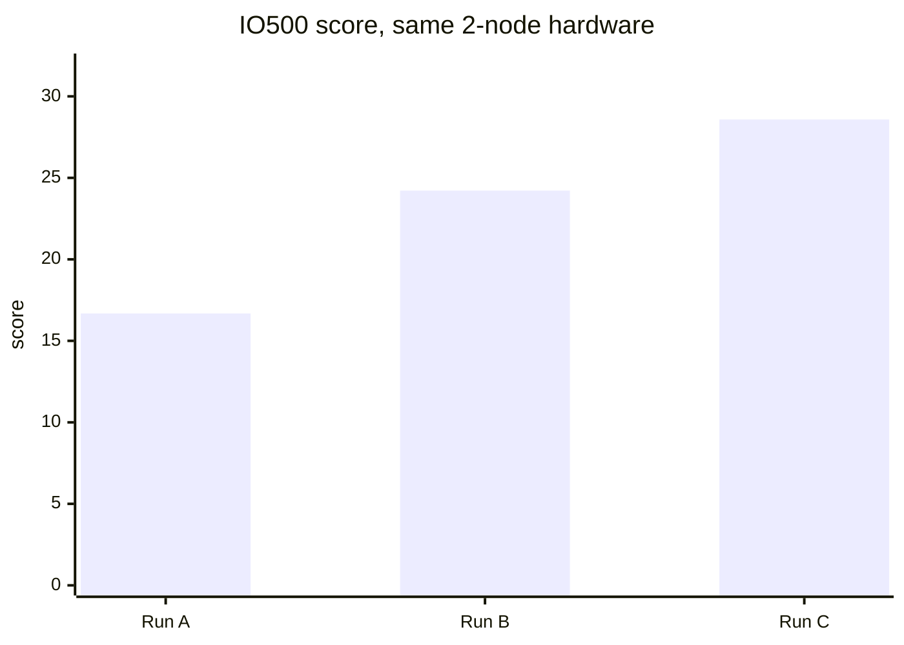

# IO500 進捗レポート：AWS 上の有効な 3 回の実行（2 × i3en.12xlarge、EFA）

| | |
|---|---|
| 作成日 | 2026-10-26 |
| 評価対象 | rocepool（RDMA メモリプール型分散ファイルシステム） |
| 環境 | Amazon EC2 us-east-2、i3en.12xlarge × 2 台（各ノード 48 vCPU、RAM 384 GiB、NVMe 7.5 TB × 4、EFA 50 Gb/s） |
| ベンチマーク | IO500 公式アプリケーション、標準モード、stonewall 300 秒、64 ランク（1 ノードあたり 32） |
| 比較対象 | Vendor W（商用並列ファイルシステム）。ISC25 IO500 10 ノード・プロダクションリストの 10 ノード構成（クライアント 10 台 + データサーバー 18 台） |
| 前回レポート | [IO500_AWS_2NODE_REPORT.md](IO500_AWS_2NODE_REPORT.md)（実行 A のみ） |
| 原文 | [IO500_AWS_PROGRESS_REPORT.md](IO500_AWS_PROGRESS_REPORT.md)（英語版。本書はその日本語訳） |

## 1. 概要

3 回ともハードウェアは同じで、同じインスタンスタイプのノード 2 台を使用した。変更したのはソフトウェアのみである。

| | 実行 A | 実行 B | 実行 C | C と A の比較 |
|---|---|---|---|---|
| GitHub Actions の実行番号 | 40153359125 | 40184980653 | 40195061844 | |
| 日時（UTC） | 2026-10-25 02:09 | 2026-10-25 10:29 | 2026-10-25 12:52 | |
| 結果 | 有効 | 有効 | 有効 | |
| **IO500 スコア** | **16.68** | **24.22** | **28.58** | **+71%** |
| 帯域（GiB/s） | 3.38 | 3.56 | 4.06 | +20% |
| メタデータ（kIOPS） | 82.30 | 164.72 | 201.01 | +144% |
| IO500 の所要時間（秒） | 5406 | 3181 | 2991 | −45% |

Vendor W との比較（クライアントノード 1 台あたり）：
- **メタデータ：** rocepool は **1 ノードあたり 100.5 kIOPS、Vendor W は 33.7 で、約 3.0 倍高い。** 実行 A の時点では 1.2 倍だった。
- **帯域：** Vendor W が 1 ノードあたり 3.33 GiB/s、rocepool は 2.03 で、Vendor W が 1.6 倍上回る。実行 A の時点では差は 2.0 倍だった。
- **全マシン数で割った場合：** Vendor W の構成は 28 台（クライアント 10 台 + データサーバー 18 台）である。全台で割ると 1 台あたり 1.19 GiB/s・12.0 kIOPS となり、rocepool の 1 台あたり 2.03 GiB/s・100.5 kIOPS は両方とも上回る。

## 2. 各実行の間の変更点

変更はすべてソフトウェアのみ。各変更は実行前に、その変更範囲を対象とするテストで検証した。

**A → B**
- **find：** ディレクトリ一覧の各ページで、ディレクトリ全体を毎回ソートし直していた。メタデータサーバーが一覧ごとにソート済みのスナップショットを 1 つだけ作るように変更した（PR #16）。
- **ior-hard-write（ストレージへの書き込み）：** 順不同に届く 47 KB の断片ごとに、ストライプオブジェクトをそのオフセットから末尾まで書き直しており、有効なデータ量の約 10 倍を書いていた。現在は変更した範囲だけを書き、格納領域は最初にまとめて確保し、ダーティなデータは 1 回だけ書き戻す（PR #18）。
- **ior-hard-write（クライアントのフラッシュ）：** 1 回のフラッシュに含まれる断片をすべて並列に送り、メタデータサーバーへのサイズ更新は 1 回にまとめた（PR #18）。
- **メタデータ要求の削減：** 削除の前にファイルを検索しないようにした。小さいファイルを読み取り専用で開くときは、同じ要求で内容も取得する（PR #19）。
- **小さな応答の非同期化：** サーバーは小さな応答の送信完了を待たずに次の要求を処理する（PR #19）。
- **EFA でのアイドル待機：** EFA には CQ の待機オブジェクトがないため、アイドル状態のスレッドは約 100 µs 単位でスリープしていた。現在はスリープせずに CPU を譲る（PR #20）。

**B → C**
- **アイドル待機の見直し：** 実行 B では待機中の全スレッドが yield ループに入っていた。現在は、待機時間が短いサーバースレッドだけが yield する（PR #21）。
- **追い出しを要求処理の外へ：** OST の RAM キャッシュの追い出しと書き戻しを、要求ハンドラー内ではなくバックグラウンドスレッドで行う（PR #21）。

## 3. フェーズ別の結果

| フェーズ | 実行 A | 実行 B | 実行 C | B と A | C と B | C と A |
|---|---|---|---|---|---|---|
| ior-easy-write（GiB/s） | 5.63 | 4.94 | 4.86 | −12% | −1% | **−14%** |
| ior-hard-write（GiB/s） | 0.68 | 1.43 | 2.02 | +109% | +42% | **+195%** |
| ior-easy-read（GiB/s） | 7.71 | 6.73 | 7.04 | −13% | +5% | **−9%** |
| ior-hard-read（GiB/s） | 4.40 | 3.39 | 3.95 | −23% | +16% | **−10%** |
| mdtest-easy-write（kIOPS） | 100.30 | 98.49 | 123.23 | −2% | +25% | **+23%** |
| mdtest-hard-write（kIOPS） | 59.74 | 60.73 | 77.15 | +2% | +27% | **+29%** |
| find（kIOPS） | 56.96 | 609.28 | 637.12 | +970% | +5% | **+1019%** |
| mdtest-easy-stat（kIOPS） | 174.08 | 196.25 | 247.63 | +13% | +26% | **+42%** |
| mdtest-hard-stat（kIOPS） | 180.26 | 196.38 | 244.75 | +9% | +25% | **+36%** |
| mdtest-easy-delete（kIOPS） | 69.68 | 200.78 | 245.78 | +188% | +22% | **+253%** |
| mdtest-hard-read（kIOPS） | 64.55 | 97.05 | 120.68 | +50% | +24% | **+87%** |
| mdtest-hard-delete（kIOPS） | 43.67 | 198.06 | 244.74 | +353% | +24% | **+460%** |

### 3.1 ホストの CPU 使用率（ノード 0、48 vCPU 全体に占めるビジーの割合）

| フェーズ | 実行 A | 実行 B | 実行 C |
|---|---|---|---|
| ior-easy-write | 12% | 32% | 19% |
| ior-hard-write | 16% | **83%** | 31% |
| ior-easy-read | 36% | 60% | 47% |
| mdtest-easy-stat | 38% | 76% | 39% |
| ior-hard-read | 34% | **82%** | 33% |

実行 B の IOR フェーズの低下は、待機中のスレッドが原因で、その大半は `sched_yield` に費やされたシステム時間だった。実行 C では yield を待機の短いサーバースレッドに限定し、CPU 使用率を実行 A に近い水準まで戻した。メタデータの各フェーズも B から C で 20〜27% 向上した。

### 3.2 データ量

IO500 は、測定した速度に応じて各書き込みフェーズのデータ量を決める。そのため ior-hard-write が速くなるほど、書き込むデータ量も増える。

| | 実行 A | 実行 B | 実行 C |
|---|---|---|---|
| ior-hard の書き込みデータ量 | 236 GiB | 511 GiB | 752 GiB |
| NVMe から読み戻した ior-hard のデータ（OST あたり） | 約 108 GB | 約 217 GB | 約 310 GB |
| ior-hard-write 中の書き戻し回数（OST あたり） | 計測なし | 14.5 万回（要求ハンドラー内） | 24.5 万回（バックグラウンド） |

## 4. Vendor W との差（クライアントノード 1 台あたり、実行 C 時点）

Vendor W はクライアントノード 10 台。rocepool は 2 台で、各ノードがクライアントとサーバーを兼ねる。「差」は Vendor W ÷ rocepool で、1.0 未満は rocepool が上回ることを示す。

| フェーズ | rocepool（1 ノードあたり） | Vendor W（クライアント 1 台あたり） | 実行 A 時点の差 | **実行 C 時点の差** |
|---|---|---|---|---|
| ior-easy-write（GiB/s） | 2.43 | 7.58 | 2.69 | **3.12** |
| ior-hard-write（GiB/s） | 1.01 | 1.51 | 4.43 | **1.49** |
| ior-easy-read（GiB/s） | 3.52 | 13.40 | 3.48 | **3.81** |
| ior-hard-read（GiB/s） | 1.97 | 0.80 | 0.36 | **0.41** |
| mdtest-easy-write（kIOPS） | 61.61 | 42.48 | 0.85 | **0.69** |
| mdtest-hard-write（kIOPS） | 38.57 | 1.69 | 0.06 | **0.04** |
| find（kIOPS） | 318.56 | 113.25 | 3.98 | **0.36** |
| mdtest-easy-stat（kIOPS） | 123.81 | 191.11 | 2.20 | **1.54** |
| mdtest-hard-stat（kIOPS） | 122.37 | 146.58 | 1.63 | **1.20** |
| mdtest-easy-delete（kIOPS） | 122.89 | 48.01 | 1.38 | **0.39** |
| mdtest-hard-read（kIOPS） | 60.34 | 82.32 | 2.55 | **1.36** |
| mdtest-hard-delete（kIOPS） | 122.37 | 1.86 | 0.09 | **0.02** |
| **帯域スコア（GiB/s）** | 2.03 | 3.33 | 1.97 | **1.64** |
| **メタデータスコア（kIOPS）** | 100.5 | 33.7 | 0.82 | **0.34** |

実行 A から実行 C までに縮まった差：
- find は 4.0 倍の遅れから、2.8 倍上回るまでになった。
- mdtest-easy-delete は 1.4 倍の遅れから、2.6 倍上回るまでになった。
- ior-hard-write は 4.4 倍から 1.5 倍の遅れに縮まった。
- mdtest-hard-read は 2.6 倍から 1.4 倍の遅れに縮まった。
- mdtest-easy-stat は 2.2 倍から 1.5 倍の遅れに縮まった。

## 5. 残っている差

| 差 | 大きさ（実行 C） | 考えられる原因 | 次の対応 |
|---|---|---|---|
| ior-easy-read | 3.8 倍 | 各ノードは 50 Gb/s（約 5.8 GiB/s）のリンク越しに、NVMe 層から 3.5 GiB/s で読んでいる。Vendor W は InfiniBand と専用データサーバー 18 台を使っている。 | 主にハードウェアによる差。このインスタンスでできるのは、ストレージ層の読み取り並列度を上げること（OST はエンドポイントごとに 1 要求ずつ処理し、エンドポイントは 12 個）。 |
| ior-easy-write | 3.1 倍 | i3en の NVMe 書き込み速度（事前測定で 1 ノードあたり約 2.5 GB/s）。 | NVMe とネットワークがより大きいインスタンス（例：i4i.32xlarge、ドライブ 8 台・75 Gb/s）。 |
| mdtest-easy-stat / hard-stat | 1.54 倍 / 1.20 倍 | stat は 1 回あたり 1 要求。メタデータサーバーはエンドポイントごとに 1 要求ずつ処理し、各要求の時間の大半は EFA の送受信処理で、メタデータ処理そのもの（3〜4 µs）ではない。 | エンドポイント間で負荷を均等に分散し、複数のメタデータ操作を 1 要求にまとめる。 |
| ior-hard-write | 1.49 倍 | 共有ファイルへの、アライメントされていない 47 KB 単位の書き込み。 | ストレージ層への書き込みを少なく大きくし、クライアントごとのパイプラインを深くする。 |
| mdtest-hard-read | 1.36 倍 | open と read を合わせて 1 要求。要求の処理経路は stat と同じ。 | stat と同じ。 |

### 原因がまだ特定できていない点

ior-easy-write（−14%）、ior-easy-read（−9%）、ior-hard-read（−10%）は、まだ実行 A を下回っている。
- **ior-hard-read：** 低下の大部分はデータ量によるもの。実行 C では、NVMe から読み戻した ior-hard のデータが実行 A の約 3 倍だった（3.2 節）。
- **ior-easy-write と ior-easy-read：** OST あたりのデータ量は実行 A と同じで、ホストの CPU 使用率ももう高くない。実行 C の事前測定での NVMe 書き込みは 2652 / 2544 MiB/s で、実行 A の 2264 / 2509 MiB/s と同等以上だった。この 0.4 秒の事前測定からは「ディスクが遅かった」という説明は支持されないため、原因は未解明である。次は、実行前に 30 秒間の持続的な NVMe 読み書きを測定し、実行 A と C の OST の要求処理経路を比較する。

## 6. 比較の前提と制約

- **リスト登録ではない：** 3 回とも IO500 公式アプリケーションを使い、その有効性チェックに合格しているが、IO500 委員会への提出や審査は受けていない。
- **規模：** 2 ノードとクライアント 10 ノードの比較である。1 ノードあたりの数値はおおむね線形にスケールすると仮定しているが、より多くの AWS ノードではまだ測定していない。
- **ハードウェア：** rocepool の各ノードでは、クライアントとサーバーが同じホストで動いている。Vendor W の数値はリスト登録（提出番号 704）の公表値で、フェーズ別の数値もそのページから取っている。
- **費用：** 有効な実行 1 回あたり、2 ノード合計で AWS オンデマンド料金約 20〜28 ドル（1 時間あたり 10.85 ドル）。Vendor W のシステム費用は公開されていないため、価格は比較していない。
- **生データ：** 各実行のレポートはブランチ `aws-results/gh-<実行番号>` にある。
