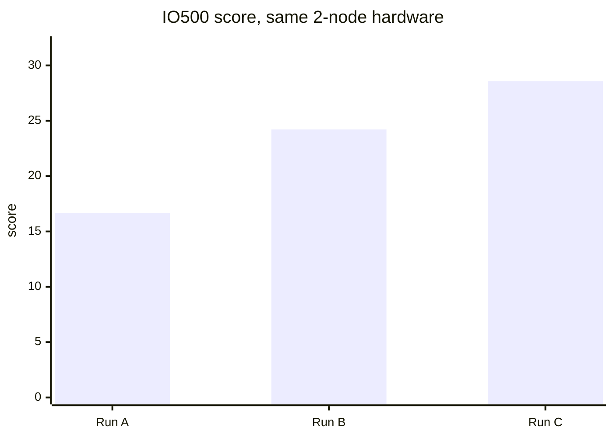

# IO500 進度報告：在 AWS 上的 3 次有效執行（2 × i3en.12xlarge、EFA）

| | |
|---|---|
| 報告日期 | 2026-10-26 |
| 評估對象 | rocepool（以 RDMA 記憶體池為基礎的分散式檔案系統） |
| 平台 | Amazon EC2 us-east-2、i3en.12xlarge × 2 台（每節點 48 vCPU、384 GiB RAM、4 × 7.5 TB NVMe、50 Gb/s EFA） |
| 效能測試 | IO500 官方應用程式，標準模式，stonewall 300 秒，64 個 rank（每節點 32 個） |
| 比較對象 | Vendor W（商用平行檔案系統）：ISC25 IO500 10 節點正式榜單的 10 節點配置（10 台用戶端＋18 台資料伺服器） |
| 前一份報告 | [IO500_AWS_2NODE_REPORT.md](IO500_AWS_2NODE_REPORT.md)（僅執行 A） |
| 原文 | [IO500_AWS_PROGRESS_REPORT.md](IO500_AWS_PROGRESS_REPORT.md)（英文版，本文件為其翻譯）・其他語言：[日本語](IO500_AWS_進捗レポート.md) · [Deutsch](IO500_AWS_Fortschrittsbericht.md) · [Español](IO500_AWS_Informe_de_progreso.md) |

## 1. 摘要

3 次執行的硬體相同，都使用 2 台相同執行個體類型的節點，只改了軟體。

| | 執行 A | 執行 B | 執行 C | C 與 A 相比 |
|---|---|---|---|---|
| GitHub Actions 的執行 | 40153359125 | 40184980653 | 40195061844 | |
| 時間（UTC） | 2026-10-25 02:09 | 2026-10-25 10:29 | 2026-10-25 12:52 | |
| 結果 | 有效 | 有效 | 有效 | |
| **IO500 分數** | **16.68** | **24.22** | **28.58** | **+71%** |
| 頻寬（GiB/s） | 3.38 | 3.56 | 4.06 | +20% |
| 中繼資料（kIOPS） | 82.30 | 164.72 | 201.01 | +144% |
| IO500 所需時間（秒） | 5406 | 3181 | 2991 | −45% |

與 Vendor W 的比較（每個用戶端節點）：
- **中繼資料：** rocepool **每節點 100.5 kIOPS，Vendor W 為 33.7，約高 3.0 倍。** 執行 A 時為 1.2 倍。
- **頻寬：** Vendor W 每節點 3.33 GiB/s，rocepool 為 2.03，Vendor W 領先 1.6 倍。執行 A 時差距為 2.0 倍。
- **除以全部機器數：** Vendor W 的配置共 28 台（10 台用戶端＋18 台資料伺服器）。除以全部台數後每台為 1.19 GiB/s、12.0 kIOPS；rocepool 每台 2.03 GiB/s、100.5 kIOPS，兩者都超過。

## 2. 各次執行之間的變更

所有變更都只限軟體。每項變更在執行前都以針對其變更範圍的測試驗證過。

**A → B**
- **find：** 目錄列出的每一頁都重新排序整個目錄。改為中繼資料伺服器每次列出只建立一份已排序的快照（PR #16）。
- **ior-hard-write（寫入儲存）：** 每個亂序到達的 47 KB 片段，都會把條帶物件從該位移重寫到結尾，寫入量約為有效資料的 10 倍。現在只寫入變更的範圍，儲存空間在一開始一次配置，髒資料只寫回一次（PR #18）。
- **ior-hard-write（用戶端 flush）：** 一次 flush 中的所有片段平行送出，對中繼資料伺服器的大小更新合併為一次（PR #18）。
- **減少中繼資料請求：** 刪除前不再先查詢檔案。以唯讀方式開啟小檔案時，在同一個請求中一併取得內容（PR #19）。
- **小型回應非同步化：** 伺服器不再等小型回應送完才處理下一個請求（PR #19）。
- **EFA 上的閒置等待：** EFA 沒有 CQ 的等待物件，閒置執行緒以約 100 µs 為單位休眠。現在不休眠而是讓出 CPU（PR #20）。

**B → C**
- **重新檢討閒置等待：** 執行 B 中所有等待中的執行緒都進入 yield 迴圈。現在只有等待時間短的伺服器執行緒才會 yield（PR #21）。
- **把逐出移出請求處理：** OST 的 RAM 快取逐出與寫回改由背景執行緒處理，而不是在請求處理常式內（PR #21）。

## 3. 各階段結果

| 階段 | 執行 A | 執行 B | 執行 C | B 對 A | C 對 B | C 對 A |
|---|---|---|---|---|---|---|
| ior-easy-write（GiB/s） | 5.63 | 4.94 | 4.86 | −12% | −1% | **−14%** |
| ior-hard-write（GiB/s） | 0.68 | 1.43 | 2.02 | +109% | +42% | **+195%** |
| ior-easy-read（GiB/s） | 7.71 | 6.73 | 7.04 | −13% | +5% | **−9%** |
| ior-hard-read（GiB/s） | 4.40 | 3.39 | 3.95 | −23% | +16% | **−10%** |
| mdtest-easy-write（kIOPS） | 100.30 | 98.49 | 123.23 | −2% | +25% | **+23%** |
| mdtest-hard-write（kIOPS） | 59.74 | 60.73 | 77.15 | +2% | +27% | **+29%** |
| find（kIOPS） | 56.96 | 609.28 | 637.12 | +970% | +5% | **+1019%** |
| mdtest-easy-stat（kIOPS） | 174.08 | 196.25 | 247.63 | +13% | +26% | **+42%** |
| mdtest-hard-stat（kIOPS） | 180.26 | 196.38 | 244.75 | +9% | +25% | **+36%** |
| mdtest-easy-delete（kIOPS） | 69.68 | 200.78 | 245.78 | +188% | +22% | **+253%** |
| mdtest-hard-read（kIOPS） | 64.55 | 97.05 | 120.68 | +50% | +24% | **+87%** |
| mdtest-hard-delete（kIOPS） | 43.67 | 198.06 | 244.74 | +353% | +24% | **+460%** |

### 3.1 主機 CPU 使用率（節點 0，占全部 48 vCPU 的忙碌比例）

| 階段 | 執行 A | 執行 B | 執行 C |
|---|---|---|---|
| ior-easy-write | 12% | 32% | 19% |
| ior-hard-write | 16% | **83%** | 31% |
| ior-easy-read | 36% | 60% | 47% |
| mdtest-easy-stat | 38% | 76% | 39% |
| ior-hard-read | 34% | **82%** | 33% |

執行 B 的 IOR 階段下降，是等待中的執行緒造成的，大部分是花在 `sched_yield` 的系統時間。執行 C 把 yield 限定在等待時間短的伺服器執行緒，CPU 使用率回到接近執行 A 的水準。中繼資料各階段從 B 到 C 也提升了 20～27%。

### 3.2 資料量

IO500 會依量測到的速度決定各寫入階段的資料量。因此 ior-hard-write 越快，寫入的資料也越多。

| | 執行 A | 執行 B | 執行 C |
|---|---|---|---|
| ior-hard 寫入資料量 | 236 GiB | 511 GiB | 752 GiB |
| 從 NVMe 讀回的 ior-hard 資料（每個 OST） | 約 108 GB | 約 217 GB | 約 310 GB |
| ior-hard-write 期間的寫回次數（每個 OST） | 未量測 | 14.5 萬次（請求處理常式內） | 24.5 萬次（背景） |

## 4. 與 Vendor W 的差距（每個用戶端節點，以執行 C 為準）

Vendor W 有 10 個用戶端節點。rocepool 有 2 個節點，每個節點同時是用戶端與伺服器。「差距」為 Vendor W ÷ rocepool，小於 1.0 表示 rocepool 領先。

| 階段 | rocepool（每節點） | Vendor W（每台用戶端） | 執行 A 時的差距 | **執行 C 時的差距** |
|---|---|---|---|---|
| ior-easy-write（GiB/s） | 2.43 | 7.58 | 2.69 | **3.12** |
| ior-hard-write（GiB/s） | 1.01 | 1.51 | 4.43 | **1.49** |
| ior-easy-read（GiB/s） | 3.52 | 13.40 | 3.48 | **3.81** |
| ior-hard-read（GiB/s） | 1.97 | 0.80 | 0.36 | **0.41** |
| mdtest-easy-write（kIOPS） | 61.61 | 42.48 | 0.85 | **0.69** |
| mdtest-hard-write（kIOPS） | 38.57 | 1.69 | 0.06 | **0.04** |
| find（kIOPS） | 318.56 | 113.25 | 3.98 | **0.36** |
| mdtest-easy-stat（kIOPS） | 123.81 | 191.11 | 2.20 | **1.54** |
| mdtest-hard-stat（kIOPS） | 122.37 | 146.58 | 1.63 | **1.20** |
| mdtest-easy-delete（kIOPS） | 122.89 | 48.01 | 1.38 | **0.39** |
| mdtest-hard-read（kIOPS） | 60.34 | 82.32 | 2.55 | **1.36** |
| mdtest-hard-delete（kIOPS） | 122.37 | 1.86 | 0.09 | **0.02** |
| **頻寬分數（GiB/s）** | 2.03 | 3.33 | 1.97 | **1.64** |
| **中繼資料分數（kIOPS）** | 100.5 | 33.7 | 0.82 | **0.34** |

從執行 A 到執行 C 縮小的差距：
- find 從落後 4.0 倍變成領先 2.8 倍。
- mdtest-easy-delete 從落後 1.4 倍變成領先 2.6 倍。
- ior-hard-write 的落後從 4.4 倍縮小到 1.5 倍。
- mdtest-hard-read 的落後從 2.6 倍縮小到 1.4 倍。
- mdtest-easy-stat 的落後從 2.2 倍縮小到 1.5 倍。

## 5. 尚存的差距

| 差距 | 大小（執行 C） | 可能原因 | 下一步 |
|---|---|---|---|
| ior-easy-read | 3.8 倍 | 每個節點透過 50 Gb/s（約 5.8 GiB/s）連線，以 3.5 GiB/s 從 NVMe 層讀取。Vendor W 使用 InfiniBand 與 18 台專用資料伺服器。 | 主要是硬體差異。在這種執行個體上能做的，是提高儲存層的讀取平行度（OST 每個端點一次處理 1 個請求，共 12 個端點）。 |
| ior-easy-write | 3.1 倍 | i3en 的 NVMe 寫入速度（事前量測約每節點 2.5 GB/s）。 | NVMe 與網路更大的執行個體（例如 i4i.32xlarge，8 顆磁碟、75 Gb/s）。 |
| mdtest-easy-stat / hard-stat | 1.54 倍／1.20 倍 | 每次 stat 是 1 個請求。中繼資料伺服器每個端點一次處理 1 個請求，每個請求的大部分時間花在 EFA 收送，而不是中繼資料處理本身（3～4 µs）。 | 在端點之間平均分散負載，並把多個中繼資料操作合併成 1 個請求。 |
| ior-hard-write | 1.49 倍 | 對共用檔案、未對齊的 47 KB 寫入。 | 對儲存層的寫入次數更少、單次更大，並加深每個用戶端的管線。 |
| mdtest-hard-read | 1.36 倍 | open 與 read 合併為 1 個請求，請求處理路徑與 stat 相同。 | 與 stat 相同。 |

### 原因尚未查明的部分

ior-easy-write（−14%）、ior-easy-read（−9%）、ior-hard-read（−10%）仍低於執行 A。
- **ior-hard-read：** 下降大多來自資料量。執行 C 從 NVMe 讀回的 ior-hard 資料約為執行 A 的 3 倍（3.2 節）。
- **ior-easy-write 與 ior-easy-read：** 每個 OST 的資料量與執行 A 相同，主機 CPU 使用率也已不高。執行 C 事前量測的 NVMe 寫入為 2652 / 2544 MiB/s，等於或高於執行 A 的 2264 / 2509 MiB/s。這個 0.4 秒的事前量測並不支持「磁碟比較慢」的解釋，原因仍未查明。下一步會在執行前量測 30 秒的持續 NVMe 讀寫，並比較執行 A 與 C 的 OST 請求處理路徑。

## 6. 比較的前提與限制

- **不是榜單登錄：** 3 次都使用 IO500 官方應用程式並通過其有效性檢查，但沒有提交給 IO500 委員會，也沒有經過審查。
- **規模：** 這是 2 個節點與 10 個用戶端節點的比較。假設每節點數值大致線性擴展，但尚未在更多 AWS 節點上量測。
- **硬體：** rocepool 的每個節點上，用戶端與伺服器在同一台主機執行。Vendor W 的數值是其榜單項目（submission 704）的公開值，各階段數值也取自該頁面。
- **費用：** 每次有效執行，2 個節點合計以 AWS 隨需價格約 $20～28（每小時 $10.85）。Vendor W 的系統費用沒有公開，因此不比較價格。
- **原始資料：** 各次執行的報告位於分支 `aws-results/gh-<run id>`。
